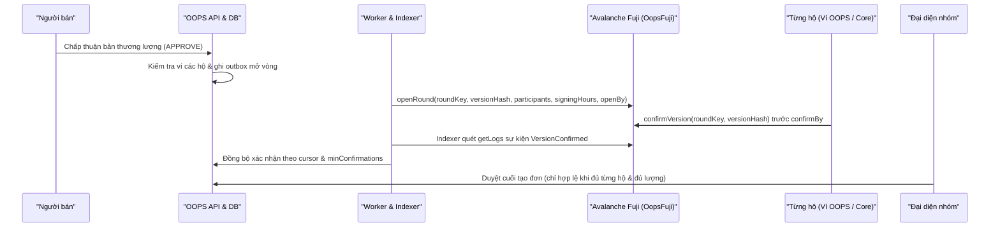

# OOPS — Gom nhu yếu phẩm cộng đồng, xác nhận minh bạch trên Avalanche

OOPS giúp các hộ trong cùng khu vực rà lại đồ đang có, gom phần nhu yếu phẩm còn thiếu và nhận đề nghị từ người bán (giá thường, giá hỗ trợ hoặc 0đ) để chuẩn bị trước thiên tai. Nhóm chốt từng món, người bán đặt cọc cam kết và hai bên xác nhận bàn giao trước khi quyết toán.

> Mỗi hộ xác nhận đúng phần của mình trên Avalanche Fuji — đồng thuận của **từng hộ**, không phải biểu quyết đa số.

- **Live App:** https://oops-livid.vercel.app/
- **Contract (Avalanche Fuji):** [`0x6c8dfa771037d7adce23d7b39250cc564de4df88`](https://testnet.snowtrace.io/address/0x6c8dfa771037d7adce23d7b39250cc564de4df88)

## Vấn đề và giải pháp

| Vấn đề | OOPS giải quyết |
| --- | --- |
| Mua lẻ đắt hoặc thiếu hàng khi chuẩn bị trước thiên tai | Gom nhu cầu theo nhóm hộ cùng khu vực, đăng công khai lên Feed để người bán chào hàng |
| Thiếu tin cậy giữa người gom, các hộ và người bán | Người bán nộp cọc cam kết, từng hộ có phần tự xác nhận trực tiếp on-chain trước khi chốt |
| Điều khoản hoặc số lượng bị sửa sau khi thỏa thuận | Đóng băng phiên bản bằng `versionHash` (`keccak256`); mọi bản sửa đều phải xác nhận lại từ đầu |
| Người dùng phổ thông không quen dùng ví Web3 hay mua AVAX trả gas | Tích hợp ví OOPS (Openfort + Alchemy ERC-4337) được tài trợ gas trên Fuji, vẫn hỗ trợ Core Wallet |

## Tích hợp Avalanche

- **Mạng:** Avalanche Fuji C-Chain (`chainId: 43113`)
- **Smart contract:** [contracts/src/OopsFuji.sol](contracts/src/OopsFuji.sol) · **ABI:** [contracts/OopsFuji.json](contracts/OopsFuji.json)
- **Contract address:** [`0x6c8dfa771037d7adce23d7b39250cc564de4df88`](https://testnet.snowtrace.io/address/0x6c8dfa771037d7adce23d7b39250cc564de4df88)
- **Live app:** https://oops-livid.vercel.app/

| Hàm contract | Vai trò |
| --- | --- |
| `proveWallet(challengeHash)` | Chứng minh quyền sở hữu ví bằng challenge một lần do server cấp, chống dùng lại |
| `openRound(roundKey, versionHash, participants, signingHours, openBy)` | Operator mở một vòng xác nhận bất biến cho phiên bản người bán đã chấp thuận, snapshot ví tham gia và hạn ký |
| `confirmVersion(roundKey, versionHash)` | Từng hộ trong danh sách `participants` xác nhận đúng `(roundKey, versionHash)` trước `confirmBy` |
| `isEligible(wallet)` / `setEligible(wallet, eligible)` | Kiểm tra và cập nhật trạng thái đủ điều kiện tham gia ký |

**Nguyên tắc riêng tư:** Trên chain chỉ lưu `roundKey`, `versionHash`, địa chỉ ví tham gia và mốc thời gian. Thông tin cá nhân, tên hộ, số lượng, số tiền VND và ghi chú bàn giao nằm off-chain tại Supabase.



- **Xác minh phía server, không tin tx hash từ client:** Indexer tại [src/server/fuji/indexer.ts](src/server/fuji/indexer.ts) đọc trực tiếp log trên Fuji và đối chiếu đúng chain, contract, vòng, `versionHash`, ví snapshot và deadline; sử dụng cursor bền vững trong DB và số block xác nhận cấu hình qua `OOPS_FUJI_CONFIRMATIONS`.
- **Ví tích hợp tài trợ gas + Core Wallet:** Người dùng không cần cài extension hay giữ AVAX vẫn tạo/khôi phục ví hợp đồng và ký `proveWallet` / `confirmVersion` qua Openfort + Alchemy ERC-4337; đồng thời vẫn tương thích Core Wallet. Chi tiết cấu hình xem tại [docs/fuji-embedded-wallet.md](docs/fuji-embedded-wallet.md).

### Bằng chứng trên Fuji (18/11/2026)

Thử nghiệm luồng 3 hộ xác nhận cùng phiên bản đơn 7 chai (`2 + 2 + 3`) bằng ví hợp đồng số dư `0 AVAX` do Alchemy tài trợ gas; indexer tự ghi nhận 3/3 và chuyển vòng sang `CONFIRMED`:

- Xác nhận 2 chai: [0xcc58e2c9...23e0b5e7 trên Snowtrace Fuji](https://testnet.snowtrace.io/tx/0xcc58e2c9d2c7824b411558bf5d19e58119b289a66347d57ca39dad8623e0b5e7)
- Xác nhận 2 chai: [0x741e655d...01dc2fcb trên Snowtrace Fuji](https://testnet.snowtrace.io/tx/0x741e655d51860a0337fc25125cb17d9e202ad663780e644ef57d542101dc2fcb)
- Xác nhận 3 chai: [0xa08ec751...a2372276eb trên Snowtrace Fuji](https://testnet.snowtrace.io/tx/0xa08ec751a4f3a2c086ac0f8c8e70a66fa0df6139b1b29fea3e3060a2372276eb)

## Tính năng chính

- **Nhóm & lời mời:** Tài khoản mới tự có nhóm riêng khi vào Nhóm/Tài khoản; đại diện tạo link dùng lại (`/join?token=…`) hoặc mã nhóm 8 ký tự.
- **Giỏ nhu yếu phẩm & gợi ý Gemini:** Hộ tự nhập lượng cần mua hoặc dùng **Gợi ý bằng AI** (Gemini trả về dữ liệu có cấu trúc qua validation); luôn nhập tay được qua cùng API khi AI lỗi.
- **Feed nhu cầu theo khu vực:** Đại diện đăng tổng nhu cầu gắn vị trí phường/xã/đặc khu; người bán lọc Feed theo địa bàn và danh mục.
- **Cứu trợ khẩn cấp (`/relief`):** Gửi yêu cầu cứu trợ khẩn cấp (`WATER`, `FOOD`, `MEDICAL`, `GEAR`) kèm vị trí và số điện thoại, nhận hỗ trợ và đóng yêu cầu qua `/api/v1/relief`.
- **Thương lượng 1 SKU & ca chuẩn `10 → 7`:** Người bán chào lượng tối đa (ví dụ 10 chai); các hộ tham gia qua vòng phiếu hoặc nháp chung (ví dụ góp `2 + 2 + 3`), chỉ chốt và giao đúng 7 chai cho 3 hộ tham gia. Người bán có thể chấp thuận, từ chối hoặc yêu cầu sửa.
- **Cọc & tiền hàng `SIM` tách bạch:** Tiền hàng và cọc tính bằng VND số nguyên ở backend; cọc người bán tính theo `max(50.000, ceil(tiền hàng / 10))` (đơn 0đ vẫn cần cọc 50.000đ).
- **Bàn giao, bằng chứng ảnh & quyết toán:** Hai bên duyệt cùng phiên bản biên nhận; ảnh bằng chứng lưu tại Supabase Storage private (URL ký có hạn 5 phút); giao thiếu quyết toán theo thực nhận từng hộ.
- **Đối soát vận hành (`/ops`, `/admin`) & thông báo realtime:** Tài khoản vận hành thuộc `public.ops_accounts` đối soát thu/chi/hoàn `SIM` bằng mã giao dịch duy nhất (`POSTED`) để hoàn tất đơn (`COMPLETED`).

## Kiến trúc & công nghệ

| Thành phần | Công nghệ & vai trò |
| --- | --- |
| Web & API | Next.js 16, React 19, TypeScript, Tailwind CSS 4 (endpoint dưới `/api/v1`) |
| Database, Auth & Storage | Supabase Auth / PostgreSQL / Private Storage (`15` migration trong `supabase/migrations`) |
| Worker & Indexer | Node.js (`npm run worker`) xử lý outbox mở vòng, retry và đồng bộ log Fuji theo cursor |
| Blockchain & Ví | Solidity `0.8` (`solc`), `viem`, Avalanche Fuji; tùy chọn ví tích hợp Openfort + Alchemy ERC-4337 |
| AI & Kiểm thử | Gemini API (`GEMINI_API_KEY`), Vitest |

Các nghiệp vụ chốt đơn, giữ lượng (`pending + reserved + received ≤ target`), tạo khoản cọc/thu và ghi outbox chạy trong cùng transaction PostgreSQL với thứ tự khóa thống nhất; các POST nghiệp vụ dùng `Idempotency-Key` để chống áp dụng lặp.

| Thư mục | Nội dung |
| --- | --- |
| `src/app/` | Giao diện Next.js App Router và các API route `/api/v1` |
| `src/server/` | Logic nghiệp vụ (`negotiation/`, `orders/`, `fuji/`, `cart/`, `worker/`, `relief.ts`) |
| `src/contracts/` | DTO và schema kiểm dữ liệu (`zod`) dùng chung ([foundation.ts](src/contracts/foundation.ts), [negotiation.ts](src/contracts/negotiation.ts), [relief.ts](src/contracts/relief.ts)) |
| `src/lib/fuji/`, `src/components/wallet/` | Client ký Core Wallet và ví tích hợp Fuji |
| `contracts/` | Contract [OopsFuji.sol](contracts/src/OopsFuji.sol) và artifact ABI [OopsFuji.json](contracts/OopsFuji.json) |
| `supabase/` | 15 migration SQL và dữ liệu mẫu [seed.sql](supabase/seed.sql) |
| `scripts/` | Script seed, worker, build/thiết lập Fuji và smoke test |
| `tests/` | 31 file test unit, DB integration và worker Fuji |
| `docs/` | Đặc tả, kiến trúc, schema, API doc và hướng dẫn cấu hình |

## Chạy local

1. Dùng Node.js 22.18 trở lên. Chạy `npm ci`.
2. Sao chép `.env.example` thành `.env.local`. Điền URL và publishable key của project Supabase dev, `DATABASE_URL` PostgreSQL, `APP_URL` và `OOPS_INVITE_SECRET` (ngẫu nhiên, tối thiểu 32 byte, dùng cùng hostname giữa `APP_URL` và trình duyệt).
3. Áp dụng [các migration](supabase/migrations) theo thứ tự tên file lên project dev được phép (ví dụ `supabase init` nếu chưa có `supabase/config.toml`, liên kết project rồi chạy `supabase db push --remote`). Nếu cần TLS CA, đặt đường dẫn ở `DATABASE_CA_FILE`.
4. Điền `OOPS_DEV_PROJECT_REF`, `SUPABASE_SECRET_KEY` và `OOPS_DEMO_PASSWORD`, rồi chạy `npm run db:seed` để tạo danh mục, 5 hộ, 1 người bán, 1 tài khoản vận hành và giỏ nước 12 chai.
5. Cấu hình Fuji (đọc `.env.example` và [docs/fuji-embedded-wallet.md](docs/fuji-embedded-wallet.md)):
   - Chạy `npm run contracts:build` để biên dịch contract.
   - Chạy `npm run fuji:setup init`, cấp AVAX testnet cho ví operator, rồi `npm run fuji:setup deploy` (kiểm tra lại bằng `npm run fuji:setup status`) hoặc điền sẵn các biến `OOPS_FUJI_*` của bản đã deploy.
   - Mở thêm một terminal chạy worker: `npm run worker` (hoặc chạy một lượt `npm run worker:once`).
6. Chạy web app: `npm run dev`. Gửi `Idempotency-Key` cho các POST nghiệp vụ và chỉ dùng lại khóa khi gửi lại đúng request.

Tài khoản seed mặc định: đại diện `oops-dev-household-1@example.test`, các hộ khác `2–5`, người bán `oops-dev-seller@example.test`, quản trị vận hành `oops-dev-admin@example.test` (thuộc `public.ops_accounts`, truy cập `/ops` hoặc `/admin`), dùng mật khẩu trong `OOPS_DEMO_PASSWORD`. Từ phiên đại diện có thể gọi `GET /api/v1/groups/{groupId}`, `GET /api/v1/campaigns/{id}/needs`, `POST /api/v1/campaigns/{id}/publish` (`{}`), và đọc Feed qua phiên người bán tại `GET /api/v1/feed?district=OOPS_DEMO&category=WATER`.

## Kịch bản demo

1. Mở `/` hoặc `/login` để đăng nhập (hoặc **Tạo tài khoản mới** tại `/login?mode=signup` với nơi sinh sống và mật khẩu >= 9 ký tự).
2. Tại **Nhóm của tôi**, đại diện chọn **Lấy liên kết và mã nhóm** (dùng lại hoặc mã 8 ký tự) để các hộ tham gia.
3. Trong đợt gom, từng hộ nhập số lượng cần mua hoặc dùng **Gợi ý bằng AI** → **Lưu giỏ**; đại diện đăng tổng nhu cầu lên Feed.
4. Người bán mở **Feed**, chọn `demandItemId` và gửi đề nghị (`POST /api/v1/needs/{id}/offers`).
5. Các hộ tham gia góp phần `2 + 2 + 3` trên tổng 10 chào bán (qua vòng phiếu hoặc nháp chung tại `POST /api/v1/offers/{id}/draft` và `PUT /api/v1/drafts/{id}/my-line`, xem [fixture thương lượng](tests/fixtures/negotiation.ts)).
6. Người bán chấp thuận (`APPROVE`); backend kiểm tra điều kiện ví và ghi yêu cầu mở vòng Fuji vào outbox để worker gọi `openRound`.
7. Từng hộ có phần ký `confirmVersion` trên Fuji bằng ví OOPS tích hợp hoặc Core Wallet (xem trạng thái ví tại trang **Tài khoản**).
8. Sau khi indexer xác nhận đủ từng hộ, đại diện duyệt cuối để chốt đơn hàng, tạo khoản cọc seller và giữ lượng `pending`.
9. Người bán nộp cọc `SIM`, các hộ nộp tiền hàng `SIM` (nếu đơn > 0đ); hai bên xác nhận cùng biên nhận bàn giao kèm ảnh bằng chứng.
10. Tài khoản ops tại `/ops` hoặc `/admin` đối soát, ghi `POSTED` bằng mã `SIM` duy nhất để hoàn tất đơn (`COMPLETED`).

Có thể mở `/ui-preview` (hoặc `/ui-preview/demo`) để xem design system khi chưa cấu hình Supabase. Các bảng nghiệp vụ không mở trực tiếp cho browser; luôn giữ thông tin kết nối DB, secret Auth và secret lời mời ở server.

## Kiểm thử

Bộ kiểm thử gồm 31 file test, bao gồm suite tích hợp PostgreSQL thật ([tests/foundation.db.test.ts](tests/foundation.db.test.ts)) và worker Fuji ([tests/fuji-worker.test.ts](tests/fuji-worker.test.ts)).

| Lệnh | Kiểm chứng |
| --- | --- |
| `npm run typecheck` / `npm run build` | Kiểu, route và bản build Next.js |
| `npm test` | Fixture, validation và công thức lượng. Suite DB mặc định bỏ qua khi chưa chọn DB test. |
| `npm run test:db` | Handler và PostgreSQL thật, với danh tính Auth giả lập. Đặt `OOPS_TEST_DATABASE_URL` trỏ đến DB test đã áp migration và có danh mục từ `supabase/seed.sql`. Suite tạo dữ liệu riêng, kiểm khóa và dọn theo ID sau khi chạy. |
| `npm run test:auth` | Đăng nhập Supabase dev bằng tài khoản demo, kiểm tra `Set-Cookie` khi làm mới phiên trên `/`, `/groups`, `/groups/[id]` và `/api/v1/me`, rồi dùng cookie mới gọi API nhóm và Feed của app local. |
| `npm run test:registration` | App local đang chạy với Supabase dev. Tạo hai tài khoản tạm để kiểm xác nhận, đăng nhập, nhóm mặc định, mời, tham gia, rời nhóm và lọc Feed theo vị trí đại diện. Dọn tài khoản và nhóm thử sau khi chạy. Cần `OOPS_DEV_PROJECT_REF`, `SUPABASE_SECRET_KEY` và `DATABASE_URL`. Email được xác nhận bằng link thử từ `admin.generateLink`. |

`test:db` hỗ trợ PostgreSQL thử nghiệm trên loopback có bảng `auth.users` và các role Supabase, hoặc project Supabase dev được xác nhận bằng `OOPS_DEV_PROJECT_REF`. Với Supabase dev, suite dùng secret Auth để tạo và xóa tài khoản test tạm thời.

## Cấu hình

### Cấu hình backend demo

- Đặt `OOPS_PAYMENT_MODE=SIM` cho luồng chốt, thu mô phỏng và ghi chi. Cấp quyền ops riêng bằng một dòng `ops_accounts.user_id` cho hồ sơ vận hành đã xác thực trên DB dev.
- Dùng `OOPS_EVIDENCE_BUCKET` trỏ tới bucket Supabase riêng và giữ `SUPABASE_SECRET_KEY` ở server. Bằng chứng dùng trường multipart `file` và liên kết đọc có hạn 5 phút.
- Đặt `GEMINI_API_KEY` (và tùy chọn `GEMINI_MODEL`, mặc định `gemini-4-hydrogen`) để tạo gợi ý giỏ. Giỏ nhập tay dùng cùng API lưu và xác nhận khi AI lỗi. [Gemini GenerateContent](https://ai.google.dev/api/generate-content)
- Điền `OOPS_FUJI_RPC_URL`, `OOPS_FUJI_CONFIRMATION_CONTRACT`, `OOPS_FUJI_CREDENTIAL_CONTRACT` và `OOPS_FUJI_CREDENTIAL_ABI` từ deployment Fuji. ABI là một hàm `view` nhận `address`, trả `bool` hoặc số dư `uint256`. Worker mở vòng từ outbox và đồng bộ xác nhận; bộ test DB dùng RPC và xác nhận mô phỏng. [Interface Fuji và worker](docs/architecture.md#bàn-giao-backend-và-worker)

### Cấu hình email đăng ký

Khi đăng ký, chọn phường/xã/đặc khu tại TP.HCM trong mục **Nơi sinh sống**. Nhu cầu lưu vị trí của đại diện tại thời điểm đăng để lọc Feed; cần áp hai migration vị trí ngày 17/11/2026 trước khi chạy. [Nguồn dữ liệu và hợp đồng vị trí](docs/locations.md)

Trong Supabase **Authentication → URL Configuration**, đặt **Site URL** là URL HTTPS của bản triển khai chính. Trong **Redirect URLs**, cho phép callback `/login/confirm` cùng query `next` và `sb_flow_id` (khi thử local, thêm `http://localhost:3000/**` hoặc `http://localhost:3001/**` theo đúng cổng đang chạy). Kiểm tra Email provider cho phép đăng ký và đặt độ dài mật khẩu tối thiểu là `9` ở Supabase Auth để khớp API Auth.

Callback hỗ trợ cả link mặc định có `code`/`sb_flow_id` (PKCE, cần cùng trình duyệt đã đăng ký) và link có `token_hash` (`type=email` hoặc `signup`). Để xác nhận trên trình duyệt/thiết bị khác, cấu hình **Confirm signup** email template:

```html
<h2>Xác nhận tài khoản OOPS</h2>
<p><a href="{{ .RedirectTo }}&token_hash={{ .TokenHash }}&type=email">Xác nhận email</a></p>
```

Template này dùng URL do OOPS gửi khi `signUp`/`resend` (luôn có `?next=…`) nên giữ được lời mời; link dùng một lần. Để mở đăng ký cho email ngoài danh sách mặc định của Supabase, cấu hình **custom SMTP** và kiểm tra giới hạn gửi (tham khảo [Supabase password Auth](https://supabase.com/docs/guides/auth/passwords), [redirect URLs](https://supabase.com/docs/guides/auth/redirect-urls), [custom SMTP](https://supabase.com/docs/guides/auth/auth-smtp)).

## Tài liệu

- [Đặc tả tổng thể (OOPS-Spec)](docs/OOPS-Spec.md)
- [Yêu cầu & ca nghiệm thu (requirements)](docs/requirements.md)
- [Kế hoạch MVP & kịch bản (OOPS-MVP-Plan)](docs/OOPS-MVP-Plan.md)
- [Kiến trúc & luồng trạng thái (architecture)](docs/architecture.md)
- [Schema dữ liệu & bất biến (schema)](docs/schema.md)
- [Đặc tả API `/api/v1` (API doc)](docs/API%20doc.md)
- [Ví tích hợp trên Avalanche Fuji (fuji-embedded-wallet)](docs/fuji-embedded-wallet.md)
- [Dữ liệu & hợp đồng vị trí (locations)](docs/locations.md)
- [Design system (STYLE)](design/STYLE.md) (`/ui-preview`)
