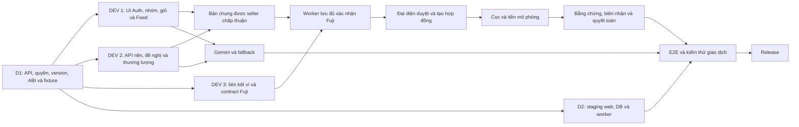

# Kế hoạch phát triển OOPS trong 7 ngày

## 1. Executive Summary — Tổng quan đồ án

**Mục tiêu đến cuối ngày 7 là bàn giao một bản OOPS chạy được trên môi trường demo, có giao dịch xác nhận thật trên Avalanche Fuji và có thể chạy lại từ dữ liệu mẫu.** Kịch bản chính đi từ giỏ nhu yếu phẩm đến đề nghị của người bán, hợp đồng do các hộ gửi, xác nhận trên Fuji, duyệt của đại diện, thu cọc mô phỏng, bàn giao và quyết toán. Slide và video được làm sau 7 ngày phát triển.

Luồng hợp đồng đã chốt với bạn:

1. Người bán chào tối đa 10 chai. Các hộ góp phần muốn mua vào một bản hợp đồng chung, ví dụ 2 + 2 + 3 = 7 chai.
2. Người bán từ chối, yêu cầu sửa hoặc chấp thuận bản 7 chai. Khi cần sửa, các hộ cập nhật và gửi phiên bản mới.
3. Từng hộ có phần hàng xác nhận phiên bản người bán đã chấp thuận trên Fuji. Sau khi đủ xác nhận, đại diện duyệt đúng phiên bản đó.
4. Hợp đồng 7 chai chuyển sang chờ cọc. Tiền hàng và cọc tính theo 7 chai. Phần nhu cầu còn thiếu vẫn có thể nhận đề nghị khác.

**ASSUMED — Đánh giá khả thi:** Giữ các cổng staging D2, Fuji thật D3 và đơn 0đ trọn luồng D5. Ước lượng theo phân công hiện tại là 35h Frontend, 67h Backend + DB và 54h DevOps + Fuji. Với giả định 56h/người, Backend + DB vượt 11h cả tuần. Cần xác nhận năng lực backend trước các mốc D4–D6 theo mục 10.

## 2. Repository & Documentation Audit — Hiện trạng thực tế

| Trạng thái | Phát hiện | Căn cứ |
|---|---|---|
| **VERIFIED** | Gốc workspace có Git, AGENTS và tài liệu OOPS trong `docs/`. | [Hướng dẫn repository](../AGENTS.md) · [Đặc tả](OOPS-Spec.md) |
| **VERIFIED** | Stack đặc tả gồm Next.js, TypeScript, Tailwind, Supabase Auth/PostgreSQL/Storage, Gemini, Solidity/Viem và Fuji. Schema và API mô tả các bảng, route, định dạng và quy tắc quyền. | [Kiến trúc](architecture.md), [schema](schema.md), [API](API%20doc.md) |
| **MISSING** | Chưa tìm thấy app OOPS, route nghiệp vụ, migration, seed, contract Fuji, worker, CI hay test OOPS. Phần triển khai của các chức năng P0 được ước lượng từ đầu. | Kết quả khảo sát workspace |
| **VERIFIED** | SenpAI là dự án tham khảo có Next.js/Viem, SQLite, auth riêng và token x402. Template ví và mint có thể cung cấp mẫu kết nối ví, gửi giao dịch, đọc receipt và event. | [SenpAI](../ref/Template_projects/senpai_temp/README.md), [SQLite](../ref/Template_projects/senpai_temp/web/lib/db.ts), [template ví](../ref/Template_projects/wallet-connect-dapp.zip), [template giao dịch](../ref/Template_projects/mint-from-the-ui.zip) |
| **ĐÃ ĐỒNG BỘ** | Kiến trúc, schema và API chuyển sang xác nhận theo phiên bản hợp đồng. Các hộ có thể gửi bản với lượng thấp hơn lượng chào. Người bán chấp thuận trước khi các hộ xác nhận và đại diện duyệt cuối. | [Kiến trúc](architecture.md#vòng-đời-hợp-đồng), [schema](schema.md#đề-nghị-thương-lượng-và-xác-nhận), [API](API%20doc.md) |
| **MISSING** | Chưa xác minh các project dịch vụ, quota, ví có AVAX testnet và host worker thực tế. Audit trước đó kiểm tra tĩnh, chưa có kết quả build hay test OOPS. | Điều kiện khởi động ngày 1 |

Có thể tái sử dụng mẫu ví và giao dịch từ `ref/` sau khi kiểm dependency, cấu hình và quyền sử dụng. App OOPS dùng PostgreSQL và Supabase Auth theo kiến trúc. Cổng kiểm thử dùng app OOPS.

## 3. Requirement Analysis — Phân tích yêu cầu

| Nhóm | Phạm vi nghiệm thu |
|---|---|
| **FR01 — Tài khoản và nhóm** | Một tài khoản dùng được cả vai trò mua và bán. Tối đa một nhóm hoạt động. Người được mời làm đại diện phải chấp thuận. Người bán và đại diện duyệt cùng hợp đồng phải là hai tài khoản khác nhau. |
| **FR02 — Giỏ, đợt gom, Feed** | Giỏ tay và giỏ Gemini đều qua bước sửa, xác nhận. Đại diện xem tổng giỏ đã xác nhận, đăng sớm để đóng gom. Feed lọc theo khu vực và danh mục, hiển thị hạn cần hàng và lượng còn thiếu. |
| **FR03 — Đề nghị và hợp đồng** | Người bán chào một món với lượng tối đa và giá, gồm giá hỗ trợ và 0đ. Các hộ tạo một bản chung có phần từng hộ, ghi chú và số tiền. Người bán phản hồi. Từng hộ có phần xác nhận trên Fuji. Đại diện duyệt cuối. |
| **FR04 — Cọc, tiền hàng, bàn giao** | Cọc riêng với tiền hàng. Cọc hợp lệ mới chuyển lượng sang đã giữ. Đơn có giá thu theo từng hộ. Hai bên duyệt cùng biên nhận. Giao thiếu ghi lượng thực nhận và hoàn tiền tương ứng. Có trạng thái đơn và thông báo trong app. |

Các bất biến cần kiểm bằng test là giới hạn tồn lượng theo món và theo hộ, một lần áp dụng mỗi sự kiện thu tiền, chỉ tạo một hợp đồng cho bản được chốt, chỉ quyết toán một lần trên cùng biên nhận, và không đọc được thông tin của nhóm hoặc hợp đồng khác. Bằng chứng dùng kho riêng và URL có hạn. Lỗi Gemini phải giữ được dữ liệu đang nhập. Worker phải phục hồi sau khi dừng và tiếp tục từ dữ liệu đã lưu. [Yêu cầu và ca nghiệm thu](requirements.md#yêu-cầu-và-phạm-vi) · [Nhất quán dữ liệu và quyền riêng tư](architecture.md#nhất-quán-và-xử-lý-lặp)

## 4. Issues & Assumptions — Vấn đề, giả định và quyết định

| Trạng thái | Quyết định dùng để lập kế hoạch | Việc cần kiểm chứng |
|---|---|---|
| **ĐÃ CHỐT** | Một hợp đồng chung cho các hộ mua. Người bán chấp thuận lượng các hộ đề xuất. **Tất cả hộ có phần dương** xác nhận trên Fuji. Đại diện duyệt cuối. | Dùng đặc tả đã đồng bộ để chốt fixture chung ngày 1. |
| **ĐÃ CHỐT** | Hoãn đổi giá/lượng **sau khi đại diện đã chốt** và đổi lịch hai bên. Vòng yêu cầu sửa **trước khi chốt** vẫn là P0. | Có test cho bản cũ mất hiệu lực khi gửi bản mới. |
| **VERIFIED** | UniHack chấp nhận Fuji và chấm phần Avalanche chạy thực tế. Core Wallet là lựa chọn cho OOPS. | Thu địa chỉ contract, mã giao dịch liên kết ví và mã giao dịch xác nhận của các hộ. [Team1 Vietnam](https://team1vn.xyz/#faq-network) · [Avalanche Fuji](https://docs.avax.network/docs/primary-network) |
| **ASSUMED** | Mỗi DEV có 8 giờ/ngày. DEV 2 có thể chịu trách nhiệm PostgreSQL và DEV 3 có thể chịu trách nhiệm Solidity/Viem. | Đổi người giữ vai trò nếu kiểm tra đầu ngày 1 cho thấy kinh nghiệm thực tế khác giả định. |
| **ASSUMED** | Mỗi đề nghị có một bản thương lượng đang hoạt động. Hộ khởi tạo bấm gửi bản chung và mỗi hộ sửa dòng của mình khi bản ở trạng thái cho phép. | Chốt quyền sửa và gửi trên fixture nhiều hộ trong ngày 1. |
| **ASSUMED** | Hạn demo dùng cấu hình riêng. Khi còn vòng xác nhận hoặc hợp đồng đang chạy, demo khóa thao tác rời nhóm hoặc đổi ví có ảnh hưởng. | Đo thời gian xác nhận Fuji và đặt hạn demo phù hợp. |
| **MISSING** | Chưa có định mức nhu yếu phẩm có nguồn. | Seed một số SKU đại diện. Gemini trích thông tin người dùng cung cấp, đánh dấu dữ liệu thiếu để hộ nhập tiếp. |
| **MISSING** | Chưa có quyền và API giải quyết tranh chấp cọc. | Demo giữ cọc ở `NEEDS_REVIEW` khi chưa có kết quả. Tiền hàng đã xác định được xử lý theo biên nhận. |

## 5. MVP Scope — Phạm vi cần hoàn thành

| Ưu tiên | Chức năng và giá trị | Độ khó, phụ thuộc và rủi ro | Nghiệm thu |
|---|---|---|---|
| **P0** | Tài khoản, nhóm, link mời và chấp thuận vai trò đại diện | Trung bình. Phụ thuộc Auth và ràng buộc nhóm hoạt động. | Hai hộ vào được nhóm. Không vào đồng thời nhóm thứ hai. Đại diện mới chỉ nhận vai trò sau khi chấp thuận. |
| **P0** | Giỏ tay, giỏ Gemini, đóng gom và Feed | Trung bình. Phụ thuộc SKU, phiên bản giỏ và giao dịch chụp nhu cầu. | Chỉ cộng giỏ xác nhận. Đăng sớm đóng gom. Feed khớp tổng và ẩn thông tin riêng. Gemini lỗi vẫn sửa được giỏ. |
| **P0** | Đề nghị, hợp đồng chung và vòng yêu cầu sửa | Cao. Phụ thuộc `demandItemId`, quyền theo nhóm và phiên bản. | Chào 10, các hộ gửi bản 7, người bán có đủ ba lựa chọn. Người đại diện không thể duyệt nhầm bản cũ. |
| **P0** | Liên kết ví và xác nhận từng hộ trên Fuji | Cao. Phụ thuộc Core Wallet, Fuji RPC, AVAX testnet và hợp đồng thông minh. | Ví liên kết thành công có giao dịch tra được. Ví ngoài danh sách bị từ chối. Thiếu một xác nhận thì đại diện chưa duyệt được. |
| **P0** | Duyệt cuối, cọc, đơn 0đ và đơn có giá | Cao. Phụ thuộc kết quả Fuji và transaction PostgreSQL. | Duyệt cuối chỉ tạo một hợp đồng. Cọc hợp lệ mới chuyển `pending` sang `reserved`. Đơn 0đ không tạo khoản tiền hàng. |
| **P0** | Bàn giao, giao thiếu, hủy và xử lý quá hạn | Cao. Phụ thuộc Storage, biên nhận, sổ tiền và worker. | Hai bên duyệt đúng bản. Giao thiếu mở lại nhu cầu và hoàn phần dư. Chỉ một bên duyệt đến hạn thì chuyển `NEEDS_REVIEW`. Hủy áp đúng quyền và điều kiện. |
| **P0** | Theo dõi đơn, thông báo trong app và triển khai | Trung bình. Phụ thuộc toàn bộ luồng và khả năng phục hồi worker. | Người dùng xem được phần hàng, khoản tiền và trạng thái liên quan. Staging có seed và kiểm thử lại được. |
| **P1** | Cải thiện màn chờ ví, trạng thái rỗng, thông báo lỗi và hiển thị trên nhiều kích thước màn hình | Thấp đến trung bình. Làm sau khi luồng P0 đã ổn định. | Người thử mới tự hoàn thành luồng với ít hướng dẫn hơn. |
| **P2** | Đổi giá/lượng sau khi chốt, đổi lịch, QR/payOS thật, phân xử cọc và vận hành tiền thật | Cao. Cần đặc tả và năng lực vận hành riêng. | Đưa vào backlog sau demo, với tiêu chí nghiệm thu riêng. |

## 6. Architecture & Technical Decisions — Kiến trúc và công nghệ

**Một codebase Next.js có web, API và module nghiệp vụ.** Supabase cung cấp Auth, PostgreSQL và Storage. Một worker chạy riêng từ cùng codebase để gửi lệnh mở vòng xác nhận, đọc log Fuji, chạy hạn và phát thông báo. Gemini chỉ phục vụ giỏ nháp. Tiền đi qua adapter `SIM`. UI dùng Next.js/Tailwind và lấy dữ liệu từ API `/api/v1`.

**Ranh giới dữ liệu và ghi nghiệp vụ**

- **Nhu cầu:** Giữ `demand_items` và `demand_shares`. Khi chụp nhu cầu, chỉ lấy giỏ đã xác nhận. Luôn giữ `pending + reserved + received ≤ target` cho món và từng hộ. Feed dùng `missing = target − reserved − received`. Lượng còn có thể chốt dùng `offerable = missing − pending`.
- **Thương lượng:** Một đề nghị có một hồ sơ thương lượng. Hộ khởi tạo gửi bản chung, mỗi hộ chỉ sửa dòng của mình khi nháp mở. Bản gửi chụp số lượng, đơn giá, lịch giao, ghi chú, phần từng hộ và tổng tiền. Các điều khoản trong bản đã gửi bất biến. Phiên bản mới cần người bán chấp thuận và tất cả hộ có phần dương xác nhận lại. [Trạng thái và thời hạn](architecture.md#trạng-thái-thương-lượng-và-thời-hạn)
- **Fuji:** Mỗi phiên bản có tối đa một vòng xác nhận. Đề nghị có thể có nhiều vòng qua các phiên bản. DB lưu tập hộ, ví và xác nhận theo vòng, cùng cursor đồng bộ. On-chain dùng mã vòng, mã băm, ví và sự kiện xác nhận. Thông tin liên hệ, ghi chú, ảnh và dữ liệu VND ở PostgreSQL/Storage.
- **Đơn và sổ tiền:** Giữ `contracts`, `allocations`, `charges`, `fund_events`, `disbursements`, biên nhận, bằng chứng, thông báo, audit và outbox. Tạo dòng giữ tạm khi đại diện duyệt cuối. Dòng giữ tạm chỉ thành đã giữ sau cọc. Dùng VND số nguyên và tính cọc theo `max(50.000đ, ceil(tiền hàng / 10))`. [Quy tắc dữ liệu](schema.md#quy-tắc-dữ-liệu)

Chia migration theo phụ thuộc `nền tài khoản/nhóm/nhu cầu → thương lượng → xác nhận → đơn/sổ tiền/bàn giao → worker và policy`. DEV 2 sở hữu migration và hàm transaction. DEV 3 phối hợp phần Fuji và worker. Thao tác chốt, thu, hết hạn, hủy và áp biên nhận đi qua các hàm transaction PostgreSQL. Hàm ghi kiểm tra actor, trạng thái, phiên bản và lượng dưới khóa. Route nhận lặp trả lại kết quả đã có, còn cùng khóa với dữ liệu khác trả `409`. Thay đổi nghiệp vụ và outbox được ghi cùng transaction. [Thứ tự khóa](architecture.md#thứ-tự-khóa-dữ-liệu)

**Hợp đồng API chốt ngày 1**

Dùng route trong [đặc tả API](API%20doc.md). DEV 2 bàn giao schema TypeScript/Zod, ví dụ request/response và fixture lỗi. DEV 1 và DEV 3 review phần tiêu thụ trước khi làm song song.

| API hoặc bàn giao | Dữ liệu chính | Điều kiện cần cố định |
|---|---|---|
| Giỏ, đợt gom và Feed | `campaignId`, `demandItemId`, `target`, `missing`, `offerable`, `version` | ID món ổn định sau publish. Lượng và đơn vị theo SKU. |
| `POST /needs/{id}/offers` | `proposalId`, lượng tối đa, giá, điều kiện giao, hạn | Người bán chào tối đa 10. Bản hộ gửi có thể là 7. |
| Nháp theo đề nghị, sửa phần của hộ, gửi bản chung | `draftId`, `version`, `lines`, `qty`, `unitPriceVnd`, `totalVnd`, `note` | Mỗi hộ chỉ sửa phần của mình. Server tính tổng và kiểm tra hạn mức. |
| Phản hồi của người bán | `version`, `APPROVE`, `REJECT` hoặc `REQUEST_CHANGES`, ghi chú | Khi chấp thuận, mọi hộ có phần dương phải có ví đã xác minh và đủ điều kiện. Nếu thiếu, trả `409 WALLET_NOT_READY`, giữ bản chờ phản hồi. Nếu đủ, chụp danh sách đầy đủ và đưa yêu cầu mở vòng vào outbox. |
| Liên kết ví và vòng xác nhận | `address`, `proofTx`, `nonce`, `roundId`, `roundKey`, `versionHash`, `confirmBy` | Challenge có `expiresAt`. Worker kiểm chain, địa chỉ contract, vòng, ví và phiên bản. |
| Đại diện duyệt | `draftId`, `version`, `Idempotency-Key` → `contractId`, `AWAIT_DEPOSIT` | Kiểm quyền, hạn, đúng bản seller đã chấp thuận và xác nhận của từng hộ dưới khóa. Nếu thiếu lượng, ghi `STOCK_CONFLICT`, thông báo rồi trả `409`; giữ nguyên các phần đã xác nhận trong lịch sử. |
| Thu SIM, bằng chứng, biên nhận, chi/hoàn | `contractId`, `chargeId`, `receiptId`, `receiptVersion`, `disbursementId`, `transferRef` | Hai bên duyệt cùng biên nhận. Tài khoản vận hành ghi `POSTED` bằng mã SIM duy nhất. Chuyển đơn `SETTLING` sang `COMPLETED` khi mọi khoản chi/hoàn của đơn đã `POSTED`. |

**Xác thực và phân quyền.** Supabase Auth quản lý phiên. API, hàm transaction và RLS bảo vệ dữ liệu theo vai. Server xác minh challenge Fuji có nonce dùng một lần. Chốt chuẩn credential, chủ thể cấp/thu hồi và điều kiện đủ quyền ở D1. Quyền ops quyết toán SIM được kiểm riêng với quyền quản trị credential. Tập hộ cần xác nhận lấy từ toàn bộ dòng có lượng dương của phiên bản đã gửi. Mỗi hộ phải có đúng một ví đã liên kết, đã xác minh, đủ quyền và khác ví của các hộ khác trong vòng. Mỗi ví chỉ xác nhận một lần trên đúng phiên bản. Duyệt cuối kiểm đủ từng hộ, bản còn hiệu lực và hạn chưa qua.

**Môi trường.** Local dùng fixture, Postgres/Supabase dev và chain local khi sẵn sàng. Staging dùng Supabase và bucket riêng, Next.js chạy server, worker khởi động lại được. Dựng môi trường tối thiểu trước cuối ngày 2. Fuji thật là cổng nghiệm thu. Fixture chạy ở dev/test. Nếu RPC lỗi, UI giữ trạng thái chờ và worker tiếp tục từ cursor khi RPC phục hồi. Nếu Gemini lỗi, hộ tiếp tục bằng giỏ tay. Seed và reset chỉ tác động dữ liệu demo.

## 7. Phân công

Áp dụng [bản đồ sở hữu trong AGENTS.md](../AGENTS.md#3-phân-công-và-sở-hữu).

| Người | Sở hữu | Bàn giao chính | Người review |
| --- | --- | --- | --- |
| **DEV 1** | App shell, API client và UI các vai, gồm Auth, nhóm, giỏ tay/Gemini, Feed, thương lượng, đơn, bàn giao, ops và thông báo. Ghép component ký. | UI theo fixture và API thật, kết quả kiểm trình duyệt theo vai. | DEV 2 review API và quyền. DEV 3 review phần ghép ví. |
| **DEV 2** | DTO/fixture chung, Auth/phân quyền server và toàn bộ API nghiệp vụ, gồm nhóm, Feed, Gemini, thông báo, ops. Sở hữu schema, migration, RLS và hàm giao dịch. | `demandItemId`, `proposalId`, `draftId`, `versionId`, `contractId`, seed và hàm cho worker. | DEV 1 review phần tiêu thụ API. DEV 3 review phần Fuji và worker gọi. |
| **DEV 3** | Toolchain, CI, staging, API ví dùng Auth chung, credential, ABI, component ký, indexer, lịch hạn/thông báo và điều phối E2E. | `roundId`, ví verified, xác nhận Fuji đã lưu, URL staging, kết quả E2E, SHA và runbook. | DEV 2 review quyền, ABI và ghi lặp. DEV 1 review phần tiêu thụ component. |

DEV 1 kiểm UI, DEV 2 kiểm PostgreSQL và mỗi DEV sửa lỗi module mình. DEV 3 ghép và ghi bằng chứng cổng staging. DEV 2 giữ quy tắc chuyển trạng thái. DEV 3 lập lịch và gọi hàm đã thống nhất.

## 8. Task Breakdown — Danh sách task chi tiết

Đường dẫn trong bảng là module dự kiến theo AGENTS.md. Giờ gồm code, review, debug và tích hợp. Đây là ước lượng để kiểm tải ở D1. Cột cuối ghi điều kiện nghiệm thu của từng task, cùng cổng chung ở mục 13.

| ID · Task | Ưu tiên · DEV · Giờ | Dependency | Module dự kiến | Input → Output và hướng dẫn cho agent | Acceptance criteria · Kiểm thử |
|---|---|---|---|---|---|
| **A01 · App shell và API client** | P0 · 1 · 5h | Toolchain C01, DTO B01 | `src/app/`, `src/lib/api-client/` | DTO và fixture → layout, client dùng phiên và xử lý lỗi chung. | Build nền chạy. Mock bật tường minh ở dev/test. |
| **A02 · UI Auth, nhóm và mời** | P0 · 1 · 4h | A01, B07 (fixture trước API thật) | `src/app/`, `src/components/` | API phiên/nhóm → màn đăng nhập, tạo/vào nhóm, nhận vai đại diện. | Kiểm link hết hạn, phiên hết hạn và kết nối API thật ở D2. |
| **A03 · UI giỏ tay, đợt gom, Feed** | P0 · 1 · 5h | A02, B08 | `src/app/`, `src/components/` | DTO Cart/Campaign/Feed → giỏ, xem trước, publish và Feed. | Thấy đúng tổng 12 chai, hạn gom và phân biệt đã giữ/còn thiếu. |
| **A04 · UI thương lượng, đơn, bàn giao và ops** | P0 · 1 · 12h | A01, fixture B01, API B02–B05, C03 | `src/app/`, `src/components/` | Fixture nhiều vai → chào, góp phần, gửi/duyệt bản, ghép component ký, thu SIM, biên nhận, ops và thông báo. | Các vai dùng đúng phiên bản, hạn, lý do bị chặn và trạng thái chi/hoàn. |
| **A05 · UI giỏ Gemini** | P0 · 1 · 3h | A03, B09 | `src/components/` | Kết quả AI đã validate → giỏ nháp để hộ sửa. | Khi AI lỗi hoặc thiếu dữ liệu, giữ bản đang sửa và nhập tay được. |
| **A06 · Kiểm UI và ghép API** | P0 · 1 · 6h | A02–A05, phối hợp C07 | `src/app/`, test UI theo module | Fixture và staging → kết quả trình duyệt, lỗi theo vai và sửa UI. | Kiểm luồng chính trên điện thoại, tải/lỗi/rỗng và quyền hiển thị. |
| **B01 · DTO/fixture và nền PostgreSQL** | P0 · 2 · 8h | Quyết định D1 | `src/contracts/`, `tests/fixtures/`, `supabase/migrations/`, `supabase/seed.sql` | Đặc tả → DTO, fixture 10→7, lỗi, seed nền, migration và interface giao dịch chung. | Cả ba DEV dùng cùng fixture. DB dev khởi tạo được và kiểm được khóa nền, quyền ghi và đơn vị. |
| **B02 · API đề nghị và thương lượng** | P0 · 2 · 10h | B01, fixture `demandItemId`, interface C01 | `src/server/negotiation/`, `src/app/api/v1/offers/` | Đề nghị 10 → bản 7, seller phản hồi, chụp đủ hộ và ví khi approve. Bàn giao hàm hết hạn cho C05. | Kiểm sửa đúng vai, reject, yêu cầu sửa, gửi lại phiên bản, thiếu ví, hết hạn phản hồi và không còn đủ thời gian giao. |
| **B03 · Duyệt cuối và giữ lượng** | P0 · 2 · 6h | B02, interface xác nhận chốt ở D1 | `src/server/orders/finalize/`, migration đơn | Bản còn hiệu lực và đủ xác nhận từng hộ → một hợp đồng, `pending` và khoản cọc trong cùng transaction. | Thiếu hộ, sai version hoặc hết hạn bị chặn. Hai lần duyệt chỉ tạo một đơn. Thiếu lượng lưu `STOCK_CONFLICT`, không đổi phần và không vượt target. |
| **B04 · Thu SIM, hết hạn cọc/tiền** | P0 · 2 · 6h | B03 | `src/server/payments/`, `src/server/orders/expiry/`, `src/app/api/v1/demo/` | Khoản cọc/tiền → fund event, chuyển trạng thái, hoàn các khoản đã thu khi đủ điều kiện. | Kiểm đơn 0đ, đơn nhiều hộ có giá, gửi lặp, mã giao dịch thứ hai và tiền đến trễ. |
| **B05 · Bàn giao, quyết toán, API ops và thông báo** | P0 · 2 · 11h | B04, Supabase Storage | `src/server/handoff/`, `src/server/settlement/`, `src/app/api/v1/`, migration Storage | Bằng chứng và lượng nhận → biên nhận có version, hai lượt duyệt, ghi lượng, lập chi/hoàn và xử lý hủy. API ops liệt kê và ghi `POSTED` bằng mã SIM. API thông báo đọc/đánh dấu theo chủ. | D5 ưu tiên ca 0đ giao đủ tới `COMPLETED`. D6 kiểm giao thiếu, ảnh sai quyền, một bên duyệt, hủy, cọc cần xử lý, mã chuyển lặp và quyền đọc thông báo. |
| **B06 · Kiểm tra transaction và sửa lỗi** | P0 · 2 · 8h | B02–B05; C05 cho ca worker | `tests/db/`, `tests/integration/` | Fixture và lỗi staging → kiểm cạnh tranh, idempotency, ledger. Chạy ca DB trước, ghép deadline khi C05 có kết quả. | Có bằng chứng đối soát. Hai yêu cầu đồng thời không ghi tiền, tạo đơn hoặc giải phóng hàng hai lần. |
| **B07 · API phiên, nhóm và mời** | P0 · 2 · 6h | B01, Supabase Auth | `src/server/auth/`, `src/app/api/v1/`, `supabase/migrations/` | Phiên Supabase → hồ sơ, nhóm, lời mời dùng một lần, chuyển vai đại diện và kiểm quyền. | Tạo/vào nhóm, từ chối truy cập chéo nhóm và không tham gia hai nhóm hoạt động. |
| **B08 · API giỏ tay, đợt gom và Feed** | P0 · 2 · 8h | B01, B07, SKU seed | `src/server/`, `src/app/api/v1/`, `supabase/seed.sql` | SKU và giỏ có version → chụp giỏ xác nhận, `demandItemId` và Feed. | Kiểm tổng 12 chai, đăng sớm, hết hạn, đầu vào âm và ẩn trường riêng. |
| **B09 · Gemini server** | P0 · 2 · 4h | B08, Gemini key | `src/server/cart/`, `src/app/api/v1/` | Text và SKU → giỏ nháp đã validate, trường chưa rõ và lỗi cho UI. | Kiểm timeout, schema sai, SKU mơ hồ và một lần gọi Gemini thật trên staging. |
| **C01 · Chuẩn bị Fuji và toolchain** | P0 · 3 · 4h | Quyết định đầu D1 | `contracts/`, cấu hình build/lockfile, `.env.example` | Công cụ, ví testnet, AVAX, RPC và quyền host → toolchain, ABI dự kiến và owner của blocker. | Core kết nối Fuji, kiểm quyền và cấu hình cùng DEV 1/2. |
| **C02 · Contract credential và xác nhận** | P0 · 3 · 9h | C01, schema ABI ngày 1 | `contracts/src/`, `contracts/test/` | Ví được cấp quyền và digest phiên bản → proof và sự kiện xác nhận Fuji. | Kiểm ví ngoài tập, xác nhận lặp, sai vòng, hết hạn. Có địa chỉ deploy và một giao dịch thành công trên Fuji. |
| **C03 · Liên kết ví và component ký** | P0 · 3 · 8h | C02 ABI, B07 cho phiên thật, A02 cho UI | `src/lib/fuji/`, `src/app/api/v1/wallet/`, `src/components/wallet/` | Phiên + challenge → verified wallet, chọn Fuji, ký, hiển thị receipt/chờ đồng bộ. | Core ký được. Sai mạng, sai challenge và dùng lại nonce bị chặn. Component ghép được vào A04 qua props đã chốt. |
| **C04 · Mở vòng và đồng bộ Fuji** | P0 · 3 · 10h | B02, C02, interface xác nhận chốt ở D1 | `src/lib/fuji/`, `worker/chain/` | Tập ví đầy đủ của bản seller đã duyệt → mở vòng theo version và lưu xác nhận Fuji. Vòng khác và sự kiện đến sau cutoff không mở quyền duyệt. | Ví chưa sẵn sàng không tạo snapshot thiếu hộ. Restart không mất cursor. Log lặp không tăng số xác nhận. Bản 3 hộ chỉ sẵn sàng khi đủ cả 3. |
| **C05 · Worker hạn và thông báo** | P0 · 3 · 7h | C04, interface B02/B04/B05 | `worker/jobs/`, `worker/notifications/` | Outbox và deadline → gọi hàm BE, chạy hạn và tạo thông báo. B05 giữ API đọc/đánh dấu. | Clock giả kiểm hạn, retry không gửi trùng, thông báo đúng người và đúng đối tượng. |
| **C06a · Dựng staging sớm** | P0 · 3 · 4h | Chuẩn bị host sau C01. Deploy sau khi có app shell A01 và kết nối DB B01. | `docs/deploy/`, cấu hình host, health | App shell và cấu hình → staging có URL, health kết nối DB và worker chạy được. | Cuối D2, có deploy theo SHA, DB/Storage staging và log khởi động worker. D4 dùng môi trường này để ghép luồng. |
| **C06b · Release và phục hồi** | P0 · 3 · 6h | C06a, C04/C05, chuẩn bị song song C07. Chốt sau cổng A06/B06/C07 | `.github/workflows/`, `docs/deploy/`, cấu hình host | Candidate và bằng chứng kiểm thử → kiểm CI, release theo SHA, smoke Fuji và hướng dẫn phục hồi. Chuẩn bị song song, chỉ chốt release sau cổng kiểm thử. | Deploy từ SHA đã duyệt, worker restart và chạy lại được ca Fuji từ seed. Có SHA phục hồi và checklist dữ liệu tương thích migration. |
| **C07 · Điều phối E2E và dữ liệu demo** | P0 · 3 · 6h | C06a, seed B01/B08, A04, B05, C04/C05 theo ca | `tests/e2e/`, `docs/runbook-demo.md` | Seed và các lát đã ghép → kịch bản 0đ, có giá, giao thiếu, quá hạn và chạy lại staging. | D5 có bằng chứng Fuji thật tới `COMPLETED`, D6 kiểm các nhánh lỗi, D7 chạy lại cổng release. |

**Prompt giao trực tiếp cho AI Coding Agent**

- **A03:** “Dựng UI giỏ tay, publish đợt và Feed theo DTO của B08. Kiểm fixture 12 chai, trạng thái hết hạn và hiển thị đúng `missing`/`offerable`. Ghép API thật khi B08 bàn giao.”
- **B02:** “Triển khai hồ sơ thương lượng và bản gửi bất biến cho ca chào 10, hộ góp 2+2+3. Seller được chấp thuận, từ chối hoặc yêu cầu sửa. Khi chấp thuận, kiểm tất cả hộ có phần có ví hợp lệ rồi chụp đủ danh sách. Giao fixture thiếu ví, hết hạn và gửi lại bản mới cho DEV 1 và DEV 3.”
- **B03:** “Triển khai transaction đại diện duyệt bản cuối. Kiểm seller đã chấp thuận đúng version, tất cả hộ có phần đã xác nhận Fuji và còn đủ lượng. Tạo đúng một hợp đồng, `pending` và khoản cọc. Viết test hai lần duyệt đồng thời và bản hết hạn.”
- **B05:** “Áp biên nhận theo từng allocation khi seller và đại diện duyệt cùng version. Lập chi/hoàn đúng một lần. Cung cấp thao tác ops ghi POSTED theo mã SIM và hoàn tất đơn đủ điều kiện trong transaction. Kiểm giao 6/8 chai, gửi lặp, sai quyền và một bên duyệt quá hạn.”
- **C02/C04:** “Triển khai vòng xác nhận theo `roundKey` và `versionHash` đã thống nhất. Chỉ ví trong snapshot được xác nhận một lần. Indexer xác thực chain, contract, event và version, lưu cursor bền vững. Bàn giao mẫu giao dịch Fuji, test replay log và restart.”
- **B09:** “Dùng Gemini trích SKU, số lượng và đơn vị sang giỏ nháp. Validate qua schema chung, đánh dấu trường không rõ và trả lỗi để A05 giữ đường nhập tay.”

## 9. Dependency Map — Sơ đồ phụ thuộc và critical path

**Critical path** đi qua API nền, bản seller chấp thuận, worker Fuji, duyệt cuối, thu SIM, biên nhận và ops. B02 và A04 bắt đầu bằng fixture B01. C02/C03 dùng fixture bản 7 chai trước khi B02 xong. B03–B05 có thể kiểm bằng xác nhận giả trong dev/test. Cổng D5 dùng Fuji thật và API thật.

## 10. Lịch mục tiêu và quỹ giờ

Giả định mỗi DEV có 8h/ngày trong 7 ngày. Bảng dưới là lượng công việc cần để giữ từng cổng. Các ô DEV 2 vượt 8h cần được bổ sung năng lực trước mốc tương ứng.

| Ngày | DEV 1 | DEV 2 | DEV 3 | Cổng nghiệm thu |
| --- | --- | --- | --- | --- |
| **D1** | A01 5h + A02 2h | B01 8h | C01 4h + C06a 3h | Chốt DTO/fixture, ABI và các quyết định chặn. Có build nền, DB dev và cấu hình staging. |
| **D2** | A02 2h + A03 4h + A04 2h | B07 6h + B08 2h | C06a 1h + C02 6h | Staging web/DB/worker có health. UI đăng nhập, vào nhóm qua API thật. |
| **D3** | A03 1h + A04 5h | B08 6h + B02 2h | C02 3h + C03 5h | Feed có `demandItemId` thật. Có bằng chứng ví và giao dịch xác nhận Fuji thật bằng fixture. |
| **D4** | A04 3h | B02 8h + B03 6h + B04 2h = **16h** | C03 3h + C04 5h | Bản seller chấp thuận mở được vòng, nối duyệt cuối và đường cọc SIM. |
| **D5** | A04 2h + A05 2h + A06 1h | B04 4h + B05 7h = **11h** | C04 5h + C07 3h | Ca 0đ trên staging qua Fuji thật, cọc và bàn giao, ops ghi hoàn cọc `POSTED`, đơn `COMPLETED`. Ca có giá tới thu đủ. |
| **D6** | A05 1h + A06 3h | B05 4h + B09 4h + B06 4h = **12h** | C05 7h + C07 1h | Đơn có giá, giao thiếu, Gemini thật và nhập tay khi lỗi, ca hạn và restart. Đóng phạm vi. |
| **D7** | A06 2h | B06 4h | C07 2h + C06b 6h | Regression, đối soát, chạy lại từ seed và release theo SHA sau khi đạt cổng. |

| Người | Effort dự kiến | Quỹ giả định | Chênh lệch cả tuần |
| --- | ---: | ---: | ---: |
| DEV 1 | 35h | 56h | Còn 21h |
| DEV 2 | 67h | 56h | Thiếu 11h |
| DEV 3 | 54h | 56h | Còn 2h |
| **Tổng** | **156h** | **168h** | **Còn 12h trên tổng quỹ** |

Với thứ tự ở trên, tải backend lũy kế cần **40h đến D4**, **51h đến D5** và **63h đến D6**. So với 8h/ngày, thiếu lần lượt **8h, 11h và 15h** tại các mốc đó. B04 dành 2h ở D4 cho đường cọc SIM. B05 dành 7h ở D5 cho lát giao đủ 0đ. DEV 3 có thể chuẩn bị phần mở vòng và indexer trên fixture, rồi ghép phần đọc kết quả thật sau khi B02 bàn giao.

Ở D1, DEV 2 bàn giao DTO và fixture đầu tiên trong B01 để DEV 1 dựng app shell và UI nhóm song song với migration. Xác nhận giờ và năng lực PostgreSQL/Fuji. Nếu có người hỗ trợ backend, DEV 2 chia lát độc lập, tính cả giờ bàn giao và review, rồi cập nhật người thực hiện và mốc. Tách lát API đọc trong B08 để giải phóng giờ trước D4, hoặc B09 để bù tải D6. DEV 2 tiếp tục giữ các transaction lượng và tiền. Nếu vẫn thiếu năng lực đúng mốc, đưa lịch cập nhật cho nhóm quyết định.

**Mốc review và nghiệm thu mỗi ngày**

| Ngày | Mục tiêu và việc chạy song song | Review thủ công và checkpoint | Rủi ro nếu chưa đạt |
|---|---|---|---|
| **1** | Chốt API và fixture trước. Sau đó chia app, DB và Fuji thành ba nhánh độc lập. | Cả nhóm đi qua 10→7 và lỗi bản cũ. Kiểm Auth, DB, AVAX, RPC, Gemini key và nơi chạy worker. | Chưa có người giữ SQL hoặc Fuji, thiếu quyền môi trường hoặc chưa chạy được công cụ. Chuyển ngay sang người/máy có thể chạy. |
| **2** | Ghép Auth/nhóm thật và dựng staging. | Kiểm lời mời, quyền hộ và lỗi hết phiên. Health có kết nối DB và log worker. | Host hoặc quyền môi trường có thể chặn tích hợp D2. |
| **3** | Có dữ liệu nhu cầu thật và giao dịch Fuji thật. | Xem mã giao dịch trên explorer. Review trường giá/lượng và quyết định khi bản hết hạn. | Nếu Fuji chưa thành công, DEV 3 dùng giờ dự phòng cho lỗi đó. Hai DEV còn lại tiếp tục qua fixture. |
| **4** | Ghép chuỗi ID đến `roundId`, duyệt cuối và đường cọc. | Kiểm seller yêu cầu sửa, bản cũ và hai đề nghị cạnh tranh. | Nếu backend chưa được bổ sung đủ giờ, ghi rõ task còn thiếu và cổng bị ảnh hưởng. |
| **5** | Chạy ca 0đ từ app đến sổ tiền. UI Gemini có thể ghép trước bằng fixture. | Kiểm từng hộ ký, đại diện duyệt, cọc 50.000đ, ảnh và biên nhận. Ops ghi hoàn cọc `POSTED`, đơn thành `COMPLETED`. | Chốt người hỗ trợ theo bước chặn và cập nhật giờ còn lại. |
| **6** | Chứng minh đơn có giá, giao thiếu và nhánh lỗi. | Đối soát từng khoản, thử hai request đồng thời và restart worker. Kiểm tra quyền đọc ảnh/đơn. | Nếu còn lỗi lệch lượng, tiền hoặc quyền, dùng ngày 7 để sửa lỗi P0 trước release. |
| **7** | Bàn giao phiên bản ổn định. | Chạy lại từ seed, trên môi trường staging, với Core Wallet thật. Đối chiếu Git SHA, ABI, địa chỉ contract và kết quả smoke. | Khi candidate lỗi, quay về bản staging gần nhất đã qua cổng tương ứng và công bố cụ thể ca còn thiếu. |

## 11. Phối hợp khi giao task cho agent

Mỗi task ghi owner, module được sửa, phiên bản DTO/ABI, fixture, dependency, nghiệm thu và reviewer theo [mẫu bàn giao](../AGENTS.md#7-nhận-và-bàn-giao-task-cho-agent). Đầu ngày cập nhật SHA, trạng thái API, sample payload và blocker. Cuối ngày, người nhận chạy ít nhất một fixture qua phần được bàn giao.

- **Frontend** triển khai UI và API client. Mock dùng chung contract và bật rõ ở dev/test.
- **Backend + DB** giữ DTO, fixture, Auth server, API nghiệp vụ, migration và hàm transaction.
- **DevOps + Fuji** giữ toolchain, staging, ABI, component ký, indexer, job và điều phối E2E. Kết quả ký trên UI chờ API đồng bộ sự kiện Fuji.

DEV đọc diff và chạy ca nghiệm thu trước khi gửi review. Thay đổi quyền, migration, ABI, lượng, tiền hoặc release cần người thật review. Đổi interface cập nhật tài liệu, kiểu, fixture và caller liên quan trong cùng PR hoặc chuỗi PR tương thích.

## 12. Git & Integration Strategy — Quy trình tích hợp

Dùng một repository OOPS với `main` luôn build được. Nhánh ngắn theo `feat/A03-cart-feed`, `feat/B03-finalize` hoặc `fix/C04-indexer-cursor`. Một PR giải quyết một issue hoặc một lát nhỏ có thể review. Mỗi PR ghi hành vi, dependency, migration hoặc ABI thay đổi, cách test và bằng chứng nghiệm thu.

- Ba DEV trên máy riêng dùng checkout thông thường. Dùng **Git worktree** khi một DEV chạy nhiều phiên agent hoặc cần giữ riêng nhánh đang kiểm thử với nhánh đang sửa. Mỗi worktree có port và môi trường dev riêng.
- Đồng bộ từ `main` đầu ngày và trước checkpoint. PR giao diện có thể merge với fixture nếu fixture chỉ bật ở dev/test và không làm hỏng luồng chạy thật.
- Ít nhất một DEV khác review PR P0. Owner phải review khi PR chạm vào file dùng chung. Merge bằng squash sau khi qua cổng chất lượng.
- Nếu xung đột API hoặc migration, owner xử lý schema trước. Các nhánh phụ cập nhật theo schema đã merge và chạy lại test liên quan. Với migration đã áp lên staging, dùng migration bổ sung để sửa.
- Tích hợp tối thiểu một lần mỗi ngày. Sau khi D6 đạt cổng P0, giới hạn thay đổi vào lỗi chặn release và giữ SHA staging đã chạy qua kiểm thử để phục hồi.

## 13. Testing & Definition of Done — Tiêu chí chất lượng

**DoD áp dụng cho mỗi task:** mergeable trên `main`, build và typecheck qua, lint qua nếu đã cấu hình, test liên quan qua, DTO/migration/ABI khớp caller, không có secret trong diff hoặc log, reviewer đã xem phần có ảnh hưởng và PR kèm bằng chứng nghiệm thu. Task còn dùng fixture ở điểm cần dữ liệu thật chưa đạt DoD tích hợp.

| Gate | Ca kiểm bắt buộc |
|---|---|
| **Nghiệp vụ và UI** | Ca chào 10, gửi 7 với phần 2+2+3. Seller yêu cầu sửa rồi chấp thuận bản mới. Kiểm hết hạn seller, thiếu xác nhận và đại diện không duyệt đúng hạn. Khi thiếu lượng lúc chốt, lưu xung đột và chỉ gửi bản mới nếu đề nghị còn hiệu lực. |
| **Fuji** | Một trong ba hộ chưa có ví thì chưa mở vòng. Khi cả ba có ví, cần đủ ba xác nhận đúng version. Kiểm log lặp, sai vòng, bản hết hạn và restart worker. Có mã giao dịch thật trên explorer. |
| **Tồn lượng** | Nhu cầu 12 chai, đơn 8 chai chờ cọc vẫn còn `missing = 12`, `offerable = 4`. Sau cọc còn thiếu 4. Khi hai bên duyệt nhận 6, còn thiếu 6. Hai yêu cầu chốt đồng thời không vượt target. |
| **Tiền mô phỏng** | Đơn 0đ có cọc 50.000đ. Đơn 8 × 2.000đ thu 16.000đ riêng. Nhận 6 chai thì chi 12.000đ và hoàn 4.000đ. Gửi lại, nộp thêm và tiền đến trễ chỉ áp một lần. Ops ghi `POSTED` bằng mã SIM duy nhất. Ca giao đủ, đúng hạn đạt `COMPLETED` sau khi ghi đủ chi/hoàn. |
| **Bàn giao và hạn** | Chưa đủ tiền bị chặn lập biên nhận. Hai bên duyệt cùng version. Chỉ một bên duyệt quá hạn chuyển `NEEDS_REVIEW`. Hủy trực tiếp sau bằng chứng bị chặn. Cọc tranh chấp giữ riêng khỏi tiền hàng đã xác định. |
| **Quyền riêng tư và phục hồi** | Kiểm truy cập chéo nhóm, URL ảnh có hạn, quyền vận hành riêng, Gemini lỗi vẫn nhập tay, staging chạy lại được từ seed và worker khởi động lại không mất việc. |

## 14. Risks & Contingency Plans — Rủi ro và dự phòng

| Rủi ro | Tín hiệu | Ứng phó |
|---|---|---|
| **Không có Fuji hoặc ví chưa sẵn sàng** | Cuối D1 chưa có người giữ ví/AVAX hoặc D3 chưa có giao dịch thật | Dùng fixture để app tiếp tục. DEV 3 ưu tiên Fuji, một thiết bị Core đã thử và RPC dự phòng. Ghi trạng thái chưa đạt cổng Fuji cho đến khi có giao dịch thật. |
| **Lệch phiên bản hợp đồng** | Seller thấy bản khác bản hộ ký, hoặc đại diện thấy số tiền khác | Đóng giao diện duyệt nếu version/digest lệch. Kiểm lại dưới khóa. Dùng fixture bản cũ/bản mới trước khi mở rộng UI. |
| **DEV 2 quá tải** | Thiếu người hỗ trợ đủ 8h trước D4, 11h trước D5 hoặc 15h trước D6 theo lịch mục 10 | Đưa task, giờ và dependency còn thiếu vào checkpoint. Giao lát độc lập cho người đủ năng lực với reviewer DEV 2. Nếu chưa đủ, cập nhật lịch với nhóm. |
| **Worker lỗi hoặc staging không chạy liên tục** | Cursor không tiến, job tồn hoặc mất lịch khi restart | Dùng một worker, cursor và outbox bền vững. Host cho phép restart. Thử dừng và khởi động lại trước khi release. |
| **Gemini thiếu quota hoặc dữ liệu đầu vào mơ hồ** | Trả sai schema, không nhận diện đơn vị | Hộ sửa giỏ tay trong cùng màn. Giữ test lỗi và đánh dấu phần Gemini chưa đạt nếu staging chưa gọi thành công được. |
| **Trễ khoảng 30%** | Hai checkpoint trượt liên tiếp hoặc estimate còn lại vượt quỹ theo owner | Ước lượng lại thời gian còn lại và ưu tiên phần chặn cổng tiếp theo. Đề xuất bổ sung người, giờ hoặc điều chỉnh lịch để nhóm quyết định. |

Nếu effort tăng đều 30%, tổng 156h thành 202,8h, vượt quỹ giả định 168h khoảng 34,8h. Tính lại theo từng DEV và từng cổng, vì giờ trống của Frontend chỉ giúp backend nếu người nhận có năng lực và lát việc đủ độc lập.

Nếu một thành viên mất một ngày, quỹ của người đó giảm 8h. Kiểm lại mốc theo phần việc còn lại, người thay thế, quyền môi trường và thời gian review. Giữ thời gian kiểm thử và release khi cập nhật lịch.

## 15. Final Feasibility Review — Đánh giá tổng thể

| Câu hỏi CTO | Kết luận |
|---|---|
| **3 người trong 7 ngày làm được không?** | Có điều kiện. Với 56h/người, effort Backend + DB vượt quỹ 11h cả tuần và thiếu tới 15h ở mốc D6 theo lịch hiện tại. D1 cần xác nhận cách bù tải trước khi cam kết mốc. |
| **Critical path là gì?** | Bản thương lượng đúng version → xác nhận Fuji → đại diện duyệt → giữ lượng/thu SIM → biên nhận và quyết toán → release. |
| **Task dễ ước lượng thiếu?** | B02, B05 và C04. Mỗi task có nhiều tình huống cạnh tranh, trạng thái đã thay đổi hoặc công việc bị gián đoạn giữa chừng. |
| **Điểm nghẽn tích hợp lớn nhất?** | Cùng một bản phải xuất hiện nhất quán ở UI, seller approval, event Fuji, transaction duyệt cuối và sổ tiền. |
| **Module nào khiến cả nhóm chờ?** | Môi trường Auth/DB và schema chung ở D1. Sau đó là worker Fuji và B03. Fixture cho phép phát triển song song đến mốc staging. |
| **Dùng AI Agent đến mức nào?** | Giao scaffold, form, adapter và test từ fixture. DEV giữ quyền quyết định nghiệp vụ, review SQL, ABI, quyền và kết quả kiểm thử thật. |
| **Nếu chậm 30%?** | Theo giả định tăng đều, tổng effort vượt quỹ 34,8h. Tính lại theo owner, deadline và mức hỗ trợ thực tế. |
| **Nếu một người mất một ngày?** | Giảm 8h quỹ của người đó và tính lại cổng bị ảnh hưởng. Nếu vắng ở mốc chốt DB hoặc Fuji, phân công người thay thế đủ năng lực và quyền. |
| **Cần xong sớm tính năng nào?** | Giao dịch Fuji thật ngày 3, bản chung 10→7 và cọc SIM ngày 4, ca 0đ trọn luồng ngày 5. |
| **Làm sao có bản chạy ngày 7?** | Có staging từ ngày 2, ghép vòng Fuji ngày 4, chạy ca 0đ tới `COMPLETED` ngày 5, đóng phạm vi ngày 6 và chốt release sau cổng kiểm thử ngày 7. |

Hồ sơ dự thi làm sau khi code ổn định. Dùng **23:59 ngày 21/11/2026, giờ Việt Nam** làm mốc nộp bảo thủ vì FAQ Team1 và Builder Hub công bố mốc khác nhau. Ngày 7 cần để lại đủ dữ liệu cho khâu trình bày, gồm URL staging, seed, địa chỉ contract, mã giao dịch và kịch bản chạy. FAQ Team1 yêu cầu slide và video demo 2–3 phút. [FAQ Team1](https://team1vn.xyz/#faq-submit) · [Avalanche Builder Hub](https://docs.avax.network/events/596c0b2d-63aa-4cf0-a0ad-a7e34ddbfdc0)

## 16. Day 1 Action Checklist — Việc phải làm ngay sau khi duyệt kế hoạch

- [ ] Xác nhận số giờ, người giữ PostgreSQL/Fuji, reviewer thay thế và phương án bù tải backend trước D4–D6.
- [ ] Chốt fixture và dùng đặc tả đã đồng bộ theo luồng **chào 10 → hộ gửi 7 → seller chấp thuận → từng hộ xác nhận Fuji → đại diện duyệt → chờ cọc**.
- [ ] Chốt fixture ba hộ 2+2+3, một bản bị yêu cầu sửa, một hộ chưa xác nhận và một ca chốt vượt lượng khả dụng.
- [x] Chốt [hạn phản hồi, xác nhận Fuji, duyệt và thu](OOPS-Spec.md#8-thời-hạn). Dùng bảng chuyển trạng thái trong kiến trúc để thống nhất quyền gửi lại bản, xử lý thiếu ví và lượng thay đổi.
- [ ] Chốt DTO, error envelope, chuẩn credential, ABI, hash/test vector, chính sách block/cutoff/reorg, interface BE–worker và quyền sở hữu file dùng chung.
- [ ] Kiểm tra Supabase Auth/Postgres/Storage, Gemini quota, Core Wallet, AVAX Fuji, công cụ Solidity, host web và host worker. Ghi owner và giờ xử lý cho từng mục còn thiếu.
- [ ] Tạo backlog từ các task ở mục 8 và đưa app nền, schema, fixture vào lần tích hợp đầu tiên.
- [ ] Chạy kiểm tra cuối ngày. Ba DEV đọc được cùng fixture, build nền chạy, DB dev truy cập được và nhóm biết chính xác điều kiện nào còn chặn giao dịch Fuji.

Kế hoạch cần xác nhận ở D1 về effort, năng lực từng DEV và môi trường. Các checkpoint là mục tiêu triển khai và cần bằng chứng khi nghiệm thu.
