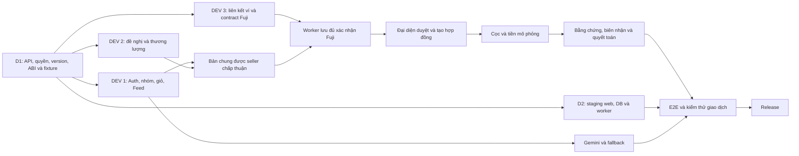

# Kế hoạch phát triển OOPS trong 7 ngày

## 1. Executive Summary — Tổng quan đồ án

**Mục tiêu đến cuối ngày 7 là bàn giao một bản OOPS chạy được trên môi trường demo, có giao dịch xác nhận thật trên Avalanche Fuji và có thể chạy lại từ dữ liệu mẫu.** Kịch bản chính đi từ giỏ nhu yếu phẩm đến đề nghị của người bán, hợp đồng do các hộ gửi, xác nhận trên Fuji, duyệt của đại diện, thu cọc mô phỏng, bàn giao và quyết toán. Slide và video được làm sau 7 ngày phát triển.

Luồng hợp đồng đã chốt với bạn:

1. Người bán chào tối đa 10 chai. Các hộ góp phần muốn mua vào một bản hợp đồng chung, ví dụ 2 + 2 + 3 = 7 chai.
2. Người bán từ chối, yêu cầu sửa hoặc chấp thuận bản 7 chai. Khi cần sửa, các hộ cập nhật và gửi phiên bản mới.
3. Từng hộ có phần hàng xác nhận phiên bản người bán đã chấp thuận trên Fuji. Sau khi đủ xác nhận, đại diện duyệt đúng phiên bản đó.
4. Hợp đồng 7 chai chuyển sang chờ cọc. Tiền hàng và cọc tính theo 7 chai. Phần nhu cầu còn thiếu vẫn có thể nhận đề nghị khác.

**Đánh giá khả thi:** Có thể nhắm tới bản demo 7 ngày nếu nhóm có khoảng **56 giờ mỗi DEV**, chốt interface trong ngày 1, thử thành công Fuji chậm nhất ngày 3 và chạy trọn luồng 0đ trên staging vào ngày 5. Đây là kế hoạch cho bản demo có kiểm thử, với 48 giờ công việc dự kiến và 8 giờ dự phòng mỗi DEV. Hai thay đổi sau khi chốt hợp đồng đã được đồng ý hoãn là đổi giá/lượng trước thu cọc và đổi lịch hai bên.

## 2. Repository & Documentation Audit — Hiện trạng thực tế

| Trạng thái | Phát hiện | Căn cứ |
|---|---|---|
| **VERIFIED** | Khi khảo sát ban đầu, workspace gốc có 5 tài liệu OOPS và thư mục tham khảo. Cấp gốc chưa là Git repository. | [Workspace](D:/HCMUS/AI/Unihack), [yêu cầu](D:/HCMUS/AI/Unihack/requirements.md), [kịch bản demo](D:/HCMUS/AI/Unihack/OOPS-MVP-Plan.md:115) |
| **VERIFIED** | Stack đặc tả gồm Next.js, TypeScript, Tailwind, Supabase Auth/PostgreSQL/Storage, Gemini, Solidity/Viem và Fuji. Schema và API mô tả các bảng, route, định dạng và quy tắc quyền. | [Kiến trúc](D:/HCMUS/AI/Unihack/architecture.md), [schema](D:/HCMUS/AI/Unihack/schema.md), [API](<D:/HCMUS/AI/Unihack/API doc.md>) |
| **MISSING** | Chưa tìm thấy app OOPS, route nghiệp vụ, migration, seed, contract Fuji, worker, CI hay test OOPS. Phần triển khai của các chức năng P0 được ước lượng từ đầu. | Kết quả khảo sát workspace |
| **VERIFIED** | SenpAI là dự án tham khảo có Next.js/Viem, SQLite, auth riêng và token x402. Template ví và mint có thể cung cấp mẫu kết nối ví, gửi giao dịch, đọc receipt và event. | [SenpAI](D:/HCMUS/AI/Unihack/ref/Template_projects/senpai_temp/README.md), [SQLite](D:/HCMUS/AI/Unihack/ref/Template_projects/senpai_temp/web/lib/db.ts:4), [template ví](D:/HCMUS/AI/Unihack/ref/Template_projects/wallet-connect-dapp.zip), [template giao dịch](D:/HCMUS/AI/Unihack/ref/Template_projects/mint-from-the-ui.zip) |
| **ĐÃ ĐỒNG BỘ** | Kiến trúc, schema và API chuyển sang xác nhận theo phiên bản hợp đồng. Các hộ có thể gửi bản với lượng thấp hơn lượng chào. Người bán chấp thuận trước khi các hộ xác nhận và đại diện duyệt cuối. | [Kiến trúc](D:/HCMUS/AI/Unihack/architecture.md#vòng-đời-hợp-đồng), [schema](D:/HCMUS/AI/Unihack/schema.md#đề-nghị-thương-lượng-và-xác-nhận), [API](<D:/HCMUS/AI/Unihack/API doc.md>) |
| **MISSING** | Chưa xác minh các project dịch vụ, quota, ví có AVAX testnet và host worker thực tế. Audit trước đó kiểm tra tĩnh, chưa có kết quả build hay test OOPS. | Điều kiện khởi động ngày 1 |

Tận dụng **đoạn code và mẫu triển khai** từ template ví, mint và SenpAI. Tạo app OOPS mới vì nền SQLite, auth riêng và cấu hình xuất web tĩnh của các template không đáp ứng đường ghi PostgreSQL và API dùng phiên của OOPS. Không tính các test SenpAI hoặc `ref/test_harness` vào chất lượng OOPS.

## 3. Requirement Analysis — Phân tích yêu cầu

| Nhóm | Phạm vi nghiệm thu |
|---|---|
| **FR01 — Tài khoản và nhóm** | Một tài khoản dùng được cả vai trò mua và bán. Tối đa một nhóm hoạt động. Người được mời làm đại diện phải chấp thuận. Người bán và đại diện duyệt cùng hợp đồng phải là hai tài khoản khác nhau. |
| **FR02 — Giỏ, đợt gom, Feed** | Giỏ tay và giỏ Gemini đều qua bước sửa, xác nhận. Đại diện xem tổng giỏ đã xác nhận, đăng sớm để đóng gom. Feed lọc theo khu vực và danh mục, hiển thị hạn cần hàng và lượng còn thiếu. |
| **FR03 — Đề nghị và hợp đồng** | Người bán chào một món với lượng tối đa và giá, gồm giá hỗ trợ và 0đ. Các hộ tạo một bản chung có phần từng hộ, ghi chú và số tiền. Người bán phản hồi. Từng hộ có phần xác nhận trên Fuji. Đại diện duyệt cuối. |
| **FR04 — Cọc, tiền hàng, bàn giao** | Cọc riêng với tiền hàng. Cọc hợp lệ mới chuyển lượng sang đã giữ. Đơn có giá thu theo từng hộ. Hai bên duyệt cùng biên nhận. Giao thiếu ghi lượng thực nhận và hoàn tiền tương ứng. Có trạng thái đơn và thông báo trong app. |

Các bất biến cần kiểm bằng test là giới hạn tồn lượng theo món và theo hộ, một lần áp dụng mỗi sự kiện thu tiền, chỉ tạo một hợp đồng cho bản được chốt, chỉ quyết toán một lần trên cùng biên nhận, và không đọc được thông tin của nhóm hoặc hợp đồng khác. Bằng chứng dùng kho riêng và URL có hạn. Lỗi Gemini phải giữ được dữ liệu đang nhập. Worker phải phục hồi sau khi dừng và tiếp tục từ dữ liệu đã lưu. [Yêu cầu và ca nghiệm thu](D:/HCMUS/AI/Unihack/requirements.md:7) · [Nhất quán dữ liệu và quyền riêng tư](D:/HCMUS/AI/Unihack/architecture.md:71)

## 4. Issues & Assumptions — Vấn đề, giả định và quyết định

| Trạng thái | Quyết định dùng để lập kế hoạch | Việc cần kiểm chứng |
|---|---|---|
| **ĐÃ CHỐT** | Một hợp đồng chung cho các hộ mua. Người bán chấp thuận lượng các hộ đề xuất. **Tất cả hộ có phần dương** xác nhận trên Fuji. Đại diện duyệt cuối. | Dùng đặc tả đã đồng bộ để chốt fixture chung ngày 1. |
| **ĐÃ CHỐT** | Hoãn đổi giá/lượng **sau khi đại diện đã chốt** và đổi lịch hai bên. Vòng yêu cầu sửa **trước khi chốt** vẫn là P0. | Có test cho bản cũ mất hiệu lực khi gửi bản mới. |
| **VERIFIED** | UniHack chấp nhận Fuji và chấm phần Avalanche chạy thực tế. Core Wallet là lựa chọn cho OOPS. | Thu địa chỉ contract, mã giao dịch liên kết ví và mã giao dịch xác nhận của các hộ. [Team1 Vietnam](https://team1vn.xyz/#faq-network) · [Avalanche Fuji](https://docs.avax.network/docs/primary-network) |
| **ASSUMED** | Mỗi DEV có 8 giờ/ngày. DEV 2 có thể chịu trách nhiệm PostgreSQL và DEV 3 có thể chịu trách nhiệm Solidity/Viem. | Đổi người giữ vai trò nếu kiểm tra đầu ngày 1 cho thấy kinh nghiệm thực tế khác giả định. |
| **ASSUMED** | Mỗi đề nghị có một bản thương lượng đang hoạt động. Hộ khởi tạo bấm gửi bản chung và mỗi hộ sửa dòng của mình khi bản ở trạng thái cho phép. | Chốt quyền sửa và gửi trên fixture nhiều hộ trong ngày 1. |
| **ASSUMED** | Hạn demo dùng cấu hình riêng. Khi còn vòng xác nhận hoặc hợp đồng đang chạy, demo khóa thao tác rời nhóm hoặc đổi ví có ảnh hưởng. | Đo thời gian xác nhận Fuji và đặt hạn demo phù hợp. |
| **MISSING** | Chưa có định mức nhu yếu phẩm có nguồn. | Seed một số SKU đại diện. Gemini trích thông tin người dùng cung cấp, đánh dấu dữ liệu thiếu để hộ nhập tiếp. |
| **MISSING** | Chưa có quyền và API giải quyết tranh chấp cọc. | Demo giữ cọc ở `NEEDS_REVIEW` khi chưa có kết quả. Tiền hàng đã xác định được xử lý theo biên nhận. |

## 5. MVP Scope — Phạm vi cần hoàn thành

| Ưu tiên | Chức năng và giá trị | Độ khó, phụ thuộc và rủi ro | Nghiệm thu |
|---|---|---|---|
| **P0** | Tài khoản, nhóm, link mời và chấp thuận vai trò đại diện | Trung bình. Phụ thuộc Auth và ràng buộc nhóm hoạt động. | Hai hộ vào được nhóm. Không vào đồng thời nhóm thứ hai. Đại diện mới chỉ nhận vai trò sau khi chấp thuận. |
| **P0** | Giỏ tay, giỏ Gemini, đóng gom và Feed | Trung bình. Phụ thuộc SKU, phiên bản giỏ và giao dịch chụp nhu cầu. | Chỉ cộng giỏ xác nhận. Đăng sớm đóng gom. Feed khớp tổng và ẩn thông tin riêng. Gemini lỗi vẫn sửa được giỏ. |
| **P0** | Đề nghị, hợp đồng chung và vòng yêu cầu sửa | Cao. Phụ thuộc `demandItemId`, quyền theo nhóm và phiên bản. | Chào 10, các hộ gửi bản 7, người bán có đủ ba lựa chọn. Người đại diện không thể duyệt nhầm bản cũ. |
| **P0** | Liên kết ví và xác nhận từng hộ trên Fuji | Cao. Phụ thuộc Core Wallet, Fuji RPC, AVAX testnet và hợp đồng thông minh. | Ví liên kết thành công có giao dịch tra được. Ví ngoài danh sách bị từ chối. Thiếu một xác nhận thì đại diện chưa duyệt được. |
| **P0** | Duyệt cuối, cọc, đơn 0đ và đơn có giá | Cao. Phụ thuộc kết quả Fuji và transaction PostgreSQL. | Duyệt cuối chỉ tạo một hợp đồng. Cọc hợp lệ mới chuyển `pending` sang `reserved`. Đơn 0đ không tạo khoản tiền hàng. |
| **P0** | Bàn giao, giao thiếu, hủy và xử lý quá hạn | Cao. Phụ thuộc Storage, biên nhận, sổ tiền và worker. | Hai bên duyệt đúng bản. Giao thiếu mở lại nhu cầu và hoàn phần dư. Chỉ một bên duyệt đến hạn thì chuyển `NEEDS_REVIEW`. Hủy áp đúng quyền và điều kiện. |
| **P0** | Theo dõi đơn, thông báo trong app và triển khai | Trung bình. Phụ thuộc toàn bộ luồng và khả năng phục hồi worker. | Người dùng xem được phần hàng, khoản tiền và trạng thái liên quan. Staging có seed và kiểm thử lại được. |
| **P1** | Cải thiện màn chờ ví, trạng thái rỗng, thông báo lỗi và hiển thị trên nhiều kích thước màn hình | Thấp đến trung bình. Làm sau khi luồng P0 đã ổn định. | Người thử mới tự hoàn thành luồng với ít hướng dẫn hơn. |
| **P2** | Đổi giá/lượng sau khi chốt, đổi lịch, QR/payOS thật, phân xử cọc và vận hành tiền thật | Cao. Cần đặc tả và năng lực vận hành riêng. | Đưa vào backlog sau demo, với tiêu chí nghiệm thu riêng. |

## 6. Architecture & Technical Decisions — Kiến trúc và công nghệ

**Một codebase Next.js có web, API và module nghiệp vụ.** Supabase cung cấp Auth, PostgreSQL và Storage. Một worker chạy riêng từ cùng codebase để gửi lệnh mở vòng xác nhận, đọc log Fuji, chạy hạn và phát thông báo. Gemini chỉ phục vụ giỏ nháp. Tiền đi qua adapter `SIM`. UI dùng Next.js/Tailwind và lấy dữ liệu từ API `/api/v1`.

**Ranh giới dữ liệu và ghi nghiệp vụ**

- **Nhu cầu:** Giữ `demand_items` và `demand_shares`. Khi chụp nhu cầu, chỉ lấy giỏ đã xác nhận. Luôn giữ `pending + reserved + received ≤ target` cho món và từng hộ. Feed dùng `missing = target − reserved − received`. Lượng còn có thể chốt dùng `offerable = missing − pending`.
- **Thương lượng:** Một đề nghị có một hồ sơ thương lượng. Hộ khởi tạo gửi bản chung, mỗi hộ chỉ sửa dòng của mình khi nháp mở. Bản gửi chụp số lượng, đơn giá, lịch giao, ghi chú, phần từng hộ và tổng tiền. Các điều khoản trong bản đã gửi bất biến. Phiên bản mới cần người bán chấp thuận và tất cả hộ có phần dương xác nhận lại. [Trạng thái và thời hạn](D:/HCMUS/AI/Unihack/architecture.md#trạng-thái-thương-lượng-và-thời-hạn)
- **Fuji:** Mỗi phiên bản có tối đa một vòng xác nhận. Đề nghị có thể có nhiều vòng qua các phiên bản. DB lưu tập hộ, ví và xác nhận theo vòng, cùng cursor đồng bộ. On-chain dùng mã vòng, mã băm, ví và sự kiện xác nhận. Thông tin liên hệ, ghi chú, ảnh và dữ liệu VND ở PostgreSQL/Storage.
- **Đơn và sổ tiền:** Giữ `contracts`, `allocations`, `charges`, `fund_events`, `disbursements`, biên nhận, bằng chứng, thông báo, audit và outbox. Tạo dòng giữ tạm khi đại diện duyệt cuối. Dòng giữ tạm chỉ thành đã giữ sau cọc. Dùng VND số nguyên và tính cọc theo `max(50.000đ, ceil(tiền hàng / 10))`. [Quy tắc dữ liệu](D:/HCMUS/AI/Unihack/schema.md:51)

Chia migration theo phụ thuộc `nền tài khoản/nhóm/nhu cầu → thương lượng → xác nhận → đơn/sổ tiền/bàn giao → worker và policy`. DEV 1, DEV 2 và DEV 3 sở hữu các file SQL theo module. **DEV 2 giữ thứ tự migration và hợp đồng transaction.** Thao tác chốt, thu, hết hạn, hủy và áp biên nhận đi qua các hàm transaction PostgreSQL. Hàm ghi kiểm tra actor, trạng thái, phiên bản và lượng dưới khóa. Route nhận lặp trả lại kết quả đã có, còn cùng khóa với dữ liệu khác trả `409`. Thay đổi nghiệp vụ và outbox được ghi cùng transaction. [Thứ tự khóa](D:/HCMUS/AI/Unihack/architecture.md:73)

**Hợp đồng API chốt ngày 1**

Các route dưới đây là tên dự kiến. Cùng một schema TypeScript/Zod, ví dụ request/response và fixture lỗi được bàn giao cho cả ba DEV trước khi code song song.

| API hoặc bàn giao | Dữ liệu chính | Điều kiện cần cố định |
|---|---|---|
| Giỏ, đợt gom và Feed | `campaignId`, `demandItemId`, `target`, `missing`, `offerable`, `version` | ID món ổn định sau publish. Lượng và đơn vị theo SKU. |
| `POST /needs/{id}/offers` | `proposalId`, lượng tối đa, giá, điều kiện giao, hạn | Người bán chào tối đa 10. Bản hộ gửi có thể là 7. |
| Nháp theo đề nghị, sửa phần của hộ, gửi bản chung | `draftId`, `version`, `lines`, `qty`, `unitPriceVnd`, `totalVnd`, `note` | Mỗi hộ chỉ sửa phần của mình. Server tính tổng và kiểm tra hạn mức. |
| Phản hồi của người bán | `version`, `APPROVE`, `REJECT` hoặc `REQUEST_CHANGES`, ghi chú | Khi chấp thuận, mọi hộ có phần dương phải có ví đã xác minh và đủ điều kiện. Nếu thiếu, trả `409 WALLET_NOT_READY`, giữ bản chờ phản hồi. Nếu đủ, chụp danh sách đầy đủ và đưa yêu cầu mở vòng vào outbox. |
| Liên kết ví và vòng xác nhận | `walletAddress`, `proofTx`, `roundId`, `roundKey`, `versionHash`, `expiresAt` | Ví ký trên Fuji. Worker kiểm chain, địa chỉ contract, vòng, ví và phiên bản. |
| Đại diện duyệt | `draftId`, `version`, `Idempotency-Key` → `contractId`, `AWAIT_DEPOSIT` | Kiểm quyền, hạn, đúng bản seller đã chấp thuận và xác nhận của từng hộ dưới khóa. Nếu thiếu lượng, ghi `STOCK_CONFLICT`, thông báo rồi trả `409`; giữ nguyên các phần đã xác nhận trong lịch sử. |
| Thu SIM, bằng chứng, biên nhận, chi/hoàn | `contractId`, `chargeId`, `receiptId`, `receiptVersion`, `disbursementId`, `transferRef` | Hai bên duyệt cùng biên nhận. Tài khoản vận hành ghi `POSTED` bằng mã SIM duy nhất. Chuyển đơn `SETTLING` sang `COMPLETED` khi mọi khoản chi/hoàn của đơn đã `POSTED`. |

**Xác thực và phân quyền.** Supabase Auth quản lý phiên. API, hàm transaction và RLS bảo vệ dữ liệu theo vai. Server xác minh challenge Fuji có nonce dùng một lần. Tài khoản vận hành cấp hoặc thu hồi token testnet không chuyển nhượng và có quyền đối soát riêng. Tập hộ cần xác nhận lấy từ toàn bộ dòng có lượng dương của phiên bản đã gửi. Mỗi hộ phải có đúng một ví đã liên kết, đã xác minh, đủ quyền và khác ví của các hộ khác trong vòng. Mỗi ví chỉ xác nhận một lần trên đúng phiên bản. Duyệt cuối kiểm đủ từng hộ, bản còn hiệu lực và hạn chưa qua.

**Môi trường.** Local dùng fixture, Postgres/Supabase dev và chain local khi sẵn sàng. Staging dùng Supabase và bucket riêng, Next.js chạy server, worker khởi động lại được. Dựng môi trường tối thiểu trước cuối ngày 2. Fuji thật là cổng nghiệm thu. Fixture chạy ở dev/test. Nếu RPC lỗi, UI giữ trạng thái chờ và worker tiếp tục từ cursor khi RPC phục hồi. Nếu Gemini lỗi, hộ tiếp tục bằng giỏ tay. Seed và reset chỉ tác động dữ liệu demo.

## 7. Team Responsibilities — Phân chia trách nhiệm

| Người | Sở hữu | Bàn giao chính | Người review |
|---|---|---|---|
| **DEV 1** | Nền web, Auth, nhóm, giỏ, đợt gom, Feed, Gemini và giao diện các luồng nghiệp vụ. Giữ schema API chung và fixture. | Phiên người dùng, `demandItemId`, giao diện gửi và duyệt hợp đồng, kịch bản E2E. | DEV 2 review quyền và dữ liệu. DEV 3 review phần gắn UI với ví. |
| **DEV 2** | Thương lượng, duyệt cuối, transaction lượng và tiền, thu SIM, biên nhận, Storage và quyết toán. Giữ thứ tự migration. | `proposalId`, `draftId/version`, `contractId` và các hàm giao dịch để worker gọi. | DEV 1 review API/UX. DEV 3 review biên giữa contract Fuji và transaction chốt. |
| **DEV 3** | Core Wallet, credential, contract xác nhận, indexer, tác vụ hết hạn, thông báo và staging. | Ví verified, `roundId`, xác nhận Fuji đã lưu, log worker và cấu hình release. | DEV 2 review quyền, ABI, chống ghi lặp và xử lý khi worker dừng. |

**Cân tải có chủ đích:** DEV 2 viết nghiệp vụ giao dịch. DEV 1 làm giao diện thương lượng, đơn và bàn giao từ fixture. DEV 3 viết việc chạy deadline, gọi các hàm nghiệp vụ do DEV 2 bàn giao và hiển thị phần ký ví. DEV 2 không phải chờ giao diện mới kiểm thử được luồng.

## 8. Task Breakdown — Danh sách task chi tiết

Đường dẫn trong bảng là **module dự kiến** dưới `D:\HCMUS\AI\Unihack`. Effort gồm viết, review, debug và ghép phần liên quan. Cột cuối ghi nghiệm thu và cách kiểm. Một issue chỉ đạt DoD khi có bằng chứng đó và qua cổng chung ở mục 13.

| ID · Task | Ưu tiên · DEV · Giờ | Dependency | Module dự kiến | Input → Output và hướng dẫn cho agent | Acceptance criteria · Kiểm thử |
|---|---|---|---|---|---|
| **A01 · Nền app và schema chung** | P0 · 1 · 7h | Quyết định đầu D1 | `app/`, `src/contracts/`, `tests/fixtures/`, `docs/` | Từ đặc tả đã duyệt, tạo app shell, schema và mock chung. Chốt kiểu lỗi, quyền, thời gian và prefix. | Build nền chạy. Fixture xuyên suốt từ `demandItemId` đến `receiptId`. Mỗi DEV đọc được cùng một ví dụ. |
| **A02 · Auth, nhóm và mời** | P0 · 1 · 7h | A01, B01 | `src/auth/`, `src/groups/`, `app/api/v1/groups/` | Phiên Supabase → profile, nhóm, vai trò, link mời dùng một lần. | Kiểm hai nhóm, mời hết hạn, nhận quyền đại diện, truy cập chéo nhóm. |
| **A03 · Giỏ tay, đợt gom, Feed** | P0 · 1 · 9h | A02 | `src/campaigns/`, `src/cart/`, `src/feed/` | SKU và giỏ có version → snapshot giỏ xác nhận, `demandItemId`, Feed. | Kiểm tổng 12 chai, giỏ chưa xác nhận, hết hạn, đăng sớm, đầu vào âm và trường riêng tư. |
| **A04 · Giao diện thương lượng và đơn** | P0 · 1 · 10h | A01 mock, tích hợp theo lát B02–B05, C03/C04 | `app/offers/`, `app/orders/`, `app/ops/`, `src/components/orders/` | Fixture nhiều vai → form chào, góp phần, gửi bản, seller phản hồi, xác nhận Fuji, đại diện duyệt, thu SIM và biên nhận. Thêm màn tối thiểu cho ops xem và ghi khoản chi/hoàn. | Test hộ, seller, đại diện và ops. Hiển thị đúng bản, hạn, lý do bị chặn và trạng thái chi/hoàn. Hộ không được ghi khoản chi. |
| **A05 · Giỏ Gemini** | P0 · 1 · 6h | A03, Gemini key | `src/cart/ai/`, `app/api/v1/campaigns/` | Mô tả hộ và SKU → giỏ nháp đúng schema, trường chưa rõ để hộ sửa. | Kiểm JSON sai, timeout, SKU mơ hồ và luồng nhập tay. Có một lần chạy bằng Gemini thật trên staging. |
| **A06 · E2E và dữ liệu demo** | P0 · 1 · 9h | C06a để có staging; A03–A05, B05, C04/C05 cho cổng cuối | `tests/e2e/`, `tests/fixtures/`, `docs/runbook-demo.md` | Seed tài khoản và dữ liệu → smoke 0đ, có giá, giao thiếu, hết hạn và quyết toán SIM. Chuẩn bị fixture song song trước cổng cuối. | Có kết quả E2E từ dữ liệu reset được. Luồng giao đủ, đúng hạn kết thúc ở `COMPLETED`. Người khác chạy lại được từ runbook. |
| **B01 · Nền PostgreSQL và bất biến** | P0 · 2 · 7h | Quyết định đầu D1 | `supabase/migrations/`, `src/db/`, `tests/db/` | Schema cập nhật → thứ tự migration, quyền ghi và khóa. Thay cấu trúc vote cũ bằng hồ sơ, bản bất biến, vòng theo phiên bản và xác nhận theo hộ. | DB dev khởi tạo được. Chốt khóa duy nhất cho phiên bản, vòng và hợp đồng. Kiểm lượng, VND số nguyên và quyền ghi. |
| **B02 · API đề nghị và thương lượng** | P0 · 2 · 10h | B01, A01, fixture `demandItemId` | `src/offers/`, `src/negotiation/`, `app/api/v1/offers/` | Đề nghị 10 → bản 7, seller phản hồi, chụp đủ hộ và ví khi approve. Bàn giao hàm hết hạn cho C05. | Kiểm sửa đúng vai, reject, yêu cầu sửa, gửi lại phiên bản, thiếu ví, hết hạn phản hồi và không còn đủ thời gian giao. |
| **B03 · Duyệt cuối và giữ lượng** | P0 · 2 · 6h | B02, interface xác nhận chốt ở D1 | `src/orders/finalize/`, migration đơn | Bản còn hiệu lực và đủ xác nhận từng hộ → một hợp đồng, `pending` và khoản cọc trong cùng transaction. | Thiếu hộ, sai version hoặc hết hạn bị chặn. Hai lần duyệt chỉ tạo một đơn. Thiếu lượng lưu `STOCK_CONFLICT`, không đổi phần và không vượt target. |
| **B04 · Thu SIM, hết hạn cọc/tiền** | P0 · 2 · 6h | B03 | `src/payments/`, `src/orders/expiry/`, `app/api/v1/demo/` | Khoản cọc/tiền → fund event, chuyển trạng thái, hoàn các khoản đã thu khi đủ điều kiện. | Kiểm đơn 0đ, đơn nhiều hộ có giá, gửi lặp, mã giao dịch thứ hai và tiền đến trễ. |
| **B05 · Bàn giao, biên nhận, quyết toán** | P0 · 2 · 11h | B04, Supabase Storage | `src/handoff/`, `src/settlement/`, `app/api/v1/ops/`, migration Storage | Bằng chứng và lượng nhận → biên nhận có version, duyệt hai bên, ghi lượng, lập khoản chi/hoàn. Ops ghi `POSTED` bằng mã SIM và cập nhật trạng thái đơn trong transaction. | Kiểm giao đủ và hoàn tất, giao thiếu, ảnh sai quyền, một bên duyệt, hủy và cọc cần xử lý. Gửi lại cùng mã chỉ ghi một lần, trùng mã ở khoản khác trả 409. |
| **B06 · Kiểm tra transaction và sửa lỗi** | P0 · 2 · 8h | B02–B05; C05 cho ca worker | `tests/db/`, `tests/integration/` | Fixture và lỗi staging → kiểm cạnh tranh, idempotency, ledger. Chạy ca DB trước, ghép deadline khi C05 có kết quả. | Có bằng chứng đối soát. Hai yêu cầu đồng thời không ghi tiền, tạo đơn hoặc giải phóng hàng hai lần. |
| **C01 · Chuẩn bị Fuji và môi trường** | P0 · 3 · 4h | Quyết định đầu D1 | `contracts/`, `docs/deploy/`, `.env.example` | Công cụ, ví testnet, AVAX, quyền host và RPC → ABI dự kiến, cấu hình và người xử lý từng trở ngại. | Core kết nối Fuji, ví có test AVAX hoặc đã ghi trở ngại cụ thể. Kiểm quyền Supabase, Gemini và host cùng các owner. |
| **C02 · Contract credential và xác nhận** | P0 · 3 · 9h | C01, schema ABI ngày 1 | `contracts/src/`, `contracts/test/` | Ví được cấp quyền và digest phiên bản → proof và sự kiện xác nhận Fuji. | Kiểm ví ngoài tập, xác nhận lặp, sai vòng, hết hạn. Có địa chỉ deploy và một giao dịch thành công trên Fuji. |
| **C03 · Liên kết ví và component ký** | P0 · 3 · 8h | C02 ABI, A01/A02 | `src/wallet/`, `app/api/v1/wallet/`, `src/components/wallet/` | Phiên + challenge → verified wallet, chọn Fuji, ký, hiển thị receipt/chờ đồng bộ. | Core ký được. Sai mạng, sai challenge và dùng lại nonce bị chặn. Component ghép được vào A04 qua props đã chốt. |
| **C04 · Mở vòng và đồng bộ Fuji** | P0 · 3 · 10h | B02, C02, interface xác nhận chốt ở D1 | `src/chain/`, `src/worker/chain/` | Tập ví đầy đủ của bản seller đã duyệt → mở vòng theo version và lưu xác nhận Fuji. Vòng khác và sự kiện đến sau cutoff không mở quyền duyệt. | Ví chưa sẵn sàng không tạo snapshot thiếu hộ. Restart không mất cursor. Log lặp không tăng số xác nhận. Bản 3 hộ chỉ sẵn sàng khi đủ cả 3. |
| **C05 · Job hạn và thông báo** | P0 · 3 · 7h | C04, hàm B02/B04/B05 | `src/worker/jobs/`, `src/notifications/` | Outbox và deadline → xử lý hạn seller, xác nhận Fuji, đại diện duyệt, cọc, tiền và bàn giao. Gửi thông báo đến đúng vai. | Clock giả kiểm từng hạn, bản cũ hết hiệu lực và tạo lại phiên bản hợp lệ. Retry không gửi trùng. Chỉ chủ thông báo xem được. |
| **C06a · Dựng staging sớm** | P0 · 3 · 4h | C01, app shell A01, kết nối dev B01 | `docs/deploy/`, cấu hình host, health | App shell và cấu hình → staging có URL, health kết nối DB và worker chạy được. | Cuối D2, có deploy theo SHA, DB/Storage staging và log khởi động worker. D4 dùng môi trường này để ghép luồng. |
| **C06b · Release và phục hồi** | P0 · 3 · 6h | C06a, A06/B06 qua cổng kiểm thử, C04/C05 | `.github/workflows/`, `docs/deploy/`, cấu hình host | Candidate và bằng chứng kiểm thử → kiểm CI, release theo SHA, smoke Fuji và hướng dẫn phục hồi. Chuẩn bị song song, chỉ chốt release sau cổng kiểm thử. | Deploy từ SHA đã duyệt, worker restart và chạy lại được ca Fuji từ seed. Có SHA phục hồi và checklist dữ liệu tương thích migration. |

**Prompt giao trực tiếp cho AI Coding Agent**

- **A03:** “Triển khai giỏ, publish đợt và Feed theo schema đã duyệt. Dùng fixture 12 chai. Chụp các giỏ đã xác nhận trong cùng transaction đóng gom. Kiểm sửa sau hạn, hai giá trị `missing`/`offerable` và dữ liệu riêng tư. Chỉ chỉnh module giỏ, đợt gom và Feed.”
- **B02:** “Triển khai hồ sơ thương lượng và bản gửi bất biến cho ca chào 10, hộ góp 2+2+3. Seller được chấp thuận, từ chối hoặc yêu cầu sửa. Khi chấp thuận, kiểm tất cả hộ có phần có ví hợp lệ rồi chụp đủ danh sách. Giao fixture thiếu ví, hết hạn và gửi lại bản mới cho DEV 1 và DEV 3.”
- **B03:** “Triển khai transaction đại diện duyệt bản cuối. Kiểm seller đã chấp thuận đúng version, tất cả hộ có phần đã xác nhận Fuji và còn đủ lượng. Tạo đúng một hợp đồng, `pending` và khoản cọc. Viết test hai lần duyệt đồng thời và bản hết hạn.”
- **B05:** “Áp biên nhận theo từng allocation khi seller và đại diện duyệt cùng version. Lập chi/hoàn đúng một lần. Cung cấp thao tác ops ghi POSTED theo mã SIM và hoàn tất đơn đủ điều kiện trong transaction. Kiểm giao 6/8 chai, gửi lặp, sai quyền và một bên duyệt quá hạn.”
- **C02/C04:** “Triển khai vòng xác nhận theo `roundKey` và `versionHash` đã thống nhất. Chỉ ví trong snapshot được xác nhận một lần. Indexer xác thực chain, contract, event và version, lưu cursor bền vững. Bàn giao mẫu giao dịch Fuji, test replay log và restart.”
- **A05:** “Dùng Gemini để trích SKU, số lượng và đơn vị sang giỏ nháp. Validate bằng Zod. Đánh dấu trường không rõ. Giữ đường nhập tay khi lỗi hoặc thiếu key. Kiểm một fixture mô tả có đơn vị mơ hồ.”

## 9. Dependency Map — Sơ đồ phụ thuộc và critical path

**Critical path thực tế** đi qua việc hợp nhất ba phần tại **bản hợp đồng đúng phiên bản**, sau đó qua transaction duyệt cuối, cọc và biên nhận. Trong lúc chờ `demandItemId` thật, B02 dùng fixture. C02 và C03 dùng fixture bản 7 chai trước khi B02 xong. A04 dùng mock từ ngày 1. B03/B04/B05 có thể kiểm bằng xác nhận giả lập trong test, còn cổng staging ngày 5 cần Fuji thật.

## 10. Seven-Day Execution Plan — Kế hoạch 7 ngày

Mỗi DEV có **7 giờ đã phân việc/ngày từ ngày 1 đến ngày 6**, cộng **6 giờ ngày 7**. Phần còn lại là 1 giờ/ngày trong sáu ngày đầu và 2 giờ ngày 7. Dùng giờ dự phòng theo tình trạng tích hợp, ưu tiên DEV đang giữ điểm nghẽn.

| Ngày | DEV 1 | DEV 2 | DEV 3 | Dependency | Deliverable |
|---|---|---|---|---|---|
| **DAY 1** | **A01 7h** · app shell, schema, fixture | **B01 7h** · nền DB, khóa, migration, quyền | **C01 4h → C06a 3h** · kiểm Fuji và chuẩn bị host | Chốt state, deadline, DTO và ABI trước khi tách | Build nền, fixture 12 chai và 10→7, cấu hình staging sẵn để deploy |
| **DAY 2** | **A02 7h** · auth, nhóm, mời | **B02 7h** · đề nghị và draft trên fixture | **C06a 1h → C02 6h** · deploy nền và làm contract | A01/B01. B02 dùng `demandItemId` fixture | Đăng nhập và vào nhóm, gửi được draft, có staging URL/DB/health/worker. Contract có test local |
| **DAY 3** | **A03 7h** · giỏ, publish, Feed | **B02 3h → B03 4h** · phản hồi seller và duyệt cuối qua fixture | **C02 3h → C03 4h** · deploy Fuji và ghép ví | B02 + ABI. B03 dùng fixture xác nhận | Có `demandItemId` thật, ca 10→7 qua API và một xác nhận thật trên Fuji |
| **DAY 4** | **A03 2h → A04 5h** · Feed và UI hợp đồng | **B03 2h → B04 5h** · chốt, cọc và đường thu SIM chính | **C03 4h → C04 3h** · nối ví và mở vòng từ app | Staging D2 và chuỗi `demandItemId → proposalId → draftId/version → roundId` | Bản đã chấp thuận mở được vòng. Tạo đơn và thu cọc SIM chạy với fixture xác nhận |
| **DAY 5** | **A04 5h → A05 2h** · bàn giao, ops tối thiểu và bắt đầu Gemini | **B04 1h → B05 6h** · kiểm thu SIM, ghép nhánh giao đủ và ops | **C04 7h** · nối indexer thật, ghép luồng trên staging | Fuji + DB + Storage + staging | **Ca 0đ từ xác nhận Fuji đến hoàn cọc `POSTED` và `COMPLETED`.** Ca có giá đi ít nhất tới thu đủ |
| **DAY 6** | **A05 4h → A06 3h** · Gemini, E2E và reset | **B05 5h → B06 2h** · giao thiếu, hủy, đối soát và test DB | **C05 7h** · hạn trước/sau chốt và thông báo | Ca 0đ từ D5. C05 dùng hàm nghiệp vụ đã thống nhất | Ca có giá, giao thiếu, một bên duyệt, hết hạn xác nhận, tiền lặp và lỗi Gemini có bằng chứng. Đóng phạm vi |
| **DAY 7** | **A06 6h** · kiểm thử lại, viewport điện thoại và runbook | **B06 6h** · đối soát, sửa lỗi P0 và regression | **C06b 6h** · CI, smoke Fuji, phục hồi và release | Chuẩn bị song song. Chốt SHA release sau cổng A06/B06 | Bản staging theo Git SHA, kết quả test và hướng dẫn demo |

**Mốc review và nghiệm thu mỗi ngày**

| Ngày | Mục tiêu và việc chạy song song | Review thủ công và checkpoint | Rủi ro nếu chưa đạt |
|---|---|---|---|
| **1** | Chốt API và fixture trước. Sau đó chia app, DB và Fuji thành ba nhánh độc lập. | Cả nhóm đi qua 10→7 và lỗi bản cũ. Kiểm Auth, DB, AVAX, RPC, Gemini key và nơi chạy worker. | Chưa có người giữ SQL hoặc Fuji, thiếu quyền môi trường hoặc chưa chạy được công cụ. Chuyển ngay sang người/máy có thể chạy. |
| **2** | Auth/nhóm và draft chạy song song với staging và Solidity. | Kiểm quyền hộ, quyền seller và ví ngoài snapshot. Xác nhận staging URL trả health, DB kết nối được và worker có log khởi động. | Lỗi auth chặn fixture, host thiếu quyền hoặc ABI thay đổi. |
| **3** | Có dữ liệu nhu cầu thật và giao dịch Fuji thật. | Xem mã giao dịch trên explorer. Review trường giá/lượng và quyết định khi bản hết hạn. | Nếu Fuji chưa thành công, DEV 3 dùng giờ dự phòng cho lỗi đó. Hai DEV còn lại tiếp tục qua fixture. |
| **4** | Ghép chuỗi ID đến `roundId` và thu cọc. | Trên staging đã dựng D2, kiểm seller yêu cầu sửa, bản cũ và hai đề nghị cạnh tranh. | Snapshot lệch schema hoặc môi trường staging lệch cấu hình Fuji/Storage. |
| **5** | Đóng ca 0đ từ app đến sổ tiền. Gemini bắt đầu song song. | Kiểm từng hộ ký, đại diện duyệt, cọc 50.000đ, ảnh và biên nhận. Ops ghi hoàn cọc `POSTED`, đơn thành `COMPLETED`. | Nếu ca 0đ còn hở, chuyển người hỗ trợ ngay tại bước lỗi. |
| **6** | Chứng minh đơn có giá, giao thiếu và nhánh lỗi. | Đối soát từng khoản, thử hai request đồng thời và restart worker. Kiểm tra quyền đọc ảnh/đơn. | Nếu còn lỗi lệch lượng, tiền hoặc quyền, dùng ngày 7 để sửa lỗi P0 trước release. |
| **7** | Bàn giao phiên bản ổn định. | Chạy lại từ seed, trên môi trường staging, với Core Wallet thật. Đối chiếu Git SHA, ABI, địa chỉ contract và kết quả smoke. | Khi candidate lỗi, quay về bản staging gần nhất đã qua cổng tương ứng và công bố cụ thể ca còn thiếu. |

## 11. Parallel AI Coding Workflow — Cách phối hợp 3 agent

Mỗi agent nhận một issue gồm phiên bản schema, fixture, module được phép sửa, test cần chạy và tiêu chí hoàn thành. Đầu ngày, ba DEV cập nhật một bảng bàn giao ngắn gồm SHA, trạng thái API, sample payload và việc đang chặn người khác. Cuối ngày, người nhận chạy ít nhất một fixture qua phần được bàn giao.

- **Agent 1** chỉnh app shell, màn hình, Auth, nhóm, giỏ, Feed, Gemini và fixture. Với API chưa sẵn sàng, dùng đúng mock chung và ghi rõ khi chuyển sang route thật.
- **Agent 2** chỉnh nghiệp vụ thương lượng, chốt, sổ tiền và bàn giao. Mọi đường ghi lượng hoặc tiền dùng transaction đã thống nhất. Agent không mở thêm đường ghi trực tiếp từ UI.
- **Agent 3** chỉnh Solidity, ABI, ví, indexer, jobs, notifications và cấu hình staging. Component ký nhận `roundId`/version từ UI, còn kết quả được đối chiếu bằng event Fuji.
- **File dùng chung** có owner rõ. DEV 1 giữ schema API và lockfile web, DEV 2 giữ thứ tự migration và enum nghiệp vụ, DEV 3 giữ ABI và deployment manifest. Đổi interface đi qua một PR cập nhật schema, fixture và caller liên quan.

DEV đọc diff và chạy ca chấp nhận trước khi gửi review. Người thật phải duyệt thay đổi quyền, migration, ABI, chuyển trạng thái, tiền/giữ lượng và release. Nếu agent đưa ra thiết kế không tương thích, dùng schema và test của issue để chỉ rõ khác biệt, yêu cầu sửa phần lệch trong PR hiện tại. Nếu cần đổi kiến trúc, owner đưa quyết định ra cả nhóm trước khi sửa caller.

## 12. Git & Integration Strategy — Quy trình tích hợp

Dùng một repository OOPS với `main` luôn build được. Nhánh ngắn theo `feat/A03-cart-feed`, `feat/B03-finalize` hoặc `fix/C04-indexer-cursor`. Một PR giải quyết một issue hoặc một lát nhỏ có thể review. Mỗi PR ghi hành vi, dependency, migration hoặc ABI thay đổi, cách test và bằng chứng nghiệm thu.

- Ba DEV trên máy riêng dùng checkout thông thường. Dùng **Git worktree** khi một DEV chạy nhiều phiên agent hoặc cần giữ riêng nhánh đang kiểm thử với nhánh đang sửa. Mỗi worktree có port và môi trường dev riêng.
- Đồng bộ từ `main` đầu ngày và trước checkpoint. PR giao diện có thể merge với fixture nếu fixture chỉ bật ở dev/test và không làm hỏng luồng chạy thật.
- Ít nhất một DEV khác review PR P0. Owner phải review khi PR chạm vào file dùng chung. Merge bằng squash sau khi qua cổng chất lượng.
- Nếu xung đột API hoặc migration, owner xử lý schema trước. Các nhánh phụ cập nhật theo schema đã merge và chạy lại test liên quan. Với migration đã áp lên staging, dùng migration bổ sung để sửa.
- Tích hợp tối thiểu một lần mỗi ngày. Sau khi D6 đạt cổng P0, giới hạn thay đổi vào lỗi chặn release và giữ SHA staging đã chạy qua kiểm thử để phục hồi.

## 13. Testing & Definition of Done — Tiêu chí chất lượng

**DoD áp dụng cho mỗi task:** mergeable trên `main`, build và typecheck qua, lint qua nếu đã cấu hình, test liên quan qua, DTO/migration/ABI khớp caller, không có secret trong diff hoặc log, reviewer đã xem phần có ảnh hưởng và PR kèm bằng chứng nghiệm thu. Task còn dùng fixture ở điểm cần dữ liệu thật chưa đạt DoD tích hợp.

| Gate | Ca kiểm bắt buộc |
|---|---|
| **Nghiệp vụ và UI** | Ca chào 10, gửi 7 với phần 2+2+3. Seller yêu cầu sửa rồi chấp thuận bản mới. Kiểm hết hạn seller, thiếu xác nhận và đại diện không duyệt đúng hạn. Khi thiếu lượng lúc chốt, lưu xung đột và chỉ gửi bản mới nếu đề nghị còn hiệu lực. |
| **Fuji** | Một trong ba hộ chưa có ví thì chưa mở vòng. Khi cả ba có ví, cần đủ ba xác nhận đúng version. Kiểm log lặp, sai vòng, bản hết hạn và restart worker. Có mã giao dịch thật trên explorer. |
| **Tồn lượng** | Nhu cầu 12 chai, đơn 8 chai chờ cọc vẫn còn `missing = 12`, `offerable = 4`. Sau cọc còn thiếu 4. Khi hai bên duyệt nhận 6, còn thiếu 6. Hai yêu cầu chốt đồng thời không vượt target. |
| **Tiền mô phỏng** | Đơn 0đ có cọc 50.000đ. Đơn 8 × 2.000đ thu 16.000đ riêng. Nhận 6 chai thì chi 12.000đ và hoàn 4.000đ. Gửi lại, nộp thêm và tiền đến trễ chỉ áp một lần. Ops ghi `POSTED` bằng mã SIM duy nhất. Ca giao đủ, đúng hạn đạt `COMPLETED` sau khi ghi đủ chi/hoàn. |
| **Bàn giao và hạn** | Chưa đủ tiền bị chặn lập biên nhận. Hai bên duyệt cùng version. Chỉ một bên duyệt quá hạn chuyển `NEEDS_REVIEW`. Hủy trực tiếp sau bằng chứng bị chặn. Cọc tranh chấp giữ riêng khỏi tiền hàng đã xác định. |
| **Quyền riêng tư và phục hồi** | Kiểm truy cập chéo nhóm, URL ảnh có hạn, quyền vận hành riêng, Gemini lỗi vẫn nhập tay, staging chạy lại được từ seed và worker khởi động lại không mất việc. |

## 14. Risks & Contingency Plans — Rủi ro và dự phòng

| Rủi ro | Tín hiệu | Ứng phó |
|---|---|---|
| **Không có Fuji hoặc ví chưa sẵn sàng** | Cuối D1 chưa có người giữ ví/AVAX hoặc D3 chưa có giao dịch thật | Dùng fixture để app tiếp tục. DEV 3 ưu tiên Fuji, một thiết bị Core đã thử và RPC dự phòng. Ghi trạng thái chưa đạt cổng Fuji cho đến khi có giao dịch thật. |
| **Lệch phiên bản hợp đồng** | Seller thấy bản khác bản hộ ký, hoặc đại diện thấy số tiền khác | Đóng giao diện duyệt nếu version/digest lệch. Kiểm lại dưới khóa. Dùng fixture bản cũ/bản mới trước khi mở rộng UI. |
| **DEV 2 quá tải** | Cuối D4 cọc SIM còn lỗi hoặc B05 chưa có interface sẵn | DEV 1 giữ toàn bộ form/fixture bàn giao. DEV 3 nhận deadline và thông báo. DEV 2 tập trung transaction và review bất biến. |
| **Worker lỗi hoặc staging không chạy liên tục** | Cursor không tiến, job tồn hoặc mất lịch khi restart | Dùng một worker, cursor và outbox bền vững. Host cho phép restart. Thử dừng và khởi động lại trước khi release. |
| **Gemini thiếu quota hoặc dữ liệu đầu vào mơ hồ** | Trả sai schema, không nhận diện đơn vị | Hộ sửa giỏ tay trong cùng màn. Giữ test lỗi và đánh dấu phần Gemini chưa đạt nếu staging chưa gọi thành công được. |
| **Trễ khoảng 30%** | Hai checkpoint trượt liên tiếp hoặc estimate còn lại vượt quỹ giờ | Tính lại theo từng DEV và dùng các mức giảm dưới đây. Nếu vẫn thiếu giờ, báo số giờ thiếu và điều chỉnh lịch hoặc thương lượng phạm vi trước khi cam kết release. |

Nếu 144 giờ công tăng 30% thì cần 187,2 giờ, vượt quỹ 168 giờ khoảng 19,2 giờ. P1 đứng ngoài 144 giờ. Bảng dưới là mức tiết kiệm ước tính trên phần việc còn lại, cần xác nhận tại checkpoint trượt đầu tiên.

| Người | Đơn giản hóa phần đã lên lịch | Giờ có thể tiết kiệm | Tiêu chí giữ lại |
|---|---|---|---|
| DEV 1 | A04 dùng chung form và bảng theo vai, A06 dùng kịch bản thủ công cho các ca trình duyệt phụ. | 4h | Tất cả ca nghiệp vụ bắt buộc vẫn được chạy và lưu kết quả. |
| DEV 2 | B05 giới hạn API ops ở danh sách khoản chờ và ghi mã theo từng khoản. B06 dùng chung seed/fixture với B03–B05 thay cho bộ dữ liệu đối soát riêng. | 4h | Giữ kiểm quyền, trạng thái, race test và bằng chứng sổ tiền. |
| DEV 3 | C05 dùng chung vòng quét hạn và outbox. C06b chạy deploy từ SHA theo runbook. | 4h | Giữ các hạn, cảnh báo, build/typecheck, smoke Fuji và thử restart. |

Nếu đạt đủ 12 giờ tiết kiệm, vẫn thiếu khoảng 7,2 giờ, tương đương 2,4 giờ mỗi DEV nếu trễ đều. Khi đó cần xác nhận thêm thời gian hoặc đưa ra điều chỉnh phạm vi cụ thể để duyệt.

**Nếu một thành viên mất một ngày:** quỹ người đó giảm từ 56 xuống 48 giờ, vừa bằng số giờ đã phân và hết dự phòng cá nhân. Chuyển task theo interface và trừ đúng giờ vào quỹ dự phòng của người nhận. Ưu tiên bàn giao quyền staging/Fuji và người review thay thế trong D1. Giữ khối giờ D6–D7 cho kiểm thử và release.

## 15. Final Feasibility Review — Đánh giá tổng thể

| Câu hỏi CTO | Kết luận |
|---|---|
| **3 người trong 7 ngày làm được không?** | **Có điều kiện.** Tổng kế hoạch 144 giờ đã phân, 24 giờ dự phòng. Ước lượng chặt vì source OOPS chưa có. Nhóm cần một người vững transaction và một người có thể deploy/debug Fuji. |
| **Critical path là gì?** | Bản thương lượng đúng version → xác nhận Fuji → đại diện duyệt → giữ lượng/thu SIM → biên nhận và quyết toán → release. |
| **Task dễ ước lượng thiếu?** | B02, B05 và C04. Mỗi task có nhiều tình huống cạnh tranh, trạng thái đã thay đổi hoặc công việc bị gián đoạn giữa chừng. |
| **Điểm nghẽn tích hợp lớn nhất?** | Cùng một bản phải xuất hiện nhất quán ở UI, seller approval, event Fuji, transaction duyệt cuối và sổ tiền. |
| **Module nào khiến cả nhóm chờ?** | Môi trường Auth/DB và schema chung ở D1. Sau đó là worker Fuji và B03. Fixture cho phép phát triển song song đến mốc staging. |
| **Dùng AI Agent đến mức nào?** | Giao scaffold, form, adapter và test từ fixture. DEV giữ quyền quyết định nghiệp vụ, review SQL, ABI, quyền và kết quả kiểm thử thật. |
| **Nếu chậm 30%?** | Thiếu khoảng 19,2 giờ trước khi đơn giản hóa. Các cách giảm ở mục 14 dự kiến tiết kiệm 12 giờ, còn thiếu khoảng 7,2 giờ nếu trễ đều. |
| **Nếu một người mất một ngày?** | Dùng dự phòng và chuyển task theo interface. Nếu vắng đúng lúc chốt DB hoặc deploy Fuji, đổi người phụ trách mốc đó trong ngày. |
| **Cần xong sớm tính năng nào?** | Giao dịch Fuji thật ngày 3, bản chung 10→7 và cọc SIM ngày 4, ca 0đ trọn luồng ngày 5. |
| **Làm sao có bản chạy ngày 7?** | Có staging từ ngày 2, ghép vòng Fuji ngày 4, chạy ca 0đ tới `COMPLETED` ngày 5, đóng phạm vi ngày 6 và chốt release sau cổng kiểm thử ngày 7. |

Hồ sơ dự thi làm sau khi code ổn định. Dùng **23:59 ngày 21/11/2026, giờ Việt Nam** làm mốc nộp bảo thủ vì FAQ Team1 và Builder Hub công bố mốc khác nhau. Ngày 7 cần để lại đủ dữ liệu cho khâu trình bày, gồm URL staging, seed, địa chỉ contract, mã giao dịch và kịch bản chạy. FAQ Team1 yêu cầu slide và video demo 2–3 phút. [FAQ Team1](https://team1vn.xyz/#faq-submit) · [Avalanche Builder Hub](https://docs.avax.network/events/596c0b2d-63aa-4cf0-a0ad-a7e34ddbfdc0)

## 16. Day 1 Action Checklist — Việc phải làm ngay sau khi duyệt kế hoạch

- [ ] Xác nhận số giờ, người giữ vai trò PostgreSQL/Fuji và reviewer thay thế.
- [ ] Chốt fixture và dùng đặc tả đã đồng bộ theo luồng **chào 10 → hộ gửi 7 → seller chấp thuận → từng hộ xác nhận Fuji → đại diện duyệt → chờ cọc**.
- [ ] Chốt fixture ba hộ 2+2+3, một bản bị yêu cầu sửa, một hộ chưa xác nhận và một ca chốt vượt lượng khả dụng.
- [ ] Chốt các hạn phản hồi seller, xác nhận Fuji và đại diện duyệt theo lịch giao. Dùng bảng chuyển trạng thái trong kiến trúc để thống nhất quyền gửi lại bản, xử lý thiếu ví và lượng thay đổi.
- [ ] Chốt schema DTO, error envelope, ABI, chữ ký hàm transaction và quyền sở hữu file dùng chung.
- [ ] Kiểm tra Supabase Auth/Postgres/Storage, Gemini quota, Core Wallet, AVAX Fuji, công cụ Solidity, host web và host worker. Ghi owner và giờ xử lý cho từng mục còn thiếu.
- [ ] Tạo backlog từ các task ở mục 8 và đưa app nền, schema, fixture vào lần tích hợp đầu tiên.
- [ ] Chạy kiểm tra cuối ngày. Ba DEV đọc được cùng fixture, build nền chạy, DB dev truy cập được và nhóm biết chính xác điều kiện nào còn chặn giao dịch Fuji.

Kế hoạch đang ở bước **chờ bạn duyệt**. Các dự kiến về năng lực từng DEV, dịch vụ đã sẵn sàng và effort cần được xác nhận tại checkpoint ngày 1.
