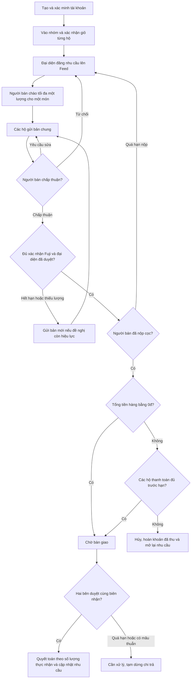

# Kế hoạch MVP OOPS

OOPS giúp các hộ trong cùng khu vực rà lại đồ đang có, gom phần nhu yếu phẩm còn thiếu và nhận đề nghị từ người bán để chuẩn bị trước thiên tai. Người bán có thể bán theo giá thường, giá hỗ trợ hoặc 0đ. Nhóm chốt từng món, người bán đặt cọc cam kết và hai bên xác nhận bàn giao trước khi quyết toán.

## Luồng chính

**Tạo và xác minh tài khoản → Vào nhóm và xác nhận giỏ → Đại diện đăng nhu cầu → Người bán gửi đề nghị → Các hộ gửi bản chung → Người bán chấp thuận → Từng hộ có phần xác nhận trên Fuji → Đại diện duyệt → Cọc và tiền hàng mô phỏng → Bàn giao và quyết toán.**

Nhóm cần **12 chai nước trước 17h**. Người bán chào tối đa **10 chai**. Ba hộ gửi bản **7 chai**, phần 2+2+3. Seller chấp thuận, cả ba hộ xác nhận đúng bản trên Fuji và đại diện duyệt. Cọc **50.000đ** được xác nhận thì app giữ 7 chai và Feed còn thiếu 5. Nếu giá **2.000đ/chai**, tiền hàng là **14.000đ**. Nếu giá 0đ, đơn chuyển sang chờ bàn giao sau cọc. Sau khi hai bên duyệt cùng biên nhận, ops ghi nhận chi/hoàn mô phỏng theo kết quả.

## 1. Người dùng và phạm vi MVP

- **Một loại tài khoản, hai luồng sử dụng.** Một người có thể mua trong **Nhóm của tôi** và gửi đề nghị bán qua **Feed**. Mỗi người tham gia tối đa một nhóm đang hoạt động. Người dùng có thể mua ở đơn này và bán ở đơn khác. Người bán không đồng thời xác nhận nhận hàng cho chính đơn mình giao.
- **Mỗi nhóm có một đại diện.** Đại diện tổ chức đợt gom, đăng nhu cầu, duyệt bản đã được seller và các hộ có phần xác nhận, rồi nhận hàng tại điểm chung. Người được mời xác nhận trước khi nhận vai trò.
- **Feed chỉ hiển thị bài đăng nhu cầu mua.** Người bán lọc theo quận/khu vực và phường, rồi gửi đề nghị vào một bài cụ thể. Feed hiện khu vực và thời hạn cần hàng. Điểm nhận chi tiết và thông tin liên hệ chỉ mở cho các bên liên quan sau khi chốt.
- **Danh mục MVP** gồm nước uống, thực phẩm đóng gói hoặc để được lâu, và nhu yếu phẩm như đèn pin, pin, đồ vệ sinh. Mỗi hộ nhập số người, đồ đang có và phần cần bổ sung. AI tạo giỏ nháp để hộ sửa hoặc nhập tay. Quy tắc có nguồn tính lượng gợi ý khi có đủ dữ liệu. Số người trong hộ dùng để gợi ý lượng đồ, còn ngưỡng gom tính theo số hộ.

## 2. Các màn hình và tính năng chính

| Màn hình | Người dùng làm được gì? |
|---|---|
| **Tài khoản** | Đăng ký, đăng nhập, liên kết ví Core và xem trạng thái xác minh. Hộ biết đã đủ điều kiện xác nhận trên Fuji hay còn thiếu bước nào. |
| **Nhóm của tôi** | Tạo nhóm hoặc vào bằng link mời, mời và xác nhận đại diện, xem các hộ tham gia, điểm nhận dự kiến và hạn gom. Mỗi hộ quản lý giỏ của mình và theo dõi phần đã đặt. |
| **Giỏ nhu yếu phẩm** | Chọn món từ danh mục hoặc mô tả đồ đang có bằng câu tự nhiên. Xem giỏ nháp, sửa món, số lượng và đơn vị, rồi xác nhận để đưa vào nhu cầu chung. |
| **Nhu cầu của nhóm** | Đại diện xem lượng cần theo từng món, đặt hạn cần hàng và đăng lên Feed. Mỗi món hiển thị **đã giữ**, **đã nhận** và **còn thiếu**. |
| **Feed và gửi đề nghị** | Lọc bài mua theo quận/khu vực, phường và nhóm mặt hàng. Người bán chọn một nhu cầu, nhập số lượng, giá, khung giờ và địa điểm bàn giao. App cho xem tiền hàng và số cọc dự kiến trước khi gửi. |
| **Bản thương lượng và xác nhận** | Mỗi hộ sửa phần của mình. Hộ khởi tạo gửi bản chung. Người bán chấp thuận, từ chối hoặc yêu cầu sửa. Hộ có phần hàng ký xác nhận đúng bản trên Fuji trước khi đại diện duyệt. |
| **Đơn của tôi** | Xem cả đơn mua và đơn bán. Theo dõi cọc, tiền hàng, hạn nộp, lịch nhận, tiến độ và khoản chi hoặc hoàn. Màn đơn 0đ bỏ bước thanh toán tiền hàng của người mua. |
| **Bàn giao** | Người bán báo hàng sẵn sàng và tải bằng chứng. Đại diện kiểm số lượng thực nhận. Hai bên duyệt cùng một biên nhận hoặc báo có vấn đề. |
| **Thông báo trong app** | Báo có đề nghị mới, mở vòng xác nhận, sắp hết hạn nộp cọc hoặc thanh toán, hàng sẵn sàng, sắp đến giờ nhận, đơn quá hạn và kết quả chi hoặc hoàn. Mỗi thông báo mở đúng nhu cầu hoặc hợp đồng liên quan. |

### AI giúp hộ rà và chuẩn bị giỏ

Ví dụ, hộ nhập *“Nhà mình có 4 người, còn 6 chai nước, có đèn pin nhưng hết pin.”* Gemini trích các thông tin này và tạo giỏ nháp từ danh mục. Nếu có đủ dữ liệu và quy tắc phù hợp, app tính lượng gợi ý còn thiếu và hiển thị lý do để hộ kiểm tra. Hộ có thể sửa hoặc bỏ đề xuất trước khi xác nhận. Chỉ giỏ đã xác nhận mới được cộng vào nhu cầu nhóm. Gom số lượng, kiểm xác nhận, tính cọc và quyết toán đều do app xử lý theo quy tắc.

## 3. Từ nhu cầu đến hợp đồng

1. **Gom và đăng nhu cầu.** Hộ xác nhận giỏ trong **Nhóm của tôi**. Đại diện đăng nhu cầu đã gom, khu vực nhận và hạn cần hàng. Hộ hoặc nhóm có thể đánh dấu **Cần giá hỗ trợ**.
2. **Người bán gửi đề nghị.** Đề nghị ghi món, số lượng có thể giao, đơn giá, tổng tiền hàng, điểm và hạn bàn giao. Có thể đáp ứng một phần nhu cầu. Ví dụ, nhóm cần 12 chai nước và một người bán đề nghị giao 8 chai với giá 2.000đ/chai hoặc 0đ/chai. Người bán hỗ trợ là bên trực tiếp cung cấp hàng và có cùng trách nhiệm giao hàng như người bán thường.
3. **Gửi bản và chốt.** Các hộ góp số lượng vào một bản chung, tổng không vượt lượng chào. Người bán chấp thuận, từ chối hoặc yêu cầu sửa. Sau chấp thuận, tất cả hộ có phần dương phải xác nhận đúng bản trên Fuji rồi đại diện mới duyệt. Bản quá hạn hoặc thiếu lượng lúc duyệt không giữ hàng. Hộ khởi tạo có thể gửi bản mới nếu đề nghị còn hiệu lực. Đổi giá/lượng và đổi lịch sau chốt nằm trong phạm vi sau demo.
4. **Người bán nộp cọc.** Khi cọc được ghi nhận, app giữ số lượng đã chốt trong lúc các hộ hoàn tất phần của mình. Với đơn có giá, hộ thanh toán qua QR theo hạn nạp. Với đơn 0đ, phần của hộ được xác nhận theo kết quả chốt và chuyển sang chờ bàn giao, không tạo QR tiền hàng. Nếu không đạt điều kiện gom hoặc quá hạn nạp, app hủy hợp đồng, hoàn các khoản đã nhận và mở lại phần nhu cầu tương ứng.
5. **Theo dõi phần còn thiếu.** Một nhu cầu có thể được đáp ứng bằng nhiều hợp đồng. Với ví dụ 12 chai, nếu 8 chai đã được giữ theo hợp đồng, Feed còn 4 chai để người bán khác đáp ứng. App phân biệt số lượng đã giữ, đã nhận và còn thiếu. Nếu hợp đồng bị hủy hoặc chỉ giao một phần, lượng chưa giao được mở lại. Khi nhiều hợp đồng cùng chốt, backend kiểm tra và cập nhật phần giữ trong cùng một thao tác để tổng lượng đã giữ không vượt nhu cầu.

### Trạng thái người dùng cần thấy

| Theo dõi | Trạng thái chính |
|---|---|
| **Nhu cầu** | Nháp → Đang tìm người bán → Đã có người đáp ứng một phần hoặc toàn bộ → Đã nhận đủ. Nếu đơn hủy hoặc giao thiếu, cập nhật lại phần còn thiếu. |
| **Đề nghị** | Đã gửi → Được chọn sau duyệt cuối, Bị từ chối hoặc Hết hạn. Bản gửi theo dõi riêng các bước chờ seller, chờ xác nhận Fuji và chờ đại diện. |
| **Hợp đồng** | Chờ cọc → Chờ thanh toán nếu có → Chờ bàn giao → Chờ hai bên duyệt → Chờ quyết toán → Hoàn tất. Có nhánh **Đã hủy** và **Cần xử lý**. |
| **Từng khoản tiền** | Chờ thu → Đã nhận → Chờ chi hoặc hoàn → Đã chi hoặc Đã hoàn. Cọc và tiền của từng hộ có trạng thái riêng. |

## 4. Cọc người bán và thanh toán VND

> **Cọc người bán = max(50.000đ, 10% × tổng tiền hàng ghi trong hợp đồng).**

Tổng tiền hàng tính theo **đơn giá đã chốt × số lượng cam kết của hợp đồng**, kể cả khi giá đã giảm xuống 0đ. App hiển thị cọc trước khi người bán gửi đề nghị và chốt số cọc theo tổng tiền hàng cuối cùng. Phí đại diện, nếu có, là dòng riêng và không tính vào cọc.

| Hợp đồng | Tiền hàng người mua thanh toán | Cọc người bán |
|---|---:|---:|
| 8 chai × 0đ | 0đ | 50.000đ |
| 8 chai × 2.000đ | 16.000đ | 50.000đ |
| Đơn có tổng tiền hàng 600.000đ | 600.000đ | 60.000đ |

- **Tiền hàng** do người mua nộp. Nếu có nhiều hộ, từng hộ thanh toán đúng phần đã duyệt. **Tiền cọc** do người bán nộp và được theo dõi riêng. Người nhận đơn 0đ không phải nộp tiền hàng hay cọc.
- **VietQR qua payOS** dùng cho các khoản thu bằng VND. Mỗi khoản thu có mã đối chiếu riêng. Backend kiểm tra chữ ký webhook, mã giao dịch và số tiền trước khi ghi nhận. Các trạng thái **Đã nhận tiền** và **Đã trả người bán** thể hiện hai giao dịch khác nhau. [Tài liệu API payOS](https://payos.vn/docs/api/)
- **Bản demo** dùng tiền mô phỏng cho cả tiền hàng và cọc. Nếu cần thử QR và webhook thật, chỉ thử số tiền nhỏ giữa ba thành viên. Tiền vào tài khoản của một thành viên đã xác thực với payOS. Thành viên đó thực hiện chi trả hoặc hoàn tiền thủ công, và app chỉ cập nhật đã chi hoặc đã hoàn sau khi ghi nhận khoản chuyển đi.
- **Trước khi nhận tiền thật từ người dùng ngoài nhóm**, cần chốt đơn vị giữ tiền, cách chi trả và cách hoàn tiền. VietQR chuyển tiền vào tài khoản nhận đã cấu hình. Cơ chế giữ tiền theo điều kiện và giải ngân cần được xác nhận với ngân hàng hoặc đối tác thanh toán.

## 5. Bàn giao và xử lý khi lệch cam kết

Người bán xác nhận hàng đã sẵn sàng trước giờ hẹn. Nếu bỏ qua mốc hoặc báo không thể giao, app báo đại diện sớm để nhóm tìm nguồn khác. Khi bàn giao, người bán tải bằng chứng lên app. Đại diện kiểm hàng và nhập số lượng thực nhận. **Cả hai duyệt cùng một biên nhận** trước khi chi trả. Phí đại diện có thể bằng 0 và chỉ được trả khi giao thành công. Đơn hỗ trợ 0đ trong MVP không thu phí đại diện.

| Kết quả | Xử lý tiền và nhu cầu |
|---|---|
| **Giao đủ, đúng hạn, cả hai đã duyệt** | Trả tiền hàng cho người bán nếu có và hoàn toàn bộ cọc. |
| **Giao thiếu hoặc giao muộn nhưng hai bên đồng ý nhận** | Hai bên duyệt số lượng thực nhận trên cùng biên nhận. Chi theo số lượng đó, hoàn phần tiền hàng tương ứng với phần thiếu và mở lại nhu cầu còn thiếu. Cọc xử lý theo điều khoản đã chốt. |
| **Người bán không giao hoặc báo hủy** | Báo đại diện và mở lại phần chưa giao. Nếu hợp đồng bị hủy, hoàn tiền hàng cho các hộ đã nộp. Cọc chỉ bị khấu trừ khi có căn cứ theo điều khoản đã công bố. |
| **Người mua hủy, không đến hoặc bàn giao không an toàn** | Khi hai bên xác nhận lý do hủy thuộc trường hợp được miễn phạt, hoàn cọc cho người bán. Đổi lịch sau chốt để sau demo. |
| **Chỉ một bên duyệt, bằng chứng mâu thuẫn hoặc chưa rõ lỗi** | Hiển thị **Cần xử lý** và tạm dừng chi trả. Hết giờ không tự xác nhận đã giao hay tự phạt cọc. |

MVP không có vai trò người phân xử riêng. Trước khi chạy với người dùng thật, nhóm cần chốt hạn xử lý khi thiếu xác nhận, điều kiện và mức khấu trừ cọc, và bên nhận khoản khấu trừ. Bản demo tập trung vào ca hai bên cùng xác nhận và ca quá hạn chuyển sang **Cần xử lý**.

## 6. Stack và vai trò của Avalanche

| Phần | Công nghệ và phạm vi |
|---|---|
| **Web và API** | Next.js App Router, TypeScript và Tailwind CSS. Tối ưu dùng trên điện thoại qua trình duyệt. |
| **Tài khoản và dữ liệu app** | Supabase Auth và PostgreSQL. Lưu nhóm, nhu cầu, đề nghị, số lượng theo từng món, giao dịch VND và biên nhận. Dùng phân quyền theo nhóm và hợp đồng. |
| **Gợi ý giỏ** | Gemini API tạo giỏ nháp, Zod kiểm tra cấu trúc dữ liệu, từng hộ chỉnh và xác nhận. |
| **Avalanche Fuji C-Chain** | Core Wallet liên kết ví. Token testnet dùng cho quyền xác nhận. Solidity và Viem ghi/đọc xác nhận của từng hộ theo phiên bản hợp đồng. |
| **Tiền hàng, cọc và quyết toán** | VietQR/payOS và backend OOPS ghi nhận khoản thu và trạng thái chi, hoàn bằng VND. Bản demo mô phỏng dòng tiền. |

Avalanche dùng để xác minh ví và ghi xác nhận của mọi hộ có phần trên bản đã được người bán chấp thuận. Tiền hàng, cọc, bằng chứng và duyệt bàn giao thuộc luồng app.

## 7. Tiêu chí demo và thứ tự làm

1. **Một tài khoản, hai luồng.** Người dùng tạo hoặc vào nhóm, sửa giỏ và xem nhu cầu tổng. Một tài khoản khác lọc Feed theo khu vực và gửi hợp đồng vào bài đăng nhu cầu.
2. **Tài khoản và xác nhận trên Fuji.** Demo liên kết ví. Ca 10→7 cần đủ cả ba hộ xác nhận đúng bản trước khi đại diện duyệt. Nếu thiếu ví, chưa mở vòng. Bản mới do seller yêu cầu sửa cần xác nhận lại.
3. **Đơn 0đ chạy trọn luồng.** Người bán đề nghị giao 8/12 chai nước giá 0đ, cọc hiển thị 50.000đ. Khi hợp đồng có hiệu lực, nhóm còn thiếu 4 chai. Hai bên duyệt biên nhận, hệ thống ghi nhận hoàn cọc và không phát sinh tiền hàng.
4. **Đơn có giá chạy cùng quy trình.** Với 8 chai giá 2.000đ/chai, màn thanh toán hiển thị 16.000đ tiền hàng và 50.000đ cọc người bán thành hai khoản riêng. Bản demo xác nhận khoản thu, duyệt bàn giao rồi ghi nhận chi trả và hoàn cọc.
5. **Một món gặp sự cố.** Món đã giao đủ được quyết toán riêng. Món quá hạn hoặc chỉ có một bên xác nhận chuyển sang **Cần xử lý**, không tự chi tiền. Người dùng thấy phần hàng chưa được đáp ứng và có thể tìm đề nghị khác khi phần đó được mở lại.
6. **Giỏ AI có thể kiểm tra và chỉnh sửa.** Từ một câu mô tả đồ đang có, app tạo giỏ nháp. Người dùng sửa số lượng, xác nhận và thấy nhu cầu của nhóm cập nhật. Nếu Gemini chưa sẵn sàng hoặc trả lỗi, nhập tay vẫn chạy cùng luồng.

DEV 1 bàn giao mã nhu cầu. DEV 2 bàn giao mã đề nghị và phiên bản. DEV 3 dựng staging trước cuối ngày 2 và bàn giao kết quả Fuji theo vòng và phiên bản. Ghép ca 0đ tới khi ops ghi hoàn cọc và đơn hoàn tất, rồi chạy đơn có giá, giao thiếu và Gemini. Lịch và quỹ giờ nằm trong [kế hoạch phát triển 7 ngày](OOPS-7-Day-Development-Plan.md).
