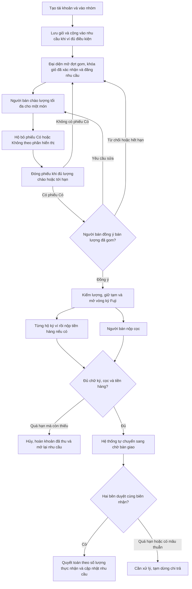

# Đặc tả dự án OOPS

Đây là điểm vào để đọc phạm vi, luồng nghiệp vụ, quy tắc bắt buộc, hợp đồng dữ liệu và tiêu chí nghiệm thu OOPS MVP. Tra chi tiết trong tài liệu chuyên đề của từng mục.

| Tài liệu | Vai trò |
| --- | --- |
| **OOPS-Spec.md** (file này) | Đặc tả tổng hợp, quy tắc đánh số, ma trận truy vết, phân công và nghiệm thu. |
| [requirements.md](requirements.md) | Yêu cầu FR01–FR04, kịch bản nghiệm thu, mốc M1–M4, quyết định còn mở. |
| [OOPS-MVP-Plan.md](OOPS-MVP-Plan.md) | Câu chuyện sản phẩm, màn hình, công thức cọc, xử lý lệch cam kết. |
| [architecture.md](architecture.md) | Sơ đồ thành phần, vòng đời hợp đồng, máy trạng thái, thứ tự khóa, bảo mật. |
| [schema.md](schema.md) | Bảng PostgreSQL, khóa, ràng buộc và bất biến dữ liệu. |
| [API doc.md](API%20doc.md) | Endpoint, payload, quyền, mã lỗi của `/api/v1`. |
| [OOPS-7-Day-Development-Plan.md](OOPS-7-Day-Development-Plan.md) | Task, giờ công, lịch 7 ngày, cổng kiểm thử, rủi ro. |
| [AGENTS.md](../AGENTS.md) | Căn cứ phân công, sở hữu file và quy ước triển khai. |

Khi tài liệu lệch nhau, áp dụng quyết định mới nhất đã được xác nhận. Luồng nghiệp vụ trong file này là căn cứ cập nhật các tài liệu liên quan khi triển khai. API, schema và kiến trúc chi tiết vẫn mô tả luồng hiện hành cho đến khi được đồng bộ. Tra phân công và cách xử lý mâu thuẫn trong [AGENTS.md](../AGENTS.md#2-tài-liệu-và-xử-lý-mâu-thuẫn). `*.before-edit.md` và `*.diff` là lịch sử.

---

## 1. Vấn đề và giải pháp

Các hộ trong cùng khu vực không biết chung nhau đang thiếu gì trước thiên tai. Mua riêng lẻ thì lượng nhỏ, không thương lượng được giá, và không có cơ chế ràng buộc người bán giao đúng cam kết.

OOPS gom nhu cầu từ giỏ đã xác nhận của nhiều hộ theo từng món và đăng lên Feed. Các hộ bỏ phiếu Có hoặc Không cho một đề nghị. Khi người bán đồng ý với tổng lượng đã gom, hệ thống tạo **một hợp đồng cho một món** để các hộ ký trên Avalanche Fuji và thanh toán phần của mình trong lúc người bán nộp cọc. Đại diện nhận hàng và cùng người bán duyệt biên nhận để quyết toán.

Ba cơ chế tạo niềm tin:

1. **Cọc của người bán** giữ cam kết giao hàng, tách hoàn toàn khỏi tiền hàng người mua trả.
2. **Xác nhận trên Fuji** của mọi hộ có phần hàng, trên đúng phiên bản bất biến mà người bán đã chấp thuận.
3. **Biên nhận hai lượt duyệt** ghi số lượng thực nhận trước khi chi tiền.

## 2. Phạm vi

### 2.1 Trong phạm vi MVP

- Một loại tài khoản dùng được cả hai luồng mua và bán, tối đa một nhóm hoạt động.
- Nhóm, vai trò đại diện có chấp thuận, link mời dùng một lần.
- Đợt gom, giỏ tay và giỏ Gemini, đóng gom, Feed theo khu vực.
- Đề nghị của người bán, bỏ phiếu Có hoặc Không theo lượng trong giỏ đã chốt, phiên bản bất biến và vòng mới khi điều khoản thay đổi.
- Vòng xác nhận Fuji theo phiên bản. Hệ thống tự chuyển đơn sang chờ bàn giao khi đủ chữ ký và các khoản thu bắt buộc.
- Cọc và tiền hàng mô phỏng (`SIM`) thu song song, bàn giao, biên nhận và quyết toán chi/hoàn.
- Thông báo trong app, theo dõi đơn, xử lý quá hạn và trạng thái **Cần xử lý**.

### 2.2 Ngoài phạm vi MVP

| Hạng mục | Ghi chú |
| --- | --- |
| Đổi giá/lượng sau khi người bán đã chốt | Điều khoản sửa trước khi chốt cần vòng bỏ phiếu mới. |
| Đổi lịch giao sau khi chốt | — |
| QR/payOS thật, thu VND thật | Adapter mô phỏng cùng sổ giao dịch; webhook và checkout đã đặc tả nhưng để sau demo. |
| Vai trò phân xử và quy trình giải quyết tranh chấp cọc | Demo dừng ở `NEEDS_REVIEW` với `reviewScope = DEPOSIT`. |
| Yêu cầu bồi thường, khấu trừ cọc tự động | Cần điều khoản và thẩm quyền chưa chốt. |
| Định mức nhu yếu phẩm có nguồn đầy đủ | Seed một số SKU đại diện; Gemini chỉ trích dữ liệu người dùng nhập. |

## 3. Vai trò và tác nhân

| Tác nhân | Quyền chính | Giới hạn |
| --- | --- | --- |
| **Hộ (member)** | Tạo, sửa và xác nhận giỏ của mình. Bỏ phiếu Có hoặc Không, ký xác nhận Fuji, thanh toán và xem phần của mình. | Không duyệt biên nhận thay đại diện, không thấy dữ liệu nhóm khác. |
| **Đại diện (REP)** | Tạo đợt gom nháp, mở đợt gom chính thức và đăng nhu cầu, mời hoặc chuyển vai trò, lập và duyệt biên nhận, báo sự cố, hủy theo điều kiện. | Tối đa một REP đang hoạt động mỗi nhóm. Quyền trên hợp đồng dựa trên `repId` đã chụp lúc chốt. |
| **Người bán (seller)** | Gửi đề nghị vào một dòng nhu cầu, quyết định bán theo tổng lượng đã bỏ phiếu, nộp cọc, báo sẵn sàng, tải bằng chứng, duyệt biên nhận, hủy trực tiếp theo điều kiện. | Không tham gia mua trong đề nghị của chính mình; chỉ thấy liên hệ của đại diện. |
| **Tài khoản vận hành (ops)** | Xem khoản chờ chi/hoàn, ghi `POSTED` kèm mã chuyển duy nhất. | Tách khỏi vai trò đại diện; chỉ môi trường demo có route mô phỏng. |
| **Worker** | Mở vòng Fuji, đọc log, chạy hạn, tạo thông báo, đối soát. | Không quyết định chuyển trạng thái nghiệp vụ; gọi hàm nghiệp vụ đã thống nhất. |

Một người có thể mua ở đơn này và bán ở đơn khác. Người bán và đại diện duyệt cùng một hợp đồng phải là hai tài khoản khác nhau.

## 4. Luồng nghiệp vụ end-to-end



Mười bước tương ứng với các mục dưới đây:

1. **Tài khoản và ví.** Supabase Auth giữ phiên. Hộ liên kết Core Wallet bằng challenge có nonce dùng một lần; bằng chứng ghi trên Fuji. Trạng thái `PENDING`, `VERIFIED`, `FAILED`; `confirmationEligible` do backend kiểm theo chính sách.
2. **Nhóm.** Tài khoản chưa tham gia nhóm có nhóm riêng và là đại diện. Đại diện tạo link `JOIN` dùng một lần để mời hộ khác. Vị trí nhóm lấy từ nơi sinh sống của đại diện. Chuyển vai trò `REP` cần đúng `targetUserId` đang trong nhóm và người nhận chấp thuận.
3. **Lưu giỏ.** Trong đợt nháp, mỗi hộ lưu số người, cờ cần hỗ trợ và các dòng `stockQty`, `needQty`. Khi hộ bấm **Lưu giỏ**, backend kiểm phiên bản giỏ và ví Fuji. Ví đã xác minh, đủ điều kiện thì giỏ được lưu ở `CONFIRMED` và lượng mua được cộng vào nhu cầu. Nếu ví chưa sẵn sàng, app lưu giỏ nháp và hướng dẫn hộ xác minh ví rồi lưu lại. Giỏ từ Gemini đi qua cùng bước lưu. Nếu AI lỗi, hộ tiếp tục nhập tay với dữ liệu đang sửa.
4. **Mở đợt gom chính thức.** Đại diện đăng nhu cầu lên Feed trước `needBy`, có thể đăng sớm để kết thúc nhập giỏ. Giao dịch đăng khóa đợt, chụp `needQty` của các giỏ `CONFIRMED` thành `demand_items` và `demand_shares`. Từ mốc này, hộ đọc giỏ đã chốt và dùng lượng đó làm căn cứ bỏ phiếu cho từng đề nghị.
5. **Đề nghị.** Người bán gửi cho một `demandItemId`: lượng tối đa đến `missing`, đơn giá (kể cả 0), cờ hỗ trợ, khung giao `handoffStart..handoffBy`, thông tin điểm nhận riêng. Điều khoản bất biến sau khi gửi. App hiển thị trước tiền hàng và cọc dự kiến.
6. **Bỏ phiếu theo giỏ đã chốt.** App hiển thị số lượng và tiền của phần hộ có thể mua. Hộ chọn **Có** hoặc **Không**. Lượng hiển thị là phần nhu cầu còn có thể chốt của hộ, giới hạn theo lượng đề nghị còn trống. Ví dụ, hộ cần 3 chai mà đề nghị còn 1 thì phiếu Có đăng ký 1 chai đã hiển thị. Hai chai còn lại tiếp tục nằm trong nhu cầu của hộ. Backend kiểm lượng dưới khóa khi ghi phiếu. Nếu lượng đã đổi do hộ khác vừa xác nhận, app hiển thị lại phần còn trống để hộ tự quyết định. Vòng tự đóng khi đủ lượng chào hoặc tới hạn. Hộ chưa phản hồi được tính là không tham gia. Nếu có phiếu Có, backend tự chụp phiên bản bất biến gồm phần từng hộ, tổng lượng, giá, lịch và `versionHash` để gửi người bán.
7. **Người bán chốt bán.** Người bán thấy tổng lượng từ phiếu Có và chọn bán đúng lượng đó, từ chối hoặc yêu cầu sửa. Ví dụ, chào tối đa 10 chai mà có 7 chai được đăng ký thì người bán quyết định bán 7 chai. Nếu điều khoản thay đổi, hệ thống mở vòng phiếu mới. Khi người bán đồng ý, backend kiểm lại lượng theo món và theo hộ dưới khóa. Thiếu lượng thì ghi `STOCK_CONFLICT` và trả `409`. Backend cũng kiểm lại ví hợp lệ và duy nhất của mọi hộ có phần dương để mở đúng một vòng Fuji cho bản đó. Khi đủ điều kiện, hệ thống tạo một hợp đồng chờ ký và thu, giữ lượng ở `pending` và đưa yêu cầu mở vòng vào outbox.
8. **Ký Fuji và thu SIM song song.** Khi vòng ký mở, người bán có thể nộp cọc. Mỗi hộ ký đúng phiên bản và có thể thanh toán phần mình ngay khi backend xác minh chữ ký của hộ đó. Đơn 0đ chỉ yêu cầu hộ ký, người bán vẫn nộp cọc. Tiến độ chữ ký và khoản thu được theo dõi riêng theo từng bên.
9. **Tự chuyển sang bàn giao.** Khi đủ chữ ký của mọi hộ có phần, cọc người bán và toàn bộ tiền hàng nếu có, backend chuyển `pending` → `reserved` và đưa hợp đồng sang `AWAIT_HANDOFF` trong cùng giao dịch. Nếu quá hạn mà còn thiếu điều kiện, backend hủy đơn, giải phóng lượng giữ tạm và lập hoàn các khoản đã thu. Đại diện tham gia ở bước nhận hàng và duyệt biên nhận.
10. **Bàn giao và quyết toán.** Người bán báo sẵn sàng và tải bằng chứng. Đại diện lập biên nhận theo lượng thực nhận từng phần. Hai bên duyệt cùng phiên bản biên nhận thì ghi lượng nhận, giải phóng toàn bộ lượng giữ và lập chi/hoàn trong một giao dịch. Ops ghi từng khoản `POSTED` bằng mã chuyển; đủ khoản bắt buộc thì đơn `SETTLING` → `COMPLETED`.

## 5. Màn hình và chức năng

| Màn hình | Nội dung bắt buộc | Yêu cầu |
| --- | --- | --- |
| **Tài khoản** | Đăng ký, đăng nhập, liên kết ví Core, trạng thái xác minh và bước còn thiếu để được xác nhận. | FR01 |
| **Nhóm của tôi** | Nhóm riêng mặc định, vào bằng link, mời và xác nhận đại diện, danh sách hộ, hạn gom. Mỗi hộ quản lý giỏ của mình. | FR01, FR02 |
| **Giỏ nhu yếu phẩm** | Chọn món hoặc mô tả bằng câu tự nhiên. Hộ sửa số lượng và bấm **Lưu giỏ** để cập nhật nhu cầu khi ví đủ điều kiện. | FR01, FR02 |
| **Nhu cầu của nhóm** | Tổng theo món, hạn cần hàng, nút đăng Feed, và với mỗi món: **đã giữ**, **đã nhận**, **còn thiếu**. | FR02 |
| **Feed và gửi đề nghị** | Lọc theo nhóm mặt hàng và chọn khu vực từ danh sách phường, xã, đặc khu. Form chào có lượng, giá, khung giờ, điểm nhận; hiện tiền hàng và cọc dự kiến trước khi gửi. | FR02, FR03 |
| **Bỏ phiếu và xác nhận** | Hộ xem phần mua từ giỏ đã chốt và bấm Có hoặc Không. Người bán xem lượng đã gom để quyết định bán. Hộ có phần ký Fuji theo đúng phiên bản đã chốt. | FR03 |
| **Đơn của tôi** | Cả đơn mua và đơn bán: cọc, tiền hàng, hạn nộp, lịch nhận, tiến độ, khoản chi/hoàn. Đơn 0đ bỏ bước nộp tiền hàng của hộ và vẫn hiển thị cọc cho người bán. | FR03, FR04 |
| **Bàn giao** | Người bán báo sẵn sàng và tải bằng chứng; đại diện nhập lượng thực nhận; hai bên duyệt cùng biên nhận hoặc báo sự cố. | FR04 |
| **Vận hành** | Danh sách khoản chờ chi/hoàn, ghi mã chuyển duy nhất, xem trạng thái hợp đồng sau khi ghi. | FR04 |
| **Thông báo** | Đề nghị mới, vòng xác nhận mở, sắp hết hạn cọc/thanh toán, hàng sẵn sàng, sắp đến giờ nhận, đơn quá hạn, kết quả chi/hoàn. Mỗi mục mở đúng đối tượng. | FR04 |

## 6. Quy tắc nghiệp vụ bắt buộc

Các quy tắc dưới đây là bất biến hệ thống. Mỗi quy tắc cần ít nhất một test tương ứng.

### 6.1 Lượng và tồn

- **BR-01** Với mỗi dòng nhu cầu và mỗi dòng phần của hộ: `pending + reserved + received ≤ target`, kiểm dưới khóa.
- **BR-02** `missing = target − reserved − received`.
- **BR-03** `offerable = missing − pending`, gồm cả khi bằng 0. Phiếu Có chiếm chỗ trong giới hạn của đề nghị đang bỏ phiếu. Lượng khả dụng chung chỉ giảm khi người bán chấp thuận và backend giữ lượng cho hợp đồng.
- **BR-04** Hợp đồng chờ ký và thu giữ lượng ở `pending`. Đủ chữ ký, cọc và tiền hàng thì chuyển `pending` → `reserved`. Quá hạn mà còn thiếu điều kiện thì giải phóng `pending`.
- **BR-05** Một đợt chỉ có một dòng nhu cầu cho mỗi SKU. Một SKU là một mã danh mục có đơn vị cố định.
- **BR-06** Giải phóng lượng đúng một lần cho mỗi hợp đồng; `stock_state` đi `PENDING` → `RESERVED` → `RECEIPT_APPLIED` hoặc `RELEASED`.

### 6.2 Tiền

- **BR-07** Mọi khoản VND là số nguyên, đơn vị đồng.
- **BR-08** `goodsVnd = qty × unit_price_vnd`.
- **BR-09** `depositVnd = max(50_000, ceil(goodsVnd / 10))`, tính trên lượng cam kết của hợp đồng, kể cả khi giá 0.
- **BR-10** Cọc và tiền hàng là hai khoản riêng, thu song song. Người bán nộp cọc khi vòng ký mở. Mỗi hộ nộp tiền hàng sau khi backend xác minh chữ ký của chính hộ đó. Đơn 0đ có cọc 50.000đ và chỉ có khoản `DEPOSIT`.
- **BR-11** Phí đại diện trong MVP bằng 0. Nếu áp dụng cho đơn có giá: là dòng riêng, loại khỏi công thức cọc, chỉ chi khi giao thành công.
- **BR-12** Mỗi khoản thu chỉ áp dụng một giao dịch khớp và đủ tiền trước hạn khi còn `PENDING`. Gửi lại cùng mã chỉ ghi một lần. Nộp thêm hoặc lệch số vào khoản đã nhận thì ghi `REVIEW`/`REFUND_DUE` để đối soát.
- **BR-13** Khoản chi/hoàn đi `PENDING` → `POSTED` chỉ khi có `transfer_ref` duy nhất. Tổng chi/hoàn theo một khoản thu ≤ tiền thực nhận.
- **BR-14** Chỉ chuyển `SETTLING` → `COMPLETED` khi mọi khoản chi/hoàn bắt buộc đã `POSTED` và không còn khoản bị khóa.

### 6.3 Phiên bản và xác nhận

- **BR-15** Điều khoản và dòng hàng bất biến kể từ lúc backend chụp phiên bản sau khi đóng phiếu. Chỉ trạng thái, phản hồi và mốc xử lý được cập nhật.
- **BR-16** Mỗi đề nghị có tối đa một vòng phiếu hoặc phiên bản đang xử lý. Phiếu Có chỉ áp dụng cho số lượng và giá hộ đã thấy. Vòng phiếu tự đóng khi đủ lượng chào hoặc tới hạn.
- **BR-17** Mỗi phiên bản có tối đa một vòng Fuji. Vòng chỉ tạo khi **toàn bộ** hộ có phần dương đã có ví hợp lệ; không bao giờ tạo snapshot thiếu hộ.
- **BR-18** Một ví chỉ thuộc một hộ trong vòng. Mỗi hộ xác nhận đúng một lần. Chỉ tính sự kiện đúng chain, contract, vòng, `versionHash`, ví và block timestamp trước `confirmBy`.
- **BR-19** Khi điều khoản thay đổi trước lúc chốt, mở lại vòng bỏ phiếu và chụp phiên bản mới. Mỗi phiếu và chữ ký chỉ có hiệu lực cho phiên bản điều khoản tương ứng.
- **BR-20** Hệ thống tự mở bàn giao khi đã ghi nhận đủ chữ ký Fuji, cọc và tiền hàng nếu có.
- **BR-21** Người bán chấp thuận và kiểm lượng thành công thì tạo **đúng một** hợp đồng cho một cặp `proposal_id` + `source_version_id`. Phần của từng hộ lấy từ phiên bản đã chốt.

#### Chuẩn băm phiên bản

Backend tạo `versionId` và lưu `versionHash = keccak256(abi.encode(...))` khi chụp bản gửi. ABI nhận các đối số dưới đây theo đúng thứ tự. Kết quả là `bytes32` trên Fuji và chuỗi hex chữ thường có tiền tố `0x` trong DB và JSON. [Đặc tả mã hóa ABI Solidity](https://docs.soliditylang.org/en/latest/abi-spec.html#formal-specification-of-the-encoding)

| Vị trí | Kiểu ABI | Giá trị |
| --- | --- | --- |
| 1 | `string` | Chuỗi cố định `OOPS_NEGOTIATION_VERSION_V1` |
| 2–3 | `bytes16, bytes16` | `proposalId`, `versionId` |
| 4 | `uint32` | Số `version` trong nháp |
| 5–6 | `bytes16, bytes16` | `demandItemId`, `sellerId` |
| 7 | `uint64` | `unitPriceVnd` tính theo đồng |
| 8–9 | `int64, int64` | `handoffStart`, `handoffBy` theo micro giây Unix UTC |
| 10–11 | `bool, string` | `supportOffer`, `handoffPrivate` |
| 12 | `(bytes16,uint32,string)[]` | Các dòng `(membershipId, qty, note)` có lượng dương |

- UUID bỏ dấu gạch nối và đọc 32 ký tự hex thành 16 byte theo thứ tự từ trái sang phải. Sắp xếp dòng tăng dần theo 16 byte của `membershipId`.
- Dùng thời điểm chính xác từ PostgreSQL. Đọc số micro giây dưới dạng số nguyên, giữ phần lẻ của giây qua quá trình mã hóa.
- Chuỗi dùng UTF-8 của giá trị đã lưu. Ghi chú vắng mặt được mã hóa thành chuỗi rỗng. Lượng tổng và tiền hàng suy ra từ dòng và đơn giá. Trạng thái, phản hồi của người bán, hạn xử lý và thông tin vòng Fuji nằm ngoài dữ liệu băm.
- Bản gửi lại có `versionId` mới và tăng `version`. Với nội dung bản, Fuji chỉ nhận mã băm. Điểm giao riêng, dòng hàng và ghi chú dùng để tính băm được giữ trong hệ thống app.

**Vector kiểm thử 10→7.** Đơn giá 2.000đ. Khung giao 15h–16h ngày 18/11/2026 theo giờ Việt Nam. JSON dưới đây dùng UUID và số micro giây dạng chuỗi cho dễ đối chiếu trước khi chuyển sang kiểu ABI.

```json
{
  "proposalId": "f00740b1-955c-4dac-9601-3aa75e430185",
  "versionId": "bf05cd2b-5143-41f0-91d6-8332c6b8257f",
  "version": 1,
  "demandItemId": "b868dc0e-4dad-43b0-8a9d-ea2db18070c4",
  "sellerId": "eced0276-59c8-4341-a214-91148a404112",
  "unitPriceVnd": 2000,
  "handoffStartUs": "1794988800000000",
  "handoffByUs": "1794992400000000",
  "supportOffer": false,
  "handoffPrivate": "Sảnh A",
  "lines": [
    ["55ea173b-4141-44c7-afc6-f0113bd72bbd", 2, ""],
    ["55ea173b-4141-44c7-afc6-f0113bd72bbe", 2, ""],
    ["55ea173b-4141-44c7-afc6-f0113bd72bbf", 3, "Nhận buổi chiều"]
  ]
}
```

`versionHash` dự kiến là `0x93c0fedb2c764bfdea295f6815462007329bf9dd2fb33b72b1707749c028ce7b`.

### 6.4 Bàn giao và hủy

- **BR-22** Chỉ ghi bằng chứng, lập hoặc duyệt biên nhận khi đã đủ chữ ký Fuji, cọc, tiền hàng nếu có, và `stock_state = RESERVED`.
- **BR-23** Biên nhận phải có đủ mỗi allocation của hợp đồng đúng một lần, kể cả lượng 0; `0 ≤ receivedQty ≤ qty`. Bằng chứng phải cùng hợp đồng. Biên nhận có lượng dương cần ít nhất một bằng chứng của người bán.
- **BR-24** Lập biên nhận đúng hạn ở `AWAIT_HANDOFF` chuyển sang `AWAIT_APPROVAL` trong cùng giao dịch. Quá hạn bàn giao, quá hạn duyệt hoặc sự cố mâu thuẫn thì đơn ở `NEEDS_REVIEW` với `reviewScope = HANDOFF`.
- **BR-25** Thay biên nhận nháp chuyển bản cũ sang `SUPERSEDED`; hai bên duyệt lại từ đầu, lượt duyệt cũ giữ để đối chiếu. Báo mâu thuẫn kết quả giao cũng `SUPERSEDED` bản nháp hiện hành.
- **BR-26** Hai bên duyệt cùng phiên bản biên nhận thì chuyển `APPROVED`, cộng lượng thực nhận, giải phóng toàn bộ lượng giữ, `stock_state = RECEIPT_APPLIED` — một lần duy nhất.
- **BR-27** Hủy trực tiếp chỉ khi hợp đồng đang chờ ký và thu hoặc đang `AWAIT_HANDOFF`, và chưa có bằng chứng, biên nhận hay sự cố bàn giao. Hủy theo điều khoản hai bên chỉ khi còn `PENDING` hoặc `RESERVED` về lượng và chưa áp biên nhận.
- **BR-28** Cọc chưa rõ cách xử lý giữ riêng ở `NEEDS_REVIEW` với `reviewScope = DEPOSIT`, không chặn phần tiền hàng đã xác định.

### 6.5 Nhất quán và lặp

- **BR-29** Thứ tự khóa: đợt gom → dòng nhu cầu, dòng phần hộ, đề nghị, hồ sơ, phiên bản, vòng → hợp đồng → bản ghi thuộc hợp đồng (khoản thu, giao dịch thu, khoản chi, bằng chứng, biên nhận, yêu cầu thay đổi). Nhiều dòng cùng loại khóa theo khóa chính tăng dần.
- **BR-30** Sau khi lấy khóa, đọc lại trạng thái, phiên bản, thời hạn và lượng trước khi ghi.
- **BR-31** Ghi thay đổi nghiệp vụ và outbox trong cùng giao dịch. Gọi dịch vụ ngoài sau khi đã commit, rồi xử lý kết quả trong giao dịch mới.
- **BR-32** `Idempotency-Key` cho POST nghiệp vụ và thao tác ghi tiền. Cùng khóa + cùng dữ liệu trả kết quả cũ; cùng khóa + khác dữ liệu trả `409`.
- **BR-33** Ràng buộc duy nhất giữ vai trò chống lặp cho sự kiện thu, chi và xác nhận (`mode + external_ref`, `transfer_ref`, `chain_id + tx_hash + log_index`).
- **BR-34** Worker thử lại có backoff; không rõ kết quả tạo link thì truy vấn theo `orderCode` trước khi thử lại. Cursor và outbox bền vững qua restart.

### 6.6 Rời nhóm và đổi ví (G-09)

- Thành viên chỉ tự rời nhóm. Đại diện phải có thành viên khác chấp nhận lời mời `REP` trước. Hợp đồng đã chốt giữ nguyên đại diện trong `repId`.
- Thành viên được rời khi không còn phần nhu cầu trong đợt `PUBLISHED` chưa tới `needBy` và không còn nghĩa vụ trong nhóm với tư cách hộ tham gia hoặc đại diện của hợp đồng. Giỏ nháp và giỏ xác nhận chưa đăng không giữ thành viên lại. Khi rời, server ghi `left_at`, giữ lịch sử và loại phần giỏ của thành viên khỏi lần đăng nhu cầu sau. Vai trò người bán của nhóm khác không chặn rời nhóm hiện tại.
- Nghĩa vụ còn mở khi hộ thuộc vòng ký chưa đóng của bản `AWAIT_CONFIRMATIONS` hoặc `AWAIT_REP_APPROVAL`, hoặc khi hợp đồng liên quan chưa `COMPLETED`/`CANCELED`. Sau khi hợp đồng kết thúc, khoản chi hoặc hoàn chưa `POSTED` vẫn giữ khóa. Chỉ mở khóa theo trạng thái đã ghi, kể cả khi đã qua giờ hạn nhưng job chưa xử lý.
- Đổi hoặc gỡ ví, hoặc hạ trạng thái của ví đã xác minh, bị khóa khi tài khoản còn nghĩa vụ với vai trò hộ ký, người mua, đại diện hoặc người bán ở bất kỳ nhóm nào. Xác minh lại cùng địa chỉ vẫn được phép. Khi đủ điều kiện đổi ví, tài khoản phải chứng minh sở hữu địa chỉ mới theo luồng liên kết. Địa chỉ và chữ ký đã chụp cho mỗi vòng vẫn giữ nguyên.

## 7. Máy trạng thái

### 7.1 Nhu cầu, đề nghị, phiên bản

| Đối tượng | Trạng thái | Điều kiện |
| --- | --- | --- |
| Nhu cầu | `DRAFT` → `OPEN` → `COVERED` → `FULFILLED` | `COVERED` khi `missing = 0` và còn chờ giao; `FULFILLED` khi `received = target`. |
| Đề nghị | `SUBMITTED`, `SELECTED`, `REJECTED`, `EXPIRED` | `SELECTED` khi người bán chốt phiên bản và backend tạo hợp đồng. `EXPIRED` khi quá hạn hoặc lịch không còn đủ thời gian. |

| Giai đoạn | Hành động hoặc mốc | Kết quả | Thông báo |
| --- | --- | --- | --- |
| Đang bỏ phiếu | Đủ lượng chào hoặc tới hạn và có ít nhất một phiếu Có | Chụp bản bất biến ở `SUBMITTED` | Người bán |
| Đang bỏ phiếu | Tới hạn và không có phiếu Có | Kết thúc đề nghị | Người bán |
| `SUBMITTED` | Người bán yêu cầu sửa hoặc từ chối | `CHANGES_REQUESTED` để mở vòng phiếu mới, hoặc `REJECTED` | Các hộ đã bỏ phiếu Có |
| `SUBMITTED` | Hết hạn phản hồi | `EXPIRED` với lý do `SELLER_TIMEOUT` | Người bán và các hộ có phần |
| `SUBMITTED` | Người bán đồng ý và kiểm lượng, ví thành công | Tạo hợp đồng chờ ký và thu, giữ lượng và yêu cầu mở vòng Fuji | Khi vòng mở, mỗi bên nhận một thông báo dẫn đến đơn hàng để hộ ký xác nhận, người bán nộp cọc và đại diện theo dõi nếu không có phần hàng. |
| `SUBMITTED` | Thiếu lượng khi người bán đồng ý | `STOCK_CONFLICT`, trả `409` | Người bán và các hộ có phần |
| Chờ ký và thu | Đủ chữ ký, cọc và tiền hàng trước hạn tương ứng | `AWAIT_HANDOFF` | Người bán, đại diện và các hộ có phần |
| Chờ ký và thu | Hết hạn và còn thiếu điều kiện | `CANCELED`, giải phóng lượng và lập hoàn các khoản đã thu | Các bên |

### 7.2 Hợp đồng và tiền

- **Hợp đồng** đi từ chờ ký và thu song song đến `AWAIT_HANDOFF → AWAIT_APPROVAL → SETTLING → COMPLETED`. Có nhánh `CANCELED` và `NEEDS_REVIEW` với phạm vi `HANDOFF` hoặc `DEPOSIT`.
- **Lượng:** `PENDING → RESERVED → RECEIPT_APPLIED` / `RELEASED`.
- **Khoản thu:** `PENDING`, `RECEIVED`, `EXPIRED`, `REVIEW`.
- **Khoản chi/hoàn:** `PENDING`, `POSTED`, `REVIEW`.
- **Biên nhận:** `DRAFT`, `APPROVED`, `SUPERSEDED`; tối đa một `APPROVED` mỗi hợp đồng.
- **Yêu cầu hủy theo điều khoản:** `PENDING`, `ACCEPTED`, `EXPIRED`; tối đa một `PENDING` mỗi hợp đồng.
- **Vòng xác nhận:** `OPENING`, `OPEN`, `CONFIRMED`, `CLOSED`.
- **Ví:** `PENDING`, `VERIFIED`, `FAILED`.

## 8. Thời hạn

Vòng phiếu có 3 giờ và đóng sớm nếu đủ lượng chào. Khi chụp bản gửi người bán, server lấy `submittedAt` từ PostgreSQL và đặt `sellerResponseDueAt = submittedAt + 3 giờ` theo cấu hình MVP. Tại hoặc sau hạn phản hồi, API trả `409` kể cả khi worker chưa ghi `EXPIRED`.

Ngay khi người bán chốt, backend đưa yêu cầu mở vòng Fuji vào outbox để worker gửi giao dịch. Từ thời điểm mở ghi trong block Fuji, người bán có 6 giờ để nộp cọc. Hộ có chung 12 giờ để ký và, với đơn có giá, nộp tiền sau khi chữ ký của chính hộ được đồng bộ. Hạn chung phải cách giờ giao ít nhất 2 giờ. Nếu đã qua mốc muộn nhất để mở vòng mà vẫn chưa có giao dịch mở hợp lệ, worker xử lý hủy sau khi đã đồng bộ chain qua mốc đó. Hạn duyệt biên nhận là `handoffBy` + 24 giờ.

| Mốc | Ý nghĩa | Ai kiểm |
| --- | --- | --- |
| `collectUntil` | Hết hạn gom; sau mốc này cấm sửa và xác nhận giỏ. Phải trước `needBy`. | API giỏ |
| `needBy` | Hạn cần hàng; giới hạn trên của `handoffBy`. | API đăng, đề nghị |
| Hạn bỏ phiếu | Mốc đóng vòng khi chưa đủ lượng chào. | API bỏ phiếu, worker |
| `sellerResponseDueAt` | Hạn người bán phản hồi bản gửi. | Worker, API phản hồi |
| Hạn mở vòng ký | Mốc hủy và giải phóng lượng nếu vòng Fuji chưa mở được. | Worker |
| `confirmBy` | Hạn ký Fuji. Worker đối chiếu log theo chính sách block và cutoff. | Worker, backend xác nhận |
| `depositDueAt`, `paymentDueAt` | Hạn nộp cọc và tiền hàng trong cùng giai đoạn. | Worker, ghi nhận thu |
| `ready_by`, `handoffBy` | Hạn báo sẵn sàng và hạn giao. | Worker, lập biên nhận |
| `approvalDueAt` | Hạn hai bên duyệt biên nhận. | Worker |
| `scheduledHandoffBy` | Lịch giao đang áp dụng, chụp lúc lập biên nhận, dùng so `handedAt` để xét giao muộn. | Lập biên nhận |

API dùng các hạn đã lưu khi ghi nghiệp vụ. Worker đối chiếu hạn hiện hành để xử lý quá hạn và thông báo.

## 9. Dữ liệu

Xem [schema.md](schema.md) cho trường và ràng buộc đầy đủ.

| Nhóm | Bảng | Bất biến chính |
| --- | --- | --- |
| Tài khoản và nhóm | `profiles`, `wallets`, `groups`, `memberships`, `invites` | `UQ user_id` với `left_at NULL`; tối đa một REP hoạt động mỗi nhóm; nhóm chỉ đăng bài khi có REP. |
| Danh mục và đợt gom | `catalog_items`, `campaigns`, `carts`, `cart_items` | `collect_until < need_by`; `UQ (campaign_id, membership_id)`; chỉ giỏ `CONFIRMED` được chụp. Điều kiện ví được kiểm khi chuyển giỏ sang `CONFIRMED`. |
| Nhu cầu | `demand_items`, `demand_shares` | `UQ (campaign_id, sku_id)`; `target > 0`; tổng theo món bằng tổng các hộ. |
| Đề nghị và bỏ phiếu | `proposals`, `negotiations`, `negotiation_draft_lines`, `negotiation_versions`, `negotiation_version_lines` | Mỗi hộ có tối đa một phiếu hiệu lực trong vòng. Tổng lượng phiếu Có không vượt lượng chào. Bản chụp có `UQ (negotiation_id, version)` và `version_hash` duy nhất. Bảng và trường lưu phiếu cần được đối chiếu với schema khi triển khai. |
| Xác nhận | `confirmation_rounds`, `confirmation_participants`, `confirmations`, `chain_cursors` | `UQ version_id`; ví duy nhất trong vòng; `UQ (chain_id, tx_hash, log_index)`. |
| Hợp đồng | `contracts`, `allocations`, `evidence`, `receipts`, `receipt_approvals`, `terminations` | `UQ proposal_id`, `UQ source_version_id`; `UQ (contract_id, membership_id)`; `UQ (contract_id, version)`. |
| Sổ tiền | `charges`, `fund_events`, `disbursements` | Một `DEPOSIT` mỗi hợp đồng; `UQ (mode, external_ref)`; `dedupe_key` và `transfer_ref` duy nhất. |
| Hạ tầng | `outbox`, `idempotency_keys`, `notifications`, `audit_events` | `UQ event_key`; PK `(actor_id, operation, key)`; `UQ (user_id, event_key)`. |

Quy ước: `id` là UUID trừ bảng có khóa ghép; `ts` là `timestamptz`; `vnd` là `bigint` không âm; trường có `?` cho phép NULL.

## 10. Hợp đồng API

Tiền tố `/api/v1`. JSON, trừ upload bằng chứng (`multipart/form-data`). Trường camelCase, enum viết hoa. Bảng dưới đây dẫn chiếu API hiện hành. Luồng ở mục 4 cần đồng bộ hợp đồng API cho kiểm ví lúc xác nhận giỏ, bỏ phiếu theo giỏ đã chốt, người bán chốt và thu song song. Xem [API doc.md](API%20doc.md) cho payload hiện hành.

| Nhóm | Endpoint |
| --- | --- |
| Tài khoản, ví | `GET/PATCH /me`, `GET /wallet/challenge`, `POST /wallet/link` |
| Nhóm | `GET /me` cấp nhóm mặc định, `GET /groups/{id}`, `POST /groups/{id}/invites`, `POST /invites/accept` |
| Đợt gom và giỏ | `POST /groups/{id}/campaigns`, `GET /catalog`, `GET/PUT /campaigns/{id}/cart`, `POST /campaigns/{id}/cart/ai`, `POST /campaigns/{id}/cart/confirm`, `POST /campaigns/{id}/publish`, `GET /campaigns/{id}/needs` |
| Feed và đề nghị | `GET /feed`, `POST /needs/{id}/offers`, `GET /needs/{id}/offers` |
| Thương lượng hiện hành, cần đồng bộ với luồng bỏ phiếu | `POST /offers/{id}/draft`, `GET /drafts/{id}`, `PUT /drafts/{id}/my-line`, `POST /drafts/{id}/submit`, `POST /drafts/{id}/versions/{version}/seller-response`, `POST /drafts/{id}/revise` |
| Xác nhận và chốt hiện hành, cần đồng bộ với bước tự mở bàn giao | `GET /rounds/{id}`, `confirmVersion` on-chain, `POST /drafts/{id}/versions/{version}/finalize` |
| Hợp đồng | `GET /contracts`, `GET /contracts/{id}`, `POST /contracts/{id}/ready` |
| Thu tiền | `POST /demo/charges/{id}/receive`; sau demo: `POST /charges/{id}/checkout`, `POST /webhooks/payos` |
| Bàn giao | `POST /contracts/{id}/evidence`, `GET /evidence/{id}`, `POST /contracts/{id}/receipts`, `POST /receipts/{id}/approve` |
| Sự cố và hủy | `POST /contracts/{id}/issues`, `POST /contracts/{id}/cancel`, `POST /contracts/{id}/terminations`, `POST /terminations/{id}/accept` |
| Vận hành và thông báo | `GET /ops/disbursements`, `POST /ops/disbursements/{id}/post`, `GET /notifications`, `PATCH /notifications`, `PATCH /notifications/{id}` |

Mã lỗi chung: `401` thiếu phiên, `403` thiếu quyền, `404` không tồn tại hoặc cần ẩn, `409` xung đột phiên bản/trạng thái/idempotency, `422` dữ liệu sai, `429` vượt giới hạn, `503` phụ thuộc lỗi tạm thời. Envelope lỗi gồm `error.code`, `error.message` và `requestId`.

## 11. Bảo mật và quyền riêng tư

- Supabase Auth giữ phiên; API kiểm quyền trên **từng bản ghi**; RLS chặn truy cập chéo nhóm.
- Hộ chỉ thấy phần của mình. Người bán và đại diện thấy thông tin cần cho bàn giao và duyệt. Người bán chỉ thấy liên hệ của đại diện.
- Địa chỉ chi tiết và liên hệ chỉ mở cho các bên liên quan **sau khi chốt**; điểm giao đề xuất chỉ hiện cho người bán và đại diện trong lúc thương lượng.
- Feed chỉ chứa dữ liệu công bố: khu vực, hạn cần hàng, lượng còn thiếu.
- Service role key, Gemini key và payOS key nằm ở server. Bằng chứng nằm trong bucket riêng, chỉ cấp URL ký có hạn sau khi kiểm quyền.
- Ví ký giao dịch Fuji ở client hoặc qua ví nhúng của người dùng. Chỉ đưa lên Fuji mã vòng, mã băm, ví và xác nhận; dữ liệu hộ, địa chỉ, ảnh và VND ở hệ thống app.
- Log dùng ID, trạng thái và mã lỗi; lược bỏ thông tin liên hệ, chữ ký và payload ngân hàng thô.
- Quyền vận hành tách khỏi vai trò đại diện; endpoint xác nhận chi thật yêu cầu quyền vận hành và mã đối soát chuyển đi.

## 12. Kiến trúc triển khai

Một codebase Next.js (App Router, TypeScript, Tailwind) phục vụ web di động và API. Supabase cung cấp Auth, PostgreSQL và Storage. Worker chạy riêng từ cùng codebase. Gemini chỉ tạo giỏ nháp, kiểm bằng Zod, app áp quy tắc. Fuji C-Chain xác minh ví và xác nhận phiên bản qua Core Wallet, Solidity và Viem. Tiền đi qua adapter `SIM` trong demo.

Sơ đồ thành phần, ranh giới dữ liệu và các phương án đã cân nhắc: [architecture.md](architecture.md).

## 13. Tiêu chí nghiệm thu

### 13.1 Kịch bản bắt buộc

| # | Kịch bản | Kết quả đúng |
| --- | --- | --- |
| AC-01 | Nhu cầu 12 chai, chưa có đơn khác. Chào 10 chai. Khi đóng phiếu có ba hộ chọn Có theo phần 2+2+3. Người bán đồng ý bán 7 chai. | Tạo một hợp đồng 7 chai với `pending=7`, `reserved=0`, `missing=12`, `offerable=5`. Sau khi đủ chữ ký, cọc và tiền hàng nếu có, tự chuyển sang `AWAIT_HANDOFF` với `pending=0`, `reserved=7`, `missing=5`. |
| AC-02 | Hộ bấm **Lưu giỏ** | Giỏ cập nhật nhu cầu ngay khi ví đủ điều kiện. Nếu ví chưa sẵn sàng, app lưu giỏ nháp và hướng dẫn hộ xác minh ví rồi lưu lại. |
| AC-03 | Người bán yêu cầu sửa điều khoản | Mở vòng phiếu mới. Phiếu và chữ ký gắn với bản tương ứng. |
| AC-04 | Nhu cầu 12 chai, đơn 8 chai đang chờ ký và thu | `missing = 12`, `offerable = 4`. Feed vẫn nhận đề nghị dự phòng. |
| AC-05 | Nhận cọc 50.000đ khi còn thiếu chữ ký hoặc tiền hàng | 8 chai vẫn ở `pending`. Khi đã đủ mọi điều kiện, 8 chai chuyển sang `reserved`, `missing = 4`. Bài còn trên Feed trong thời hạn với 4 chai thiếu và rời Feed khi `missing = 0`. |
| AC-06 | Đơn 0đ | Chỉ tạo khoản `DEPOSIT`. Tự chuyển sang chờ bàn giao khi đủ chữ ký và cọc. |
| AC-07 | Đơn 8 × 2.000đ, một hộ đã ký trong khi các hộ khác hoặc người bán chưa hoàn tất | Hộ đó được nộp phần mình ngay. Backend thu tổng 16.000đ theo từng hộ và ghi cọc riêng. |
| AC-08 | Giao 6/8 chai, hai bên duyệt cùng biên nhận | Ghi nhận 6, giải phóng cả 8; chi 12.000đ, hoàn 4.000đ theo phần từng hộ; `missing = 6`. |
| AC-09 | Chỉ một bên duyệt biên nhận đến hạn | Đơn `NEEDS_REVIEW`/`HANDOFF`; không tự chi, không tự phạt cọc. |
| AC-10 | Hết hạn phản hồi người bán, hoặc hết hạn ký và thu mà đơn còn thiếu điều kiện | Nếu người bán chưa đồng ý, bản `EXPIRED` với lý do `SELLER_TIMEOUT`. Nếu đã tạo đơn, đơn `CANCELED`, giải phóng lượng và lập hoàn các khoản đã thu đúng một lần. |
| AC-11 | Thiếu lượng lúc người bán đồng ý | Ghi `STOCK_CONFLICT`, trả `409`. Giữ nguyên phiên bản đã gửi và số lượng từng hộ. |
| AC-12 | Phát lại sự kiện thu SIM, gửi lại request cùng khóa và dùng trùng mã chuyển | Mỗi giao dịch chỉ áp dụng một lần. Cùng khóa khác dữ liệu hoặc dùng mã chuyển đã thuộc khoản khác trả `409`. |
| AC-13 | Hủy của người bán sau khi đã có bằng chứng | Bị chặn `409`. Hủy hợp lệ giải phóng lượng và hoàn tiền hàng đúng một lần. |
| AC-14 | Giao đủ, đúng hạn | `COMPLETED` sau khi mọi khoản chi/hoàn bắt buộc `POSTED`. |
| AC-15 | Đọc chéo nhóm, đọc ảnh bằng chứng ngoài quyền | Bị chặn; URL ký hết hạn. |
| AC-16 | Gemini lỗi hoặc trả sai schema | Giữ dữ liệu đang sửa, nhập tay chạy cùng luồng. |
| AC-17 | Nhóm cần 12 chai, người bán chào 7. Đã có 6 chai từ các phiếu Có và hai hộ cùng muốn lấy chai cuối | Cả hai thấy phần tối đa 1 chai. Chỉ lượt ghi thành công đầu tiên lấy được chai đó. Vòng tự đóng ở 7 chai, bản chụp gửi người bán đúng 7 chai. |
| AC-18 | Ví của một hộ đã bỏ phiếu Có mất điều kiện sau khi giỏ được xác nhận | Backend phát hiện khi người bán đồng ý. Chỉ mở vòng sau khi đủ ví hợp lệ, mỗi hộ có ví riêng. |

### 13.2 Cổng kiểm thử

| Cổng | Ca bắt buộc |
| --- | --- |
| **Nghiệp vụ và UI** | AC-01, AC-02, AC-03, AC-10, AC-11, AC-17 qua cả API và giao diện. |
| **Fuji** | AC-02, AC-03, AC-18. Kiểm log lặp, sai vòng, restart worker và mã giao dịch thật trên explorer. |
| **Tồn lượng** | AC-04, AC-05, AC-08, AC-17. Hai yêu cầu chốt đồng thời không vượt `target`. |
| **Tiền mô phỏng** | AC-06, AC-07, AC-08, AC-12, AC-14. |
| **Bàn giao và hạn** | AC-09, AC-13; chưa đủ tiền thì không lập được biên nhận. |
| **Quyền riêng tư và phục hồi** | AC-15, AC-16; worker restart không mất việc; staging chạy lại từ seed. |

Mốc tích hợp M1–M4 và điều kiện đạt từng mốc: [requirements.md](requirements.md#kế-hoạch-tích-hợp).

## 14. Ma trận truy vết

| Yêu cầu | Màn hình | API | Bảng | Kịch bản |
| --- | --- | --- | --- | --- |
| **FR01** Tài khoản, nhóm, đại diện | Tài khoản, Nhóm của tôi | `/me`, `/wallet/*`, `/groups*`, `/invites/accept` | `profiles`, `wallets`, `groups`, `memberships`, `invites` | AC-02, AC-18 |
| **FR02** Giỏ, đợt gom, Feed | Giỏ, Nhu cầu của nhóm, Feed | `/catalog`, `/campaigns/*`, `/feed` | `catalog_items`, `campaigns`, `carts`, `cart_items`, `demand_items`, `demand_shares` | AC-02, AC-04, AC-16 |
| **FR03** Đề nghị, bỏ phiếu, người bán chốt và hộ ký Fuji | Feed, Bỏ phiếu và xác nhận, Đơn của tôi | Xem mục 10 về API cần đồng bộ | `proposals`, `negotiations*`, `confirmation_*`, `confirmations`, `contracts`, `allocations` | AC-01, AC-03, AC-05, AC-10, AC-11, AC-17, AC-18 |
| **FR04** Cọc, tiền hàng, bàn giao, quyết toán | Đơn của tôi, Bàn giao, Vận hành, Thông báo | `/demo/charges/*`, `/contracts/*`, `/receipts/*`, `/ops/*`, `/notifications` | `charges`, `fund_events`, `disbursements`, `evidence`, `receipts`, `receipt_approvals`, `terminations` | AC-06, AC-07, AC-08, AC-09, AC-12, AC-13, AC-14 |

## 15. Phân công chính thức

| Vai trò | Chịu trách nhiệm | Bàn giao cho nhóm |
| --- | --- | --- |
| **DEV 1 — Frontend** | App shell, API client, UI tài khoản, nhóm, giỏ tay/Gemini, Feed, thương lượng, đơn, bàn giao, ops và thông báo. Tích hợp component ký. | UI dùng fixture chung và kết nối API thật. Kiểm màn điện thoại và luồng theo vai. |
| **DEV 2 — Backend + DB** | Auth/phân quyền server, API nghiệp vụ gồm Gemini và ops, PostgreSQL, migration/RLS, giữ lượng, cọc và quyết toán SIM. | DTO, lỗi, fixture, seed, API và hàm giao dịch để worker gọi. |
| **DEV 3 — DevOps + Tích hợp Fuji** | Toolchain, CI, staging, API chứng minh ví/credential Fuji, Solidity/ABI, component ký Core Wallet, indexer, worker hạn/thông báo và điều phối E2E. | URL staging, interface ký, kết quả Fuji đã xác minh, bằng chứng E2E, SHA và runbook. |

Ranh giới bắt buộc giữa các vai trò:

- **DEV 2** quyết định chuyển trạng thái nghiệp vụ. Không route nào được ghi thẳng lượng, tiền hoặc trạng thái ngoài hàm giao dịch đã thống nhất.
- **DEV 3** không tự đặt lại quy tắc nghiệp vụ khi thấy log Fuji lệch; ghi kết quả đã kiểm rồi gọi hàm của DEV 2.
- **DEV 1** dựng UI trên fixture chung, không tự định nghĩa payload khác đặc tả API.
- **File dùng chung:** DEV 2 giữ DTO, validation, fixture, enum nghiệp vụ và migration. DEV 1 giữ API client. DEV 3 điều phối manifest, lockfile và toolchain, đồng thời giữ ABI và cấu hình triển khai. Đổi interface cập nhật tài liệu, kiểu, fixture và bên gọi theo [bản đồ sở hữu](../AGENTS.md#bản-đồ-file-dự-kiến).

Chuỗi ID dùng khi làm song song là `demandItemId → proposalId → draftId → versionId → roundId → contractId`. `versionId` là UUID, còn `version` là số phiên bản trong một nháp.

## 16. Khoảng trống và việc cần chốt

Các mục dưới đây **chưa** có quyết định trong tài liệu hiện có. Không tự chọn thay nhóm.

| # | Vấn đề | Ảnh hưởng |
| --- | --- | --- |
| G-06 | Deployment, ABI credential, cấp/thu hồi quyền xác nhận và chính sách block/cutoff/reorg | DEV 3 cấu hình contract và worker Fuji theo [interface backend](architecture.md#bàn-giao-backend-và-worker). Dùng [chuẩn băm và vector đã chốt](#chuẩn-băm-phiên-bản) cho `versionHash`. |
| G-07 | Định mức nhu yếu phẩm có nguồn và bộ quy tắc gợi ý | MVP seed SKU đại diện và để hộ sửa tay. |
| G-08 | Điều kiện, mức khấu trừ cọc, bên nhận khấu trừ, thẩm quyền xử lý ca mâu thuẫn | Demo dừng ở `NEEDS_REVIEW`/`DEPOSIT`. |
| G-12 | Năng lực và quyền môi trường thực tế, cách bổ sung giờ cho các mốc vượt quỹ | Xác nhận ở D1 theo [kế hoạch 7 ngày](OOPS-7-Day-Development-Plan.md). |

## 17. Thứ tự đọc theo vai

| Vai | Đọc theo thứ tự |
| --- | --- |
| **DEV 1** | File này → mục 5, 6, 10, 13 → [API doc](API%20doc.md) → [OOPS-MVP-Plan.md](OOPS-MVP-Plan.md) mục 2 |
| **DEV 2** | File này → mục 6, 7, 9, 13 → [schema.md](schema.md) → [architecture.md](architecture.md) mục Nhất quán |
| **DEV 3** | File này → mục 4, 7.1, 11 → [architecture.md](architecture.md) → [OOPS-7-Day-Development-Plan.md](OOPS-7-Day-Development-Plan.md) mục 5, 14 |
