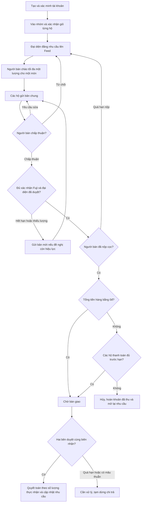

# Đặc tả dự án OOPS

Đây là điểm vào để đọc phạm vi, luồng nghiệp vụ, quy tắc bắt buộc, hợp đồng dữ liệu và tiêu chí nghiệm thu OOPS MVP. Tra chi tiết trong tài liệu chuyên đề của từng mục.

| Tài liệu | Vai trò |
| --- | --- |
| **OOPS-Spec.md** (file này) | Đặc tả tổng hợp, quy tắc đánh số, ma trận truy vết, phân công và nghiệm thu. |
| [requirements.md](requirements.md) | Yêu cầu FR01–FR04, kịch bản nghiệm thu, mốc M1–M4, quyết định còn mở. |
| [OOPS-MVP-Plan.md](OOPS-MVP-Plan.md) | Câu chuyện sản phẩm, màn hình, công thức cọc, xử lý lệch cam kết. |
| [architecture.md](architecture.md) | Sơ đồ thành phần, vòng đời hợp đồng, máy trạng thái, thứ tự khóa, bảo mật. |
| [schema.md](schema.md) | Bảng PostgreSQL, khóa, ràng buộc và bất biến dữ liệu. |
| [API doc.md](API%20doc.md) | Endpoint, payload, quyền, mã lỗi của `/api/v1`. |
| [OOPS-7-Day-Development-Plan.md](OOPS-7-Day-Development-Plan.md) | Task, giờ công, lịch 7 ngày, cổng kiểm thử, rủi ro. |
| [AGENTS.md](../AGENTS.md) | Căn cứ phân công, sở hữu file và quy ước triển khai. |

Khi tài liệu lệch nhau, áp dụng quyết định mới nhất đã được xác nhận và đồng bộ các file liên quan trong cùng thay đổi. Tra phân công và cách xử lý mâu thuẫn trong [AGENTS.md](../AGENTS.md#2-tài-liệu-và-xử-lý-mâu-thuẫn). `*.before-edit.md` và `*.diff` là lịch sử, không phải yêu cầu hiện hành.

---

## 1. Vấn đề và giải pháp

Các hộ trong cùng khu vực không biết chung nhau đang thiếu gì trước thiên tai. Mua riêng lẻ thì lượng nhỏ, không thương lượng được giá, và không có cơ chế ràng buộc người bán giao đúng cam kết.

OOPS gom nhu cầu của nhiều hộ trong một nhóm thành một nhu cầu theo từng món, đăng lên Feed cho người bán chào giá, rồi biến phần đã chốt thành **một hợp đồng cho một món** có cọc của người bán, xác nhận của từng hộ trên Avalanche Fuji, duyệt cuối của đại diện, và quyết toán hai chiều khi bàn giao.

Ba cơ chế tạo niềm tin:

1. **Cọc của người bán** giữ cam kết giao hàng, tách hoàn toàn khỏi tiền hàng người mua trả.
2. **Xác nhận trên Fuji** của mọi hộ có phần hàng, trên đúng phiên bản người bán đã chấp thuận — không sửa được sau khi gửi.
3. **Biên nhận hai lượt duyệt** ghi số lượng thực nhận trước khi chi tiền.

## 2. Phạm vi

### 2.1 Trong phạm vi MVP

- Một loại tài khoản dùng được cả hai luồng mua và bán, tối đa một nhóm hoạt động.
- Nhóm, vai trò đại diện có chấp thuận, link mời dùng một lần.
- Đợt gom, giỏ tay và giỏ Gemini, đóng gom, Feed theo khu vực.
- Đề nghị của người bán, hồ sơ thương lượng nhiều hộ, phiên bản bất biến, vòng yêu cầu sửa.
- Vòng xác nhận Fuji theo phiên bản, duyệt cuối của đại diện.
- Cọc và tiền hàng mô phỏng (`SIM`), bàn giao, biên nhận, quyết toán chi/hoàn.
- Thông báo trong app, theo dõi đơn, xử lý quá hạn và trạng thái **Cần xử lý**.

### 2.2 Ngoài phạm vi MVP

| Hạng mục | Ghi chú |
| --- | --- |
| Đổi giá/lượng sau khi đại diện đã chốt | Vòng sửa **trước** khi chốt vẫn là P0. |
| Đổi lịch giao sau khi chốt | — |
| QR/payOS thật, thu VND thật | Adapter mô phỏng cùng sổ giao dịch; webhook và checkout đã đặc tả nhưng để sau demo. |
| Vai trò phân xử và quy trình giải quyết tranh chấp cọc | Demo dừng ở `NEEDS_REVIEW` với `reviewScope = DEPOSIT`. |
| Yêu cầu bồi thường, khấu trừ cọc tự động | Cần điều khoản và thẩm quyền chưa chốt. |
| Định mức nhu yếu phẩm có nguồn đầy đủ | Seed một số SKU đại diện; Gemini chỉ trích dữ liệu người dùng nhập. |

## 3. Vai trò và tác nhân

| Tác nhân | Quyền chính | Giới hạn |
| --- | --- | --- |
| **Hộ (member)** | Tạo/sửa/xác nhận giỏ của mình, sửa dòng phần của mình khi nháp mở, ký xác nhận Fuji, thanh toán phần của mình, xem phần và khoản tiền của mình. | Không duyệt cuối, không duyệt biên nhận thay đại diện, không thấy dữ liệu nhóm khác. |
| **Đại diện (REP)** | Tạo đợt gom, đăng nhu cầu, mời/ chuyển vai trò, duyệt cuối phiên bản, lập biên nhận, duyệt biên nhận, báo sự cố, hủy theo điều kiện. | Tối đa một REP đang hoạt động mỗi nhóm. Quyền trên hợp đồng dựa trên `repId` đã chụp lúc chốt. |
| **Người bán (seller)** | Gửi đề nghị vào một dòng nhu cầu, phản hồi phiên bản, nộp cọc, báo sẵn sàng, tải bằng chứng, duyệt biên nhận, hủy trực tiếp theo điều kiện. | Không tham gia mua trong đề nghị của chính mình; chỉ thấy liên hệ của đại diện. |
| **Tài khoản vận hành (ops)** | Xem khoản chờ chi/hoàn, ghi `POSTED` kèm mã chuyển duy nhất. | Tách khỏi vai trò đại diện; chỉ môi trường demo có route mô phỏng. |
| **Worker** | Mở vòng Fuji, đọc log, chạy hạn, tạo thông báo, đối soát. | Không quyết định chuyển trạng thái nghiệp vụ; gọi hàm nghiệp vụ đã thống nhất. |

Một người có thể mua ở đơn này và bán ở đơn khác. Người bán và đại diện duyệt cùng một hợp đồng phải là hai tài khoản khác nhau.

## 4. Luồng nghiệp vụ end-to-end



Mười bước tương ứng với các mục dưới đây:

1. **Tài khoản và ví.** Supabase Auth giữ phiên. Hộ liên kết Core Wallet bằng challenge có nonce dùng một lần; bằng chứng ghi trên Fuji. Trạng thái `PENDING`, `VERIFIED`, `FAILED`; `confirmationEligible` do backend kiểm theo chính sách.
2. **Nhóm.** Người tạo nhóm xác nhận nhận vai trò đại diện khi gửi. Người khác vào bằng link `JOIN` dùng một lần. Chuyển vai trò `REP` cần đúng `targetUserId` đang trong nhóm và người nhận chấp thuận.
3. **Giỏ và đóng gom.** Mỗi hộ có một giỏ cho mỗi đợt: số người, cờ cần hỗ trợ, các dòng `stockQty` và `needQty`. Giỏ có `version` để chặn ghi đè. Giỏ nháp từ Gemini cũng phải qua bước sửa và xác nhận; lỗi AI thì quay về nhập tay, giữ nguyên dữ liệu đang sửa.
4. **Đăng nhu cầu.** Đại diện đăng trước `needBy`, có thể đăng sớm để đóng gom. Giao dịch đăng khóa đợt, chỉ chụp giỏ `CONFIRMED`, sinh `demand_items` và `demand_shares`, rồi mở Feed. Sau mốc này hộ chỉ đọc.
5. **Đề nghị.** Người bán gửi cho một `demandItemId`: lượng tối đa đến `missing`, đơn giá (kể cả 0), cờ hỗ trợ, khung giao `handoffStart..handoffBy`, thông tin điểm nhận riêng. Điều khoản bất biến sau khi gửi. App hiển thị trước tiền hàng và cọc dự kiến.
6. **Thương lượng.** Một hộ mở nháp cho đề nghị; mỗi hộ chỉ sửa dòng của mình khi nháp mở. Hộ khởi tạo gửi bản: server chụp lượng, đơn giá, lịch, phần từng hộ, tổng tiền và `versionHash`; bản bất biến. Người bán `APPROVE`, `REJECT` hoặc `REQUEST_CHANGES`. Từ chối kết thúc thương lượng của đề nghị.
7. **Xác nhận Fuji.** Khi chấp thuận, backend lấy **tất cả hộ có phần dương**. Mọi hộ phải có ví `VERIFIED`, đủ quyền và ví khác nhau. Thiếu ví trả `WALLET_NOT_READY` và **giữ bản `SUBMITTED`**. Đủ ví thì tạo đúng một vòng cho phiên bản và đưa yêu cầu mở vòng vào outbox. Mỗi ví xác nhận đúng một lần trên đúng phiên bản.
8. **Duyệt cuối.** Đại diện duyệt trước `repApproveBy`. Transaction kiểm lại trạng thái, hạn, tập xác nhận và lượng khả dụng theo món và theo hộ. Thành công tạo **đúng một** hợp đồng, khoản cọc và `pending`. Thiếu lượng ghi `STOCK_CONFLICT` và trả `409`, không đổi phần đã ký.
9. **Cọc và tiền hàng.** Cọc hợp lệ chuyển `pending` → `reserved`. Đơn 0đ bỏ `AWAIT_PAYMENT`. Đơn có giá tạo khoản `GOODS` cho từng hộ và chờ thu đủ. Quá hạn cọc hoặc tiền hàng thì hủy, giải phóng lượng và lập hoàn theo điều khoản.
10. **Bàn giao và quyết toán.** Người bán báo sẵn sàng và tải bằng chứng. Đại diện lập biên nhận theo lượng thực nhận từng phần. Hai bên duyệt cùng phiên bản biên nhận thì ghi lượng nhận, giải phóng toàn bộ lượng giữ và lập chi/hoàn trong một giao dịch. Ops ghi từng khoản `POSTED` bằng mã chuyển; đủ khoản bắt buộc thì đơn `SETTLING` → `COMPLETED`.

## 5. Màn hình và chức năng

| Màn hình | Nội dung bắt buộc | Yêu cầu |
| --- | --- | --- |
| **Tài khoản** | Đăng ký, đăng nhập, liên kết ví Core, trạng thái xác minh và bước còn thiếu để được xác nhận. | FR01 |
| **Nhóm của tôi** | Tạo nhóm, vào bằng link, mời và xác nhận đại diện, danh sách hộ, điểm nhận dự kiến, hạn gom. Mỗi hộ quản lý giỏ của mình. | FR01, FR02 |
| **Giỏ nhu yếu phẩm** | Chọn từ danh mục hoặc mô tả bằng câu tự nhiên, xem giỏ nháp, sửa món/số lượng/đơn vị, xác nhận. | FR02 |
| **Nhu cầu của nhóm** | Tổng theo món, hạn cần hàng, nút đăng Feed, và với mỗi món: **đã giữ**, **đã nhận**, **còn thiếu**. | FR02 |
| **Feed và gửi đề nghị** | Lọc theo quận/khu vực, phường, nhóm mặt hàng. Form chào có lượng, giá, khung giờ, điểm nhận; hiện tiền hàng và cọc dự kiến trước khi gửi. | FR02, FR03 |
| **Bản thương lượng và xác nhận** | Sửa phần của mình, gửi bản chung, xem phản hồi người bán, ký xác nhận Fuji đúng phiên bản. | FR03 |
| **Đơn của tôi** | Cả đơn mua và đơn bán: cọc, tiền hàng, hạn nộp, lịch nhận, tiến độ, khoản chi/hoàn. Đơn 0đ bỏ bước nộp tiền hàng của hộ và vẫn hiển thị cọc cho người bán. | FR03, FR04 |
| **Bàn giao** | Người bán báo sẵn sàng và tải bằng chứng; đại diện nhập lượng thực nhận; hai bên duyệt cùng biên nhận hoặc báo sự cố. | FR04 |
| **Vận hành** | Danh sách khoản chờ chi/hoàn, ghi mã chuyển duy nhất, xem trạng thái hợp đồng sau khi ghi. | FR04 |
| **Thông báo** | Đề nghị mới, vòng xác nhận mở, sắp hết hạn cọc/thanh toán, hàng sẵn sàng, sắp đến giờ nhận, đơn quá hạn, kết quả chi/hoàn. Mỗi mục mở đúng đối tượng. | FR04 |

## 6. Quy tắc nghiệp vụ bắt buộc

Các quy tắc dưới đây là bất biến hệ thống. Mỗi quy tắc cần ít nhất một test tương ứng.

### 6.1 Lượng và tồn

- **BR-01** Với mỗi dòng nhu cầu và mỗi dòng phần của hộ: `pending + reserved + received ≤ target`, kiểm dưới khóa.
- **BR-02** `missing = target − reserved − received`.
- **BR-03** `offerable = missing − pending`, gồm cả khi bằng 0. Đề nghị dự phòng và bản đang thương lượng **chưa** chiếm lượng.
- **BR-04** Tạo hợp đồng tăng `pending` đến hạn cọc. Cọc hợp lệ chuyển `pending` → `reserved`. Quá hạn cọc giải phóng `pending`.
- **BR-05** Một đợt chỉ có một dòng nhu cầu cho mỗi SKU. Một SKU là một mã danh mục có đơn vị cố định.
- **BR-06** Giải phóng lượng đúng một lần cho mỗi hợp đồng; `stock_state` đi `PENDING` → `RESERVED` → `RECEIPT_APPLIED` hoặc `RELEASED`.

### 6.2 Tiền

- **BR-07** Mọi khoản VND là số nguyên, đơn vị đồng.
- **BR-08** `goodsVnd = qty × unit_price_vnd`.
- **BR-09** `depositVnd = max(50_000, ceil(goodsVnd / 10))`, tính trên lượng cam kết của hợp đồng, kể cả khi giá 0.
- **BR-10** Cọc và tiền hàng là hai khoản riêng, chủ thể nộp khác nhau. Đơn 0đ vẫn có cọc 50.000đ nhưng không tạo khoản `GOODS`.
- **BR-11** Phí đại diện trong MVP bằng 0. Nếu áp dụng cho đơn có giá: là dòng riêng, loại khỏi công thức cọc, chỉ chi khi giao thành công.
- **BR-12** Mỗi khoản thu chỉ áp dụng một giao dịch khớp và đủ tiền trước hạn khi còn `PENDING`. Gửi lại cùng mã chỉ ghi một lần. Nộp thêm hoặc lệch số vào khoản đã nhận thì ghi `REVIEW`/`REFUND_DUE` để đối soát.
- **BR-13** Khoản chi/hoàn đi `PENDING` → `POSTED` chỉ khi có `transfer_ref` duy nhất. Tổng chi/hoàn theo một khoản thu ≤ tiền thực nhận.
- **BR-14** Chỉ chuyển `SETTLING` → `COMPLETED` khi mọi khoản chi/hoàn bắt buộc đã `POSTED` và không còn khoản bị khóa.

### 6.3 Phiên bản và xác nhận

- **BR-15** Điều khoản và dòng hàng của bản đã gửi là bất biến. Chỉ trạng thái, phản hồi và mốc xử lý được cập nhật.
- **BR-16** Tối đa một bản đang chờ phản hồi, xác nhận hoặc duyệt trong mỗi hồ sơ thương lượng.
- **BR-17** Mỗi phiên bản có tối đa một vòng Fuji. Vòng chỉ tạo khi **toàn bộ** hộ có phần dương đã có ví hợp lệ; không bao giờ tạo snapshot thiếu hộ.
- **BR-18** Một ví chỉ thuộc một hộ trong vòng. Mỗi hộ xác nhận đúng một lần. Chỉ tính sự kiện đúng chain, contract, vòng, `versionHash`, ví và block timestamp trước `confirmBy`.
- **BR-19** Xác nhận của bản cũ **không** áp dụng cho bản mới. Bản mới phải qua lại người bán, xác nhận Fuji và đại diện.
- **BR-20** Chỉ đại diện duyệt được, chỉ sau khi người bán chấp thuận và mọi hộ có phần đã xác nhận đúng phiên bản.
- **BR-21** Duyệt cuối tạo **đúng một** hợp đồng cho một cặp `proposal_id` + `source_version_id`, không tự phân lại phần.

#### Chuẩn băm phiên bản

Backend tạo `versionId` và lưu `versionHash = keccak256(abi.encode(...))` khi chụp bản gửi. ABI nhận các đối số dưới đây theo đúng thứ tự. Kết quả là `bytes32` trên Fuji và chuỗi hex chữ thường có tiền tố `0x` trong DB và JSON. [Đặc tả mã hóa ABI Solidity](https://docs.soliditylang.org/en/latest/abi-spec.html#formal-specification-of-the-encoding)

| Vị trí | Kiểu ABI | Giá trị |
| --- | --- | --- |
| 1 | `string` | Chuỗi cố định `OOPS_NEGOTIATION_VERSION_V1` |
| 2–3 | `bytes16, bytes16` | `proposalId`, `versionId` |
| 4 | `uint32` | Số `version` trong nháp |
| 5–6 | `bytes16, bytes16` | `demandItemId`, `sellerId` |
| 7 | `uint64` | `unitPriceVnd` tính theo đồng |
| 8–9 | `int64, int64` | `handoffStart`, `handoffBy` theo micro giây Unix UTC |
| 10–11 | `bool, string` | `supportOffer`, `handoffPrivate` |
| 12 | `(bytes16,uint32,string)[]` | Các dòng `(membershipId, qty, note)` có lượng dương |

- UUID bỏ dấu gạch nối và đọc 32 ký tự hex thành 16 byte theo thứ tự từ trái sang phải. Sắp xếp dòng tăng dần theo 16 byte của `membershipId`.
- Dùng thời điểm chính xác từ PostgreSQL. Đọc số micro giây dưới dạng số nguyên, giữ phần lẻ của giây qua quá trình mã hóa.
- Chuỗi dùng UTF-8 của giá trị đã lưu. Ghi chú vắng mặt được mã hóa thành chuỗi rỗng. Lượng tổng và tiền hàng suy ra từ dòng và đơn giá. Trạng thái, phản hồi của người bán, hạn xử lý và thông tin vòng Fuji nằm ngoài dữ liệu băm.
- Bản gửi lại có `versionId` mới và tăng `version`. Với nội dung bản, Fuji chỉ nhận mã băm. Điểm giao riêng, dòng hàng và ghi chú dùng để tính băm được giữ trong hệ thống app.

**Vector kiểm thử 10→7.** Đơn giá 2.000đ. Khung giao 15h–16h ngày 18/11/2026 theo giờ Việt Nam. JSON dưới đây dùng UUID và số micro giây dạng chuỗi cho dễ đối chiếu trước khi chuyển sang kiểu ABI.

```json
{
  "proposalId": "f00740b1-955c-4dac-9601-3aa75e430185",
  "versionId": "bf05cd2b-5143-41f0-91d6-8332c6b8257f",
  "version": 1,
  "demandItemId": "b868dc0e-4dad-43b0-8a9d-ea2db18070c4",
  "sellerId": "eced0276-59c8-4341-a214-91148a404112",
  "unitPriceVnd": 2000,
  "handoffStartUs": "1794988800000000",
  "handoffByUs": "1794992400000000",
  "supportOffer": false,
  "handoffPrivate": "Sảnh A",
  "lines": [
    ["55ea173b-4141-44c7-afc6-f0113bd72bbd", 2, ""],
    ["55ea173b-4141-44c7-afc6-f0113bd72bbe", 2, ""],
    ["55ea173b-4141-44c7-afc6-f0113bd72bbf", 3, "Nhận buổi chiều"]
  ]
}
```

`versionHash` dự kiến là `0x93c0fedb2c764bfdea295f6815462007329bf9dd2fb33b72b1707749c028ce7b`.

### 6.4 Bàn giao và hủy

- **BR-22** Chỉ ghi bằng chứng, lập hoặc duyệt biên nhận khi cọc đã nhận, tiền hàng đã thu đủ nếu có, và `stock_state = RESERVED`.
- **BR-23** Biên nhận phải có đủ mỗi allocation của hợp đồng đúng một lần, kể cả lượng 0; `0 ≤ receivedQty ≤ qty`. Bằng chứng phải cùng hợp đồng. Biên nhận có lượng dương cần ít nhất một bằng chứng của người bán.
- **BR-24** Lập biên nhận đúng hạn ở `AWAIT_HANDOFF` chuyển sang `AWAIT_APPROVAL` trong cùng giao dịch. Quá hạn bàn giao, quá hạn duyệt hoặc sự cố mâu thuẫn thì đơn ở `NEEDS_REVIEW` với `reviewScope = HANDOFF`.
- **BR-25** Thay biên nhận nháp chuyển bản cũ sang `SUPERSEDED`; hai bên duyệt lại từ đầu, lượt duyệt cũ giữ để đối chiếu. Báo mâu thuẫn kết quả giao cũng `SUPERSEDED` bản nháp hiện hành.
- **BR-26** Hai bên duyệt cùng phiên bản biên nhận thì chuyển `APPROVED`, cộng lượng thực nhận, giải phóng toàn bộ lượng giữ, `stock_state = RECEIPT_APPLIED` — một lần duy nhất.
- **BR-27** Hủy trực tiếp chỉ khi đang `AWAIT_DEPOSIT`, `AWAIT_PAYMENT` hoặc `AWAIT_HANDOFF`, và chưa có bằng chứng, biên nhận hay sự cố bàn giao. Hủy theo điều khoản hai bên chỉ khi còn `PENDING` hoặc `RESERVED` về lượng và chưa áp biên nhận.
- **BR-28** Cọc chưa rõ cách xử lý giữ riêng ở `NEEDS_REVIEW` với `reviewScope = DEPOSIT`, không chặn phần tiền hàng đã xác định.

### 6.5 Nhất quán và lặp

- **BR-29** Thứ tự khóa: đợt gom → dòng nhu cầu, dòng phần hộ, đề nghị, hồ sơ, phiên bản, vòng → hợp đồng → bản ghi thuộc hợp đồng (khoản thu, giao dịch thu, khoản chi, bằng chứng, biên nhận, yêu cầu thay đổi). Nhiều dòng cùng loại khóa theo khóa chính tăng dần.
- **BR-30** Sau khi lấy khóa, đọc lại trạng thái, phiên bản, thời hạn và lượng trước khi ghi.
- **BR-31** Ghi thay đổi nghiệp vụ và outbox trong cùng giao dịch. Gọi dịch vụ ngoài sau khi đã commit, rồi xử lý kết quả trong giao dịch mới.
- **BR-32** `Idempotency-Key` cho POST nghiệp vụ và thao tác ghi tiền. Cùng khóa + cùng dữ liệu trả kết quả cũ; cùng khóa + khác dữ liệu trả `409`.
- **BR-33** Ràng buộc duy nhất giữ vai trò chống lặp cho sự kiện thu, chi và xác nhận (`mode + external_ref`, `transfer_ref`, `chain_id + tx_hash + log_index`).
- **BR-34** Worker thử lại có backoff; không rõ kết quả tạo link thì truy vấn theo `orderCode` trước khi thử lại. Cursor và outbox bền vững qua restart.

## 7. Máy trạng thái

### 7.1 Nhu cầu, đề nghị, phiên bản

| Đối tượng | Trạng thái | Điều kiện |
| --- | --- | --- |
| Nhu cầu | `DRAFT` → `OPEN` → `COVERED` → `FULFILLED` | `COVERED` khi `missing = 0` và còn chờ giao; `FULFILLED` khi `received = target`. |
| Đề nghị | `SUBMITTED`, `SELECTED`, `REJECTED`, `EXPIRED` | `SELECTED` sau duyệt cuối; `EXPIRED` khi lịch không còn đủ thời gian. |

| Từ | Hành động hoặc mốc | Sang | Thông báo |
| --- | --- | --- | --- |
| `SUBMITTED` | Người bán chấp thuận, mọi hộ có ví hợp lệ | `AWAIT_CONFIRMATIONS` | Các hộ khi vòng mở |
| `SUBMITTED` | Yêu cầu sửa / từ chối | `CHANGES_REQUESTED` / `REJECTED` | Hộ khởi tạo và các hộ có phần |
| `SUBMITTED` | Hết hạn phản hồi | `EXPIRED` (`SELLER_TIMEOUT`) | Người bán, hộ khởi tạo, các hộ có phần |
| `AWAIT_CONFIRMATIONS` | Đủ sự kiện hợp lệ cho bản hiện hành | `AWAIT_REP_APPROVAL` | Đại diện |
| `AWAIT_CONFIRMATIONS` | Hết `confirmBy`, đã đồng bộ qua cutoff, còn thiếu | `EXPIRED` (`CONFIRMATION_TIMEOUT`) | Các bên |
| `AWAIT_CONFIRMATIONS`, `AWAIT_REP_APPROVAL` | Tới `repApproveBy` | `EXPIRED` (`FINALIZE_TIMEOUT`) | Các bên |
| `AWAIT_REP_APPROVAL` | Đại diện duyệt đúng hạn, đủ lượng | `FINALIZED` → hợp đồng `AWAIT_DEPOSIT` | Người bán, các hộ có phần |
| `AWAIT_REP_APPROVAL` | Lượng không còn đủ | `STOCK_CONFLICT` | Ghi nhận và trả `409` |

### 7.2 Hợp đồng và tiền

- **Hợp đồng:** `AWAIT_DEPOSIT → AWAIT_PAYMENT? → AWAIT_HANDOFF → AWAIT_APPROVAL → SETTLING → COMPLETED`; nhánh `CANCELED` và `NEEDS_REVIEW` (`HANDOFF` hoặc `DEPOSIT`).
- **Lượng:** `PENDING → RESERVED → RECEIPT_APPLIED` / `RELEASED`.
- **Khoản thu:** `PENDING`, `RECEIVED`, `EXPIRED`, `REVIEW`.
- **Khoản chi/hoàn:** `PENDING`, `POSTED`, `REVIEW`.
- **Biên nhận:** `DRAFT`, `APPROVED`, `SUPERSEDED`; tối đa một `APPROVED` mỗi hợp đồng.
- **Yêu cầu hủy theo điều khoản:** `PENDING`, `ACCEPTED`, `EXPIRED`; tối đa một `PENDING` mỗi hợp đồng.
- **Vòng xác nhận:** `OPENING`, `OPEN`, `CONFIRMED`, `CLOSED`.
- **Ví:** `PENDING`, `VERIFIED`, `FAILED`.

## 8. Thời hạn

Khi hộ khởi tạo gửi bản, server lấy `submittedAt` từ đồng hồ PostgreSQL sau khi khóa nháp và tính `sellerResponseDueAt = submittedAt + 6 giờ`. Từ hạn phản hồi đến `handoffStart` phải còn ít nhất 24 giờ cho xác nhận, duyệt và thu tiền. Nhóm vì vậy cần gửi bản ít nhất 30 giờ trước lúc bắt đầu giao. Nếu lịch không đủ thời gian, API trả `409 STATE_CONFLICT` và giữ nháp mở. Mỗi phiên bản gửi mới được tính hạn riêng. Phát lại cùng yêu cầu với khóa idempotency còn hiệu lực trả lại bản và hạn đã lưu.

Tạo đề nghị, mở nháp và sửa dòng nháp cũng yêu cầu còn ít nhất 30 giờ trước lúc bắt đầu giao. Bản đã gửi tiếp tục dùng các hạn đã lưu cho phiên bản đó.

Ví dụ, lịch giao bắt đầu lúc 15h ngày 18/11. Nhóm gửi bản lúc 9h ngày 17/11 thì người bán có thể phản hồi trước 15h cùng ngày. Gửi lúc 9h01 ngày 17/11 bị từ chối vì còn 23 giờ 59 phút sau hạn phản hồi. Tại hoặc sau hạn phản hồi, API trả `409` dù worker chưa ghi `EXPIRED` với lý do `SELLER_TIMEOUT`.

Khi người bán chấp thuận, `confirmBy` là lúc chấp thuận + 8 giờ và `repApproveBy` là `confirmBy` + 4 giờ. Sau khi đại diện duyệt, hạn cọc là lúc duyệt + 4 giờ. Nếu có tiền hàng, hạn thu là hạn cọc + 6 giờ. Hạn thu cuối phải cách giờ bắt đầu giao ít nhất 2 giờ để chuẩn bị. Hạn duyệt biên nhận là `handoffBy` + 24 giờ.

| Mốc | Ý nghĩa | Ai kiểm |
| --- | --- | --- |
| `collectUntil` | Hết hạn gom; sau mốc này cấm sửa và xác nhận giỏ. Phải trước `needBy`. | API giỏ |
| `needBy` | Hạn cần hàng; giới hạn trên của `handoffBy`. | API đăng, đề nghị |
| `sellerResponseDueAt` | Hạn người bán phản hồi bản gửi. | Worker, API phản hồi |
| `confirmBy` | Hạn xác nhận Fuji; sự kiện sau mốc không tính. | Worker, duyệt cuối |
| `repApproveBy` | Hạn đại diện duyệt; tại hoặc sau mốc bị từ chối kể cả khi job chưa chạy. | API duyệt, worker |
| `depositDueAt`, `paymentDueAt` | Hạn nộp cọc và tiền hàng. | Worker, ghi nhận thu |
| `ready_by`, `handoffBy` | Hạn báo sẵn sàng và hạn giao. | Worker, lập biên nhận |
| `approvalDueAt` | Hạn hai bên duyệt biên nhận. | Worker |
| `scheduledHandoffBy` | Lịch giao đang áp dụng, chụp lúc lập biên nhận, dùng so `handedAt` để xét giao muộn. | Lập biên nhận |

API dùng các hạn đã lưu khi ghi nghiệp vụ. Worker đối chiếu hạn hiện hành để xử lý quá hạn và thông báo.

## 9. Dữ liệu

Xem [schema.md](schema.md) cho trường và ràng buộc đầy đủ.

| Nhóm | Bảng | Bất biến chính |
| --- | --- | --- |
| Tài khoản và nhóm | `profiles`, `wallets`, `groups`, `memberships`, `invites` | `UQ user_id` với `left_at NULL`; tối đa một REP hoạt động mỗi nhóm; nhóm chỉ đăng bài khi có REP. |
| Danh mục và đợt gom | `catalog_items`, `campaigns`, `carts`, `cart_items` | `collect_until < need_by`; `UQ (campaign_id, membership_id)`; chỉ giỏ `CONFIRMED` được chụp. |
| Nhu cầu | `demand_items`, `demand_shares` | `UQ (campaign_id, sku_id)`; `target > 0`; tổng theo món bằng tổng các hộ. |
| Thương lượng | `proposals`, `negotiations`, `negotiation_draft_lines`, `negotiation_versions`, `negotiation_version_lines` | `UQ (negotiation_id, version)`; `version_hash` duy nhất; tối đa một bản đang hoạt động. |
| Xác nhận | `confirmation_rounds`, `confirmation_participants`, `confirmations`, `chain_cursors` | `UQ version_id`; ví duy nhất trong vòng; `UQ (chain_id, tx_hash, log_index)`. |
| Hợp đồng | `contracts`, `allocations`, `evidence`, `receipts`, `receipt_approvals`, `terminations` | `UQ proposal_id`, `UQ source_version_id`; `UQ (contract_id, membership_id)`; `UQ (contract_id, version)`. |
| Sổ tiền | `charges`, `fund_events`, `disbursements` | Một `DEPOSIT` mỗi hợp đồng; `UQ (mode, external_ref)`; `dedupe_key` và `transfer_ref` duy nhất. |
| Hạ tầng | `outbox`, `idempotency_keys`, `notifications`, `audit_events` | `UQ event_key`; PK `(actor_id, operation, key)`; `UQ (user_id, event_key)`. |

Quy ước: `id` là UUID trừ bảng có khóa ghép; `ts` là `timestamptz`; `vnd` là `bigint` không âm; trường có `?` cho phép NULL.

## 10. Hợp đồng API

Tiền tố `/api/v1`. JSON, trừ upload bằng chứng (`multipart/form-data`). Trường camelCase, enum viết hoa. Xem [API doc.md](API%20doc.md) cho payload chi tiết.

| Nhóm | Endpoint |
| --- | --- |
| Tài khoản, ví | `GET/PATCH /me`, `GET /wallet/challenge`, `POST /wallet/link` |
| Nhóm | `POST /groups`, `GET /groups/{id}`, `POST /groups/{id}/invites`, `POST /invites/accept` |
| Đợt gom và giỏ | `POST /groups/{id}/campaigns`, `GET /catalog`, `GET/PUT /campaigns/{id}/cart`, `POST /campaigns/{id}/cart/ai`, `POST /campaigns/{id}/cart/confirm`, `POST /campaigns/{id}/publish`, `GET /campaigns/{id}/needs` |
| Feed và đề nghị | `GET /feed`, `POST /needs/{id}/offers`, `GET /needs/{id}/offers` |
| Thương lượng | `POST /offers/{id}/draft`, `GET /drafts/{id}`, `PUT /drafts/{id}/my-line`, `POST /drafts/{id}/submit`, `POST /drafts/{id}/versions/{version}/seller-response`, `POST /drafts/{id}/revise` |
| Xác nhận và chốt | `GET /rounds/{id}`, `confirmVersion` on-chain, `POST /drafts/{id}/versions/{version}/finalize` |
| Hợp đồng | `GET /contracts`, `GET /contracts/{id}`, `POST /contracts/{id}/ready` |
| Thu tiền | `POST /demo/charges/{id}/receive`; sau demo: `POST /charges/{id}/checkout`, `POST /webhooks/payos` |
| Bàn giao | `POST /contracts/{id}/evidence`, `GET /evidence/{id}`, `POST /contracts/{id}/receipts`, `POST /receipts/{id}/approve` |
| Sự cố và hủy | `POST /contracts/{id}/issues`, `POST /contracts/{id}/cancel`, `POST /contracts/{id}/terminations`, `POST /terminations/{id}/accept` |
| Vận hành và thông báo | `GET /ops/disbursements`, `POST /ops/disbursements/{id}/post`, `GET /notifications`, `PATCH /notifications/{id}` |

Mã lỗi chung: `401` thiếu phiên, `403` thiếu quyền, `404` không tồn tại hoặc cần ẩn, `409` xung đột phiên bản/trạng thái/idempotency, `422` dữ liệu sai, `429` vượt giới hạn, `503` phụ thuộc lỗi tạm thời. Envelope lỗi gồm `error.code`, `error.message` và `requestId`.

## 11. Bảo mật và quyền riêng tư

- Supabase Auth giữ phiên; API kiểm quyền trên **từng bản ghi**; RLS chặn truy cập chéo nhóm.
- Hộ chỉ thấy phần của mình. Người bán và đại diện thấy thông tin cần cho bàn giao và duyệt. Người bán chỉ thấy liên hệ của đại diện.
- Địa chỉ chi tiết và liên hệ chỉ mở cho các bên liên quan **sau khi chốt**; điểm giao đề xuất chỉ hiện cho người bán và đại diện trong lúc thương lượng.
- Feed chỉ chứa dữ liệu công bố: khu vực, hạn cần hàng, lượng còn thiếu.
- Service role key, Gemini key và payOS key nằm ở server. Bằng chứng nằm trong bucket riêng, chỉ cấp URL ký có hạn sau khi kiểm quyền.
- Ví ký giao dịch Fuji ở client hoặc qua ví nhúng của người dùng. Chỉ đưa lên Fuji mã vòng, mã băm, ví và xác nhận; dữ liệu hộ, địa chỉ, ảnh và VND ở hệ thống app.
- Log dùng ID, trạng thái và mã lỗi; lược bỏ thông tin liên hệ, chữ ký và payload ngân hàng thô.
- Quyền vận hành tách khỏi vai trò đại diện; endpoint xác nhận chi thật yêu cầu quyền vận hành và mã đối soát chuyển đi.

## 12. Kiến trúc triển khai

Một codebase Next.js (App Router, TypeScript, Tailwind) phục vụ web di động và API. Supabase cung cấp Auth, PostgreSQL và Storage. Worker chạy riêng từ cùng codebase. Gemini chỉ tạo giỏ nháp, kiểm bằng Zod, app áp quy tắc. Fuji C-Chain xác minh ví và xác nhận phiên bản qua Core Wallet, Solidity và Viem. Tiền đi qua adapter `SIM` trong demo.

Sơ đồ thành phần, ranh giới dữ liệu và các phương án đã cân nhắc: [architecture.md](architecture.md).

## 13. Tiêu chí nghiệm thu

### 13.1 Kịch bản bắt buộc

| # | Kịch bản | Kết quả đúng |
| --- | --- | --- |
| AC-01 | Nhu cầu 12 chai, chưa có đơn khác. Chào 10 chai, ba hộ gửi 7 chai (2+2+3), người bán chấp thuận. | Cả ba hộ xác nhận đúng bản rồi đại diện chốt 7 chai. Chờ cọc: `pending=7`, `reserved=0`, `missing=12`, `offerable=5`. Sau cọc hợp lệ: `pending=0`, `reserved=7`, `missing=5`, `offerable=5`. |
| AC-02 | Một hộ chưa có ví khi người bán chấp thuận | Trả `WALLET_NOT_READY`, bản giữ `SUBMITTED`, vòng không mở. |
| AC-03 | Yêu cầu sửa rồi gửi bản mới | Bản cũ hết hiệu lực, không kế thừa xác nhận; bản mới qua lại đủ ba bước. |
| AC-04 | Nhu cầu 12 chai, đơn 8 chai chờ cọc | `missing = 12`, `offerable = 4`; Feed vẫn nhận đề nghị dự phòng. |
| AC-05 | Cọc 50.000đ hợp lệ | `pending` → `reserved` 8 chai, `missing = 4`. Trong thời hạn, bài còn trên Feed với 4 chai thiếu và rời Feed nếu `missing = 0`. |
| AC-06 | Đơn 0đ | Không tạo khoản `GOODS`; chuyển thẳng chờ bàn giao sau cọc. |
| AC-07 | Đơn 8 × 2.000đ | Thu tổng 16.000đ theo từng hộ, tách khỏi cọc. |
| AC-08 | Giao 6/8 chai, hai bên duyệt cùng biên nhận | Ghi nhận 6, giải phóng cả 8; chi 12.000đ, hoàn 4.000đ theo phần từng hộ; `missing = 6`. |
| AC-09 | Chỉ một bên duyệt biên nhận đến hạn | Đơn `NEEDS_REVIEW`/`HANDOFF`; không tự chi, không tự phạt cọc. |
| AC-10 | Hết hạn seller, thiếu xác nhận, đại diện chưa duyệt | Bản `EXPIRED` với đúng `reasonCode`; không giữ lượng. |
| AC-11 | Thiếu lượng lúc duyệt cuối | Ghi `STOCK_CONFLICT`, trả `409`, không đổi phần đã ký. |
| AC-12 | Phát lại sự kiện thu SIM, gửi lại request cùng khóa và dùng trùng mã chuyển | Mỗi giao dịch chỉ áp dụng một lần. Cùng khóa khác dữ liệu hoặc dùng mã chuyển đã thuộc khoản khác trả `409`. |
| AC-13 | Hủy của người bán sau khi đã có bằng chứng | Bị chặn `409`. Hủy hợp lệ giải phóng lượng và hoàn tiền hàng đúng một lần. |
| AC-14 | Giao đủ, đúng hạn | `COMPLETED` sau khi mọi khoản chi/hoàn bắt buộc `POSTED`. |
| AC-15 | Đọc chéo nhóm, đọc ảnh bằng chứng ngoài quyền | Bị chặn; URL ký hết hạn. |
| AC-16 | Gemini lỗi hoặc trả sai schema | Giữ dữ liệu đang sửa, nhập tay chạy cùng luồng. |

### 13.2 Cổng kiểm thử

| Cổng | Ca bắt buộc |
| --- | --- |
| **Nghiệp vụ và UI** | AC-01, AC-03, AC-10, AC-11 qua cả API và giao diện. |
| **Fuji** | AC-02, AC-03; cộng log lặp, sai vòng, restart worker; có mã giao dịch thật trên explorer. |
| **Tồn lượng** | AC-04, AC-05, AC-08; hai yêu cầu chốt đồng thời không vượt `target`. |
| **Tiền mô phỏng** | AC-06, AC-07, AC-08, AC-12, AC-14. |
| **Bàn giao và hạn** | AC-09, AC-13; chưa đủ tiền thì không lập được biên nhận. |
| **Quyền riêng tư và phục hồi** | AC-15, AC-16; worker restart không mất việc; staging chạy lại từ seed. |

Mốc tích hợp M1–M4 và điều kiện đạt từng mốc: [requirements.md](requirements.md#kế-hoạch-tích-hợp).

## 14. Ma trận truy vết

| Yêu cầu | Màn hình | API | Bảng | Kịch bản |
| --- | --- | --- | --- | --- |
| **FR01** Tài khoản, nhóm, đại diện | Tài khoản, Nhóm của tôi | `/me`, `/wallet/*`, `/groups*`, `/invites/accept` | `profiles`, `wallets`, `groups`, `memberships`, `invites` | AC-02 |
| **FR02** Giỏ, đợt gom, Feed | Giỏ, Nhu cầu của nhóm, Feed | `/catalog`, `/campaigns/*`, `/feed` | `catalog_items`, `campaigns`, `carts`, `cart_items`, `demand_items`, `demand_shares` | AC-04, AC-16 |
| **FR03** Đề nghị, thương lượng, xác nhận, duyệt cuối | Feed, Bản thương lượng, Đơn của tôi | `/needs/*`, `/offers/*/draft`, `/drafts/*`, `/rounds/*`, `confirmVersion` | `proposals`, `negotiations*`, `confirmation_*`, `confirmations`, `contracts`, `allocations` | AC-01, AC-02, AC-03, AC-05, AC-10, AC-11 |
| **FR04** Cọc, tiền hàng, bàn giao, quyết toán | Đơn của tôi, Bàn giao, Vận hành, Thông báo | `/demo/charges/*`, `/contracts/*`, `/receipts/*`, `/ops/*`, `/notifications` | `charges`, `fund_events`, `disbursements`, `evidence`, `receipts`, `receipt_approvals`, `terminations` | AC-06, AC-07, AC-08, AC-09, AC-12, AC-13, AC-14 |

## 15. Phân công chính thức

| Vai trò | Chịu trách nhiệm | Bàn giao cho nhóm |
| --- | --- | --- |
| **DEV 1 — Frontend** | App shell, API client, UI tài khoản, nhóm, giỏ tay/Gemini, Feed, thương lượng, đơn, bàn giao, ops và thông báo. Tích hợp component ký. | UI dùng fixture chung và kết nối API thật. Kiểm màn điện thoại và luồng theo vai. |
| **DEV 2 — Backend + DB** | Auth/phân quyền server, API nghiệp vụ gồm Gemini và ops, PostgreSQL, migration/RLS, giữ lượng, cọc và quyết toán SIM. | DTO, lỗi, fixture, seed, API và hàm giao dịch để worker gọi. |
| **DEV 3 — DevOps + Tích hợp Fuji** | Toolchain, CI, staging, API chứng minh ví/credential Fuji, Solidity/ABI, component ký Core Wallet, indexer, worker hạn/thông báo và điều phối E2E. | URL staging, interface ký, kết quả Fuji đã xác minh, bằng chứng E2E, SHA và runbook. |

Ranh giới bắt buộc giữa các vai trò:

- **DEV 2** quyết định chuyển trạng thái nghiệp vụ. Không route nào được ghi thẳng lượng, tiền hoặc trạng thái ngoài hàm giao dịch đã thống nhất.
- **DEV 3** không tự đặt lại quy tắc nghiệp vụ khi thấy log Fuji lệch; ghi kết quả đã kiểm rồi gọi hàm của DEV 2.
- **DEV 1** dựng UI trên fixture chung, không tự định nghĩa payload khác đặc tả API.
- **File dùng chung:** DEV 2 giữ DTO, validation, fixture, enum nghiệp vụ và migration. DEV 1 giữ API client. DEV 3 điều phối manifest, lockfile và toolchain, đồng thời giữ ABI và cấu hình triển khai. Đổi interface cập nhật tài liệu, kiểu, fixture và bên gọi theo [bản đồ sở hữu](../AGENTS.md#bản-đồ-file-dự-kiến).

Chuỗi ID dùng khi làm song song là `demandItemId → proposalId → draftId → versionId → roundId → contractId`. `versionId` là UUID, còn `version` là số phiên bản trong một nháp.

## 16. Khoảng trống và việc cần chốt

Các mục dưới đây **chưa** có quyết định trong tài liệu hiện có. Không tự chọn thay nhóm.

| # | Vấn đề | Ảnh hưởng |
| --- | --- | --- |
| G-06 | Deployment, ABI credential, cấp/thu hồi quyền xác nhận và chính sách block/cutoff/reorg | DEV 3 cấu hình contract và worker Fuji theo [interface backend](architecture.md#bàn-giao-backend-và-worker). Dùng [chuẩn băm và vector đã chốt](#chuẩn-băm-phiên-bản) cho `versionHash`. |
| G-07 | Định mức nhu yếu phẩm có nguồn và bộ quy tắc gợi ý | MVP seed SKU đại diện và để hộ sửa tay. |
| G-08 | Điều kiện, mức khấu trừ cọc, bên nhận khấu trừ, thẩm quyền xử lý ca mâu thuẫn | Demo dừng ở `NEEDS_REVIEW`/`DEPOSIT`. |
| G-09 | Trạng thái và phạm vi khóa thao tác rời nhóm hoặc đổi ví | Demo khóa thao tác có ảnh hưởng khi còn bản đang chờ xác nhận hoặc hợp đồng đang chạy. |
| G-12 | Năng lực và quyền môi trường thực tế, cách bổ sung giờ cho các mốc vượt quỹ | Xác nhận ở D1 theo [kế hoạch 7 ngày](OOPS-7-Day-Development-Plan.md). |

## 17. Thứ tự đọc theo vai

| Vai | Đọc theo thứ tự |
| --- | --- |
| **DEV 1** | File này → mục 5, 6, 10, 13 → [API doc](API%20doc.md) → [OOPS-MVP-Plan.md](OOPS-MVP-Plan.md) mục 2 |
| **DEV 2** | File này → mục 6, 7, 9, 13 → [schema.md](schema.md) → [architecture.md](architecture.md) mục Nhất quán |
| **DEV 3** | File này → mục 4, 7.1, 11 → [architecture.md](architecture.md) → [OOPS-7-Day-Development-Plan.md](OOPS-7-Day-Development-Plan.md) mục 5, 14 |
