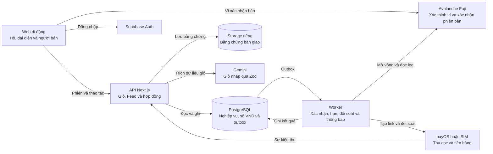

# Kiến trúc hệ thống OOPS MVP

Next.js phục vụ web trên điện thoại và API. Supabase Auth xác thực phiên, PostgreSQL lưu nghiệp vụ và VND, Gemini hỗ trợ lập giỏ nháp. Demo dùng Fuji testnet và tiền mô phỏng cho cả tiền hàng lẫn cọc.

Các luồng nghiệp vụ dựa trên [kế hoạch MVP](OOPS-MVP-Plan.md). Xem thêm [Yêu cầu](requirements.md), [Schema PostgreSQL](schema.md) và [Đặc tả API](API%20doc.md).

## Sơ đồ kiến trúc

## Thành phần chính

| Thành phần | Trách nhiệm | Dữ liệu chính | Khi có lỗi |
| --- | --- | --- | --- |
| Web và API | Next.js, TypeScript, Tailwind. Xác thực, phân quyền, nghiệp vụ. | Supabase Auth | Yêu cầu đăng nhập lại khi hết phiên. |
| Dữ liệu app | Giao dịch giữ hàng, quyết toán, outbox và RLS. | PostgreSQL và Storage riêng | Rollback khi ghi lỗi. Worker chạy lại từ outbox. |
| Giỏ AI | Gemini trích dữ liệu. Zod kiểm tra và app áp quy tắc có nguồn. | Danh mục và giỏ nháp | Giữ bản đang sửa và cho nhập tay. |
| Tài khoản và xác nhận | Core Wallet ký, Solidity kiểm quyền và Viem đọc sự kiện xác nhận. | Avalanche Fuji C-Chain | Đợi đồng bộ trước khi chốt. |
| VND và công việc nền | Mô phỏng hoặc QR, đối soát, hạn và thông báo. | Sổ VND, outbox và payOS | Đối chiếu khi lệch hoặc tới trễ. |

## Vòng đời hợp đồng

1. Hộ sửa và xác nhận giỏ trước hạn gom, khi đợt còn nháp. Đại diện xem trước tổng từ các giỏ đã xác nhận và có thể đóng gom sớm bằng cách đăng. API chụp số lượng cần theo hộ và món. Feed hiển thị khu vực, hạn cần hàng và lượng còn thiếu.
2. Người bán gửi đề nghị cho một món với lượng chào tối đa đến `missing`. Đề nghị dự phòng và bản thương lượng chưa chiếm lượng.
3. Một hộ có nhu cầu khởi tạo bản chung. Mỗi hộ sửa phần của mình khi nháp mở, trừ người bán của đề nghị. Hộ khởi tạo gửi bản bất biến có tổng lượng dương, không vượt lượng chào. App tính tiền theo đơn giá của đề nghị. Người bán chấp thuận, từ chối hoặc yêu cầu sửa bản đang chờ.
4. Khi người bán chấp thuận, backend lấy **tất cả hộ có phần dương** của bản. Từng hộ phải có ví liên kết đã xác minh và đủ quyền Fuji, mỗi ví chỉ thuộc một hộ trong vòng. Thiếu ví thì trả lỗi, giữ bản chờ người bán. Đủ ví thì tạo vòng cho đúng phiên bản và giao worker mở qua outbox. Khi worker đã ghi đủ xác nhận Fuji hợp lệ, đại diện duyệt đúng bản. Transaction duyệt kiểm lại trạng thái, thời hạn, tập xác nhận và lượng còn có thể chốt theo món và theo hộ. Thành công tạo một hợp đồng, khoản cọc và `pending`. Thiếu lượng ghi xung đột, giữ nguyên bản đã xác nhận và không giữ hàng.
5. Cọc hợp lệ chuyển `pending` sang `reserved`. Đơn 0đ chờ bàn giao. Đơn có giá tạo khoản thu cho từng hộ và chờ thu đủ. Quá hạn cọc hoặc tiền hàng thì hủy, giải phóng lượng tương ứng và lập hoàn các khoản đã thu theo điều khoản.
6. Sau khi đã nhận cọc và thu đủ tiền hàng nếu có, hợp đồng ở `AWAIT_HANDOFF` với lượng `RESERVED`. Người bán báo sẵn sàng và gửi bằng chứng. Đại diện lập biên nhận theo lượng thực nhận từng hộ. Lập biên nhận hiện hành đúng hạn chuyển đơn từ `AWAIT_HANDOFF` sang `AWAIT_APPROVAL` trong cùng giao dịch. Nếu đã ở `NEEDS_REVIEW` với phạm vi `HANDOFF`, biên nhận mới vẫn cần đủ hai lượt duyệt để xử lý. Chi tiết về phiên bản và hạn duyệt nằm trong [API thanh toán và bàn giao](API%20doc.md#thanh-toán-và-bàn-giao).
7. Khi hai bên duyệt cùng biên nhận, backend ghi lượng thực nhận, giải phóng lượng giữ và lập chi/hoàn trong một giao dịch. Giao đủ, đúng hạn thì lập hoàn toàn bộ cọc. Nếu cọc cần xử lý, `NEEDS_REVIEW` phạm vi `DEPOSIT` chỉ khóa khoản liên quan cọc. Tài khoản vận hành ghi từng khoản `POSTED` với mã chuyển SIM. Trong cùng transaction, nếu đơn `SETTLING` đã có đủ khoản chi/hoàn `POSTED` và không còn khoản bắt buộc bị khóa, đơn chuyển `COMPLETED`.

### Trạng thái thương lượng và thời hạn

Tại D1, chốt cấu hình deadline theo lịch giao và độ trễ Fuji đo được. Server tính hạn phản hồi khi gửi bản. Khi seller chấp thuận, server chụp `confirmBy < repApproveBy` và để đủ thời gian cho cọc, tiền hàng nếu có, báo sẵn sàng và giao đúng hạn. Worker kiểm cutoff và phiên bản hiện hành. API ghi cũng kiểm hạn dưới khóa để không phụ thuộc thời điểm worker chạy.

| Trạng thái bản | Hành động hoặc mốc | Kết quả và thông báo |
| --- | --- | --- |
| `SUBMITTED` | Seller chấp thuận và tất cả hộ có ví hợp lệ | `AWAIT_CONFIRMATIONS`. Đưa yêu cầu mở vòng vào outbox và báo các hộ khi vòng mở. |
| `SUBMITTED` | Seller yêu cầu sửa hoặc từ chối | `CHANGES_REQUESTED` hoặc `REJECTED`. Báo hộ khởi tạo và các hộ có phần. Từ chối kết thúc thương lượng cho đề nghị. |
| `SUBMITTED` | Hết hạn seller phản hồi | `EXPIRED` với lý do `SELLER_TIMEOUT`. Báo seller, hộ khởi tạo và các hộ có phần. |
| `AWAIT_CONFIRMATIONS` | Worker lưu đủ sự kiện hợp lệ cho bản hiện hành | `AWAIT_REP_APPROVAL`. Báo đại diện. |
| `AWAIT_CONFIRMATIONS` | Hết `confirmBy`, đã đồng bộ qua cutoff và còn thiếu xác nhận | `EXPIRED` với lý do `CONFIRMATION_TIMEOUT`. Báo seller, đại diện, hộ khởi tạo và các hộ có phần. |
| `AWAIT_CONFIRMATIONS` hoặc `AWAIT_REP_APPROVAL` | Tới `repApproveBy` mà chưa chốt, kể cả khi RPC chưa đồng bộ | `EXPIRED` với lý do `FINALIZE_TIMEOUT`. Báo các bên. |
| `AWAIT_REP_APPROVAL` | Đại diện duyệt đúng hạn và đủ lượng | `FINALIZED`. Hợp đồng chuyển `AWAIT_DEPOSIT`. Báo seller và các hộ có phần. |
| `AWAIT_REP_APPROVAL` | Lượng không còn đủ khi duyệt | `STOCK_CONFLICT`. Ghi trạng thái và thông báo rồi trả `409`, không tạo hợp đồng hoặc thay phần đã ký. |

Hộ khởi tạo được mở nháp kế tiếp sau `CHANGES_REQUESTED`, `EXPIRED` hoặc `STOCK_CONFLICT` nếu đề nghị còn mở và lịch còn đủ thời gian. Bản mới qua lại seller, xác nhận Fuji và đại diện. Không chuyển xác nhận của bản cũ sang bản mới. Mốc cọc chỉ bắt đầu sau khi đại diện duyệt. Nếu vòng on-chain chưa mở được, worker retry trong hạn và giữ trạng thái chờ. Worker chỉ tính sự kiện đúng ví, phiên bản và block timestamp trước `confirmBy`. API từ chối duyệt ở hoặc sau `repApproveBy`, kể cả khi job chưa ghi hết hạn.

## Trạng thái theo dõi

| Đối tượng | Trạng thái API | Cách cập nhật |
| --- | --- | --- |
| Nhu cầu | DRAFT, OPEN, COVERED, FULFILLED | DRAFT trước khi đăng. FULFILLED khi received = target. COVERED khi missing = 0 và còn chờ giao. OPEN khi missing > 0. |
| Đề nghị | SUBMITTED, SELECTED, REJECTED, EXPIRED | SUBMITTED khi đề nghị còn mở, SELECTED sau duyệt cuối, REJECTED khi seller từ chối bản chung, EXPIRED khi lịch không còn đủ thời gian. Trạng thái từng bản theo bảng trên. |
| Hợp đồng | AWAIT_DEPOSIT → AWAIT_PAYMENT → AWAIT_HANDOFF → AWAIT_APPROVAL → SETTLING → COMPLETED | 0đ bỏ AWAIT_PAYMENT. CANCELED khi đã xác định hủy và không còn tranh chấp cọc. NEEDS_REVIEW với HANDOFF nếu kết quả bàn giao chưa thống nhất, hoặc DEPOSIT nếu đã xác định lượng nhận hay hủy và còn vướng cọc. |
| Khoản thu và khoản chi | Khoản thu PENDING, RECEIVED, EXPIRED, REVIEW. Khoản chi PENDING, POSTED, REVIEW. | Hợp đồng hủy vẫn có khoản hoàn đang chờ. Một khoản thu có thể sinh nhiều khoản chi hoặc hoàn. |

Đổi giá/lượng hoặc đổi lịch sau khi chốt thuộc phạm vi sau demo. Vòng sửa trước chốt tạo bản thương lượng mới.

Người bán được hủy trực tiếp khi hợp đồng còn chờ cọc, chờ thanh toán hoặc chờ bàn giao, và chưa có biên nhận, bằng chứng hay sự cố bàn giao. Nếu kết quả bàn giao đang tranh chấp, hai bên có thể xác nhận cùng biên nhận hoặc cùng xác nhận hủy theo điều khoản. Khi đủ điều kiện hủy, hệ thống giải phóng lượng đúng một lần và hoàn tiền hàng đã thu. Cọc chưa rõ cách xử lý giữ riêng ở NEEDS_REVIEW với phạm vi DEPOSIT.

## Nhất quán và xử lý lặp

### Thứ tự khóa dữ liệu

Giao dịch lấy các khóa cần dùng theo thứ tự chung sau. Khi có nhiều dòng cùng loại, khóa theo khóa chính tăng dần.

1. Đợt gom khi sửa, xác nhận giỏ hoặc đăng đợt.
2. Dòng nhu cầu, các dòng phần của hộ, rồi đề nghị, hồ sơ thương lượng, phiên bản và vòng xác nhận nếu cần.
3. Hợp đồng.
4. Các bản ghi thuộc hợp đồng cần cập nhật, gồm khoản thu, giao dịch thu, khoản chi, bằng chứng, biên nhận và các yêu cầu thay đổi. Nếu chạm nhiều loại, dùng cùng thứ tự liệt kê.

Sau khi lấy khóa, đọc lại trạng thái, phiên bản, thời hạn và lượng trước khi ghi. Ghi outbox cùng giao dịch với các thay đổi nghiệp vụ. Job nhắc lịch hoặc xử lý quá hạn đối chiếu mốc hiện hành và bỏ qua lịch đã bị thay thế. Khi cần gọi dịch vụ bên ngoài, commit thay đổi cần thiết trước rồi xử lý kết quả trong một giao dịch mới.

| Tình huống | Hành vi | Cơ chế |
| --- | --- | --- |
| Hai yêu cầu duyệt cuối cùng món | Chỉ chốt trong giới hạn món và phần từng hộ. Bản thiếu lượng chuyển STOCK_CONFLICT. | Kiểm pending, reserved, received dưới khóa. Khóa duy nhất ngăn hai hợp đồng từ cùng đề nghị hoặc phiên bản. |
| Ghi bằng chứng, hủy hoặc duyệt đồng thời | Kiểm tra tiến độ bàn giao. Chỉ một giao dịch được giải phóng lượng giữ. | Kiểm phiên bản hợp đồng, stock_state và biên nhận dưới khóa. |
| Ops ghi chi/hoàn đồng thời | Ghi mỗi khoản và mã chuyển một lần. Chỉ hoàn tất khi đủ khoản. | Khóa hợp đồng và khoản chi. Kiểm trạng thái và khóa duy nhất transfer_ref. |
| Gửi lại request hoặc webhook | Request cùng khóa và dữ liệu trả kết quả cũ. Request nghiệp vụ cùng khóa nhưng khác dữ liệu trả 409. Webhook trùng mã giao dịch được xác nhận đã nhận và giữ nguyên sổ. | Khóa idempotency và khóa duy nhất của giao dịch theo nguồn. |
| Tiền đến trễ hoặc nộp thêm vào khoản đã nhận | Ghi giao dịch để đối soát hoặc hoàn. Mỗi khoản thu chỉ áp dụng một giao dịch và đơn đã hủy giữ trạng thái hủy. | Worker và webhook kiểm tra hạn và trạng thái khoản thu dưới khóa. |
| Worker lỗi giữa chừng | Thử lại có backoff. Nếu tạo link chưa rõ kết quả, truy vấn theo orderCode trước khi thử lại. | Outbox có event key duy nhất. Mỗi khoản chi có mã đối soát riêng. |

## Bảo mật và quyền riêng tư

- Kiểm tra phiên Supabase và quyền trên từng bản ghi ở API. RLS chặn truy cập chéo nhóm. Khi đọc hợp đồng, hộ thấy phần của mình, đại diện và người bán thấy thông tin cần cho bàn giao. Bên bán chỉ thấy thông tin liên hệ của đại diện.
- Feed chỉ gồm dữ liệu công bố. Hộ đọc phần của mình và tổng bản chung với điều kiện giao đã lọc. Người bán và đại diện xem các dòng cần xét duyệt. Địa chỉ chi tiết và liên hệ chỉ mở cho các bên liên quan sau khi chốt. Điểm giao đề xuất chỉ hiện với người bán và đại diện trong lúc thương lượng.
- Khóa Supabase service role, Gemini và payOS nằm ở server. Bằng chứng lưu trong bucket riêng, chỉ cấp URL ký có hạn sau khi kiểm quyền. Ví ký giao dịch Fuji ở client hoặc qua ví nhúng của người dùng.
- Tách quyền tài khoản vận hành khỏi vai trò đại diện. Chỉ môi trường demo có route mô phỏng. Endpoint xác nhận chi thật yêu cầu quyền vận hành và mã đối soát chuyển đi.
- Đưa lên Fuji mã vòng, mã băm, ví và xác nhận. Thông tin hộ, địa chỉ, ảnh giao hàng và VND lưu ở hệ thống app. Log dùng ID, trạng thái và mã lỗi, lược bỏ thông tin liên hệ, chữ ký và payload ngân hàng thô.

## Kiểm tra trước khi vận hành

| Tín hiệu | Điều kiện kiểm tra demo | Phụ trách | Tiêu chí |
| --- | --- | --- | --- |
| Thu và quyết toán | Khoản thu, chi và hoàn khớp sổ. Phát lại sự kiện thu SIM không áp dụng thêm lần nữa. | DEV 2 + DEV 3 | Bắt buộc |
| Xác nhận Fuji | Thiếu một ví thì chưa mở vòng. Mỗi hộ có phần xác nhận một lần đúng bản. Đại diện chỉ duyệt khi đủ xác nhận. | Tài khoản và Fuji | Bắt buộc |
| Độ trễ tác vụ | Theo dõi độ trễ indexer, job quá hạn và tuổi outbox. Cảnh báo khi vượt hạn xử lý đã cấu hình. | Backend | Bắt buộc |
| Toàn vẹn tồn lượng | Chạy hai ca chốt đồng thời. Tổng pending, reserved và received nằm trong target. | Giỏ và Feed | Bắt buộc |
| Sự cố và phục hồi | Giả lập lỗi Gemini, cọc đến trễ và một bên chưa duyệt. Kiểm lại giỏ tay, đối soát và trạng thái xử lý. | Nhóm OOPS | Bắt buộc |
| Giao thiếu và tranh chấp cọc | Hai bên duyệt cùng biên nhận. Kiểm lượng nhận và lượng thiếu trên Feed, tiền hàng theo thực nhận và cọc bị giữ. | Hợp đồng và VND | Bắt buộc |

Demo mặc định dùng tiền mô phỏng. Chỉ bật QR thật trong thử nghiệm nội bộ với khoản nhỏ, trên tài khoản payOS đã xác thực. Ghi nhận chi hoặc hoàn sau khi có bằng chứng chuyển khoản.

## Các phương án đã cân nhắc

| Phương án | Lợi ích | Đánh đổi |
| --- | --- | --- |
| Xác nhận trong PostgreSQL | Thuận tiện cho fixture và test local. | Cổng nghiệm thu demo dùng giao dịch Fuji thật. |
| Gộp nhiều món vào một hợp đồng | Ít thao tác khi cùng người bán. | Sự cố một món có thể trì hoãn chi trả món đã nhận. |
| AI tính toàn bộ lượng cần | Ít bước nhập trong ca thuận lợi. | Khó kiểm chứng đơn vị và nguồn. Dùng AI trích dữ liệu, app tính lượng theo quy tắc. |
| QR thật ngay từ đầu | Kiểm thử trực tiếp webhook và ngân hàng. | Tăng phụ thuộc vận hành. Demo dùng adapter mô phỏng cùng sổ giao dịch. |
