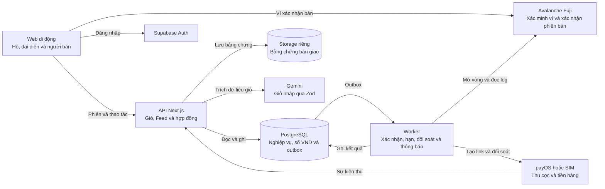

# Kiến trúc hệ thống OOPS MVP

Next.js phục vụ web trên điện thoại và API. Supabase Auth xác thực phiên, PostgreSQL lưu nghiệp vụ và VND, Gemini hỗ trợ lập giỏ nháp. Demo dùng Fuji testnet và tiền mô phỏng cho cả tiền hàng lẫn cọc.

Luồng hợp đồng và thanh toán hiện hành theo [đặc tả OOPS](OOPS-Spec.md). Xem thêm [Yêu cầu](requirements.md), [Schema PostgreSQL](schema.md) và [Đặc tả API](API%20doc.md).

## Sơ đồ kiến trúc

## Thành phần chính

| Thành phần | Trách nhiệm | Dữ liệu chính | Khi có lỗi |
| --- | --- | --- | --- |
| Web và API | Next.js, TypeScript, Tailwind. Xác thực, phân quyền, nghiệp vụ. | Supabase Auth | Yêu cầu đăng nhập lại khi hết phiên. |
| Dữ liệu app | Giao dịch giữ hàng, quyết toán, outbox và RLS. | PostgreSQL và Storage riêng | Rollback khi ghi lỗi. Worker chạy lại từ outbox. |
| Giỏ AI | Gemini trích dữ liệu. Zod kiểm tra và app áp quy tắc có nguồn. | Danh mục và giỏ nháp | Giữ bản đang sửa và cho nhập tay. |
| Tài khoản và xác nhận | Core Wallet ký, Solidity kiểm quyền và Viem đọc sự kiện xác nhận. | Avalanche Fuji C-Chain | Khoản tiền hàng của hộ chờ chữ ký đã được đồng bộ. |
| VND và công việc nền | Mô phỏng hoặc QR, đối soát, hạn và thông báo. | Sổ VND, outbox và payOS | Đối chiếu khi lệch hoặc tới trễ. |

## Vòng đời hợp đồng

1. Hộ lưu giỏ trong đợt nháp. Backend kiểm phiên bản, ví đã xác minh và quyền Fuji khi lưu giỏ để cộng vào nhu cầu. Đại diện đăng nhu cầu để chụp lượng theo hộ và món từ các giỏ `CONFIRMED`. Feed hiển thị lượng còn thiếu và lượng còn có thể chốt.
2. Người bán chào một món với lượng tối đa đến `missing`. Backend mở vòng phiếu ngay khi tạo đề nghị. Hộ có phần chọn Có hoặc Không theo lượng khả dụng hiển thị từ phần đã chụp, giới hạn bởi lượng còn trống của đề nghị. Phiếu chiếm chỗ trong đề nghị. Lượng khả dụng chung chỉ giảm khi chốt đơn.
3. Vòng đóng khi đủ lượng chào hoặc tới hạn. Backend chụp lượng của các hộ tham gia thành phiên bản bất biến, tính tiền theo đơn giá đề nghị và ghi mã băm. Nếu không còn hộ chọn Có khi đóng, đề nghị chuyển `EXPIRED`.
4. Người bán chấp thuận, từ chối hoặc yêu cầu mở vòng phiếu mới. Khi chấp thuận, backend kiểm lượng theo món và từng hộ dưới khóa, xác minh lại ví hợp lệ và duy nhất của mọi hộ có phần, rồi tạo vòng Fuji, một hợp đồng `AWAIT_COMMITMENTS`, lượng `pending`, khoản cọc và các khoản tiền hàng trong cùng giao dịch. Thiếu lượng ghi `STOCK_CONFLICT` và trả `409`. Thiếu ví giữ bản `SUBMITTED`.
5. Người bán nộp cọc sau khi vòng Fuji mở hợp lệ. Mỗi hộ có thể nộp tiền hàng sau khi xác nhận của chính hộ đã được lưu. Đơn 0đ chỉ tạo khoản cọc và vẫn cần đủ chữ ký. Khi đủ chữ ký, cọc và tiền hàng nếu có, backend chuyển `pending` sang `reserved` và tự mở bàn giao trong cùng giao dịch. Quá hạn còn thiếu điều kiện thì hủy, giải phóng lượng và lập hoàn các khoản đã thu.
6. Ở `AWAIT_HANDOFF`, người bán báo sẵn sàng và gửi bằng chứng. Đại diện lập biên nhận theo lượng thực nhận từng hộ. Lập biên nhận hiện hành đúng hạn chuyển đơn sang `AWAIT_APPROVAL` trong cùng giao dịch. Nếu đã ở `NEEDS_REVIEW` với phạm vi `HANDOFF`, biên nhận mới vẫn cần đủ hai lượt duyệt để xử lý. Chi tiết về phiên bản và hạn duyệt nằm trong [API thanh toán và bàn giao](API%20doc.md#thanh-toán-và-bàn-giao).
7. Khi hai bên duyệt cùng biên nhận, backend ghi lượng thực nhận, giải phóng lượng giữ và lập chi/hoàn trong một giao dịch. Giao đủ, đúng hạn thì lập hoàn toàn bộ cọc. Nếu cọc cần xử lý, `NEEDS_REVIEW` phạm vi `DEPOSIT` chỉ khóa khoản liên quan cọc. Tài khoản vận hành ghi từng khoản `POSTED` với mã chuyển SIM. Trong cùng transaction, nếu đơn `SETTLING` đã có đủ khoản chi/hoàn `POSTED` và không còn khoản bắt buộc bị khóa, đơn chuyển `COMPLETED`.

### Trạng thái thương lượng và thời hạn

Backend lưu hạn phản hồi bằng thời điểm đóng phiếu cộng 3 giờ theo cấu hình MVP. Khi worker đóng vòng trễ, mốc tính vẫn là hạn phiếu đã lưu. Hạn ký và thu cuối cùng cách giờ bắt đầu giao ít nhất 2 giờ. Hạn duyệt biên nhận là `handoffBy + 24 giờ`. [Quy tắc thời hạn](OOPS-Spec.md#8-thời-hạn) · [Chuẩn băm phiên bản](OOPS-Spec.md#chuẩn-băm-phiên-bản)

| Trạng thái bản | Hành động hoặc mốc | Kết quả và thông báo |
| --- | --- | --- |
| `SUBMITTED` | Người bán chấp thuận, đủ lượng và ví hợp lệ | `FINALIZED`, hợp đồng ở `AWAIT_COMMITMENTS`, vòng ở `OPENING`. Ghi yêu cầu mở vòng vào outbox. |
| `SUBMITTED` | Người bán yêu cầu sửa hoặc từ chối | `CHANGES_REQUESTED` và mở vòng phiếu mới nếu lịch còn đủ thời gian, hoặc `REJECTED` và kết thúc đề nghị. Phiếu gắn với từng vòng. |
| `SUBMITTED` | Hết hạn người bán phản hồi | `EXPIRED` với lý do `SELLER_TIMEOUT`. Đề nghị cũng hết hạn. |
| `SUBMITTED` | Lượng không đủ khi người bán chốt | `STOCK_CONFLICT`. Ghi trạng thái và sự kiện rồi trả `409`. |

Thiết lập bốn biến sau trên server trước khi tạo đề nghị mới. Mỗi biến nhận số giờ nguyên từ 1 đến 8760. Hạn cọc không vượt quá hạn chung.

| Biến | Mốc tính |
| --- | --- |
| `OOPS_VOTE_HOURS=3` | Từ lúc mở vòng phiếu. |
| `OOPS_SELLER_RESPONSE_HOURS=3` | Từ lúc đóng vòng phiếu. |
| `OOPS_FUJI_SIGN_HOURS=12` | Từ timestamp block mở vòng đến hạn chung `confirmBy` và `paymentDueAt` của đơn có giá. |
| `OOPS_DEPOSIT_HOURS=6` | Từ timestamp block mở vòng đến hạn cọc của người bán. |

Đề nghị và hợp đồng tạo theo luồng cũ tiếp tục dùng các bước `AWAIT_CONFIRMATIONS → AWAIT_REP_APPROVAL → FINALIZED` và `AWAIT_DEPOSIT → AWAIT_PAYMENT` tương ứng. Các job hạn đại diện và route finalize vẫn phục vụ dữ liệu đó.

### Bàn giao backend và worker

Khi lưu bản gửi, backend ghi outbox `NEGOTIATION_SELLER_RESPONSE_DUE` với `{draftId, versionId}` và `next_run_at = seller_response_due_at`. Worker gọi `expireSellerResponse(client, draftId, versionId)` trong transaction. Hàm chỉ đổi bản còn `SUBMITTED` đã tới hạn và trả `true` nếu đã chuyển trạng thái. Gọi lại sau khi hết hạn đã được ghi trả `false`. Backend ghi `NEGOTIATION_VERSION_STATE_CHANGED` cho bản gửi, yêu cầu sửa, từ chối và hết hạn. Payload gồm `draftId`, `proposalId`, `versionId`, `version`, `state`, `reasonCode?` và `recipientUserIds`. Worker dùng `event_key` để chống gửi thông báo lặp.

- `OFFER_VOTE_DUE` có `{draftId, round}` và chạy tại `vote_due_at`. Worker gọi `expireOfferVoting(db, draftId, round)` trong transaction. Hàm chỉ đóng vòng hiện hành đã đến hạn. Nếu không còn phiếu Có hợp lệ, backend ghi `OFFER_VOTE_CLOSED` với `{draftId, round, proposalId, recipientUserIds}` để báo người bán.
- Khi người bán chấp thuận, API đọc ví đã xác minh, gọi RPC Fuji ngoài transaction và kiểm credential của các hộ ở cùng block. Hàm credential `view(address)` trả `bool` hoặc `uint256`. Giá trị `true` hoặc số dư dương đủ quyền. `approveWithFujiEligibility(db, sellerId, draftId, versionId, round, note?)` kiểm lại bản, hạn và ví dưới khóa trước khi tạo đơn. `roundKey` là Keccak-256 của chuỗi UTF-8 `OOPS:fuji-round:v1:<versionId>`. Worker truyền nguyên khóa bytes32 đã lưu vào contract.
- `FUJI_ROUND_OPEN_REQUESTED` chạy ngay khi giao dịch seller chốt commit. Payload có `{draftId, versionId, roundId, versionHash, openBy?, signingHours?}`. Với đơn mới có `signingHours`, contract Fuji phải tính hạn từ timestamp block mở vòng. Sau khi xác minh sự kiện mở vòng, worker gọi `recordVerifiedRoundOpening(db, draftId, versionId, roundId, openedAt, confirmBy)` trong transaction. Hàm ghi hạn cọc, hạn chung và các job tương ứng. Worker phải đồng bộ chain qua `openBy` trước khi chạy job `ROUND_OPEN` để phân biệt giao dịch mở đúng hạn với giao dịch chưa mở. Worker kiểm chain, contract, vòng, hash, ví và block timestamp trước `confirmBy` khi ghi xác nhận. Payload mở vòng cũ thiếu `signingHours` tiếp tục dùng hạn đã lưu. `REP_APPROVAL_DUE` chỉ phát cho dữ liệu cũ.
- Sau khi commit việc ghi xác nhận, indexer gọi `advanceVerifiedRound(db, draftId, versionId)` trong transaction mới. Với đơn mới, hàm đánh dấu vòng `CONFIRMED` khi đủ chữ ký và thử mở bàn giao. Giao dịch thu SIM cũng thử mở bàn giao sau khi áp dụng tiền, dưới khóa lượng và hợp đồng. Chỉ gọi `expireFujiStage(db, draftId, versionId, "CONFIRMATION_TIMEOUT")` sau khi đồng bộ qua cutoff. Hàm hủy và lập hoàn cho đơn mới nếu còn thiếu chữ ký. `FINALIZE_TIMEOUT` dành cho luồng cũ.
- `ORDER_DEADLINE_DUE` có `{contractId, stage}`. Worker gọi `expireOrderDeadline(db, contractId, stage)` trong transaction cho `ROUND_OPEN`, `DEPOSIT`, `PAYMENT`, `READY`, `HANDOFF` hoặc `RECEIPT`. Với đơn mới, các job mở vòng và thu kiểm những hạn đã đến mà điều kiện vẫn còn thiếu. API nhận tiền SIM và các thao tác hủy dùng chung quy tắc quá hạn dưới khóa. API có thể trả `409` sau khi ghi hủy và lập hoàn. Worker chạy lại thấy đơn đã được xử lý.
- `ORDER_STATE_CHANGED` có `contractId`, `action`, `state` và `recipientUserIds`. Đơn mới ghi `FINALIZED` khi tạo hợp đồng và `HANDOFF_ELIGIBLE` khi đủ điều kiện bàn giao. Khi ops ghi chi hoặc hoàn, sự kiện `DISBURSEMENT_POSTED` có thêm `disbursementId` và chỉ gửi cho người nhận khoản chuyển. Worker có thể gọi `persistNotifications` với loại đối tượng, ID, `event_key` và danh sách người nhận để ghi thông báo một lần.

Backend cung cấp các hàm xử lý và outbox trên. Việc mở vòng, đọc log, chạy job theo hạn và phát thông báo cần worker tích hợp. Áp dụng các migration đến `20261113000400_fix_fuji_round_deadline_constraint.sql` trước khi chạy luồng mới.

## Trạng thái theo dõi

| Đối tượng | Trạng thái API | Cách cập nhật |
| --- | --- | --- |
| Nhu cầu | DRAFT, OPEN, COVERED, FULFILLED | DRAFT trước khi đăng. FULFILLED khi received = target. COVERED khi missing = 0 và còn chờ giao. OPEN khi missing > 0. |
| Đề nghị | SUBMITTED, SELECTED, REJECTED, EXPIRED | SUBMITTED trong lúc bỏ phiếu hoặc chờ người bán. SELECTED khi tạo hợp đồng. REJECTED khi người bán từ chối. EXPIRED khi hết hạn mà không có hộ tham gia hoặc người bán chưa phản hồi. |
| Hợp đồng | AWAIT_COMMITMENTS → AWAIT_HANDOFF → AWAIT_APPROVAL → SETTLING → COMPLETED | Đơn cũ có thể trả AWAIT_DEPOSIT hoặc AWAIT_PAYMENT. CANCELED khi đã xác định hủy và không còn tranh chấp cọc. NEEDS_REVIEW với HANDOFF nếu kết quả bàn giao chưa thống nhất, hoặc DEPOSIT nếu đã xác định lượng nhận hay hủy và còn vướng cọc. |
| Khoản thu và khoản chi | Khoản thu PENDING, RECEIVED, EXPIRED, REVIEW. Khoản chi PENDING, POSTED, REVIEW. | Hợp đồng hủy vẫn có khoản hoàn đang chờ. Một khoản thu có thể sinh nhiều khoản chi hoặc hoàn. |

Đổi giá/lượng hoặc đổi lịch sau khi chốt thuộc phạm vi sau demo. Vòng sửa trước chốt tạo bản thương lượng mới.

Người bán được hủy trực tiếp khi hợp đồng còn chờ ký và thu, hoặc chờ bàn giao, và chưa có biên nhận, bằng chứng hay sự cố bàn giao. Đơn cũ cũng cho hủy trực tiếp khi đang chờ cọc hoặc tiền hàng. Nếu kết quả bàn giao đang tranh chấp, hai bên có thể xác nhận cùng biên nhận hoặc cùng xác nhận hủy theo điều khoản. Khi đủ điều kiện hủy, hệ thống giải phóng lượng đúng một lần và hoàn tiền hàng đã thu. Cọc chưa rõ cách xử lý giữ riêng ở NEEDS_REVIEW với phạm vi DEPOSIT.

## Nhất quán và xử lý lặp

### Thứ tự khóa dữ liệu

Giao dịch lấy các khóa cần dùng theo thứ tự chung sau. Khi có nhiều dòng cùng loại, khóa theo khóa chính tăng dần.

1. Đợt gom khi sửa, xác nhận giỏ hoặc đăng đợt.
2. Dòng nhu cầu, các dòng phần của hộ, rồi đề nghị, hồ sơ thương lượng và phiên bản nếu cần.
3. Hợp đồng.
4. Các bản ghi thuộc hợp đồng cần cập nhật, gồm khoản thu, giao dịch thu, khoản chi, bằng chứng, biên nhận và các yêu cầu thay đổi. Nếu chạm nhiều loại, dùng cùng thứ tự liệt kê.

Khi chốt đề nghị, vòng mới được tạo trước hợp đồng. Với đơn mới đã tồn tại, các hàm xử lý thu, hủy và tiến độ Fuji khóa lượng và hợp đồng trước khi cập nhật vòng. Worker gọi hàm tiến độ trong giao dịch mới sau khi commit log Fuji để tránh giữ khóa vòng khi chờ khóa lượng. Với luồng cũ, vòng được khóa sau phiên bản trong giao dịch đại diện chốt.

API rời nhóm khóa nhóm rồi khóa dòng thành viên trước khi kiểm nghĩa vụ. Đăng nhu cầu dùng cùng khóa nhóm, còn tạo vòng ký giữ khóa chia sẻ trên các dòng thành viên và ví trước khi chụp. Khi tạo hợp đồng, giao dịch giữ khóa chia sẻ trên ví hiện có của người bán và đại diện. Trigger ví kiểm lại nghĩa vụ trong giao dịch ghi ví sau khi lấy khóa dòng. Áp dụng migration `20261113000200_guard_membership_and_wallet_changes.sql` trước khi dùng API rời nhóm hoặc luồng cập nhật ví theo G-09.

Sau khi lấy khóa, đọc lại trạng thái, phiên bản, thời hạn và lượng trước khi ghi. Ghi outbox cùng giao dịch với các thay đổi nghiệp vụ. Job nhắc lịch hoặc xử lý quá hạn đối chiếu mốc hiện hành và bỏ qua lịch đã bị thay thế. Khi cần gọi dịch vụ bên ngoài, commit thay đổi cần thiết trước rồi xử lý kết quả trong một giao dịch mới.

| Tình huống | Hành vi | Cơ chế |
| --- | --- | --- |
| Hai người bán chốt cùng món | Chỉ chốt trong giới hạn món và phần từng hộ. Bản thiếu lượng chuyển STOCK_CONFLICT. | Kiểm pending, reserved, received dưới khóa. Khóa duy nhất ngăn hai hợp đồng từ cùng đề nghị hoặc phiên bản. |
| Ghi bằng chứng, hủy hoặc duyệt đồng thời | Kiểm tra tiến độ bàn giao. Chỉ một giao dịch được giải phóng lượng giữ. | Kiểm phiên bản hợp đồng, stock_state và biên nhận dưới khóa. |
| Ops ghi chi/hoàn đồng thời | Ghi mỗi khoản và mã chuyển một lần. Chỉ hoàn tất khi đủ khoản. | Khóa hợp đồng và khoản chi. Kiểm trạng thái và khóa duy nhất transfer_ref. |
| Gửi lại request hoặc webhook | Request cùng khóa và dữ liệu trả kết quả cũ. Request nghiệp vụ cùng khóa nhưng khác dữ liệu trả 409. Webhook trùng mã giao dịch được xác nhận đã nhận và giữ nguyên sổ. | Khóa idempotency và khóa duy nhất của giao dịch theo nguồn. |
| Tiền đến trễ hoặc nộp thêm vào khoản đã nhận | Ghi giao dịch để đối soát hoặc hoàn. Mỗi khoản thu chỉ áp dụng một giao dịch và đơn đã hủy giữ trạng thái hủy. | Worker và webhook kiểm tra hạn và trạng thái khoản thu dưới khóa. |
| Worker lỗi giữa chừng | Thử lại có backoff. Nếu tạo link chưa rõ kết quả, truy vấn theo orderCode trước khi thử lại. | Outbox có event key duy nhất. Mỗi khoản chi có mã đối soát riêng. |

## Bảo mật và quyền riêng tư

- Kiểm tra phiên Supabase và quyền trên từng bản ghi ở API. RLS chặn truy cập chéo nhóm. Khi đọc hợp đồng, hộ thấy phần của mình, đại diện và người bán thấy thông tin cần cho bàn giao. Bên bán chỉ thấy thông tin liên hệ của đại diện.
- Feed chỉ gồm dữ liệu công bố. Hộ đọc phần của mình và tổng bản chung với điều kiện giao đã lọc. Người bán và đại diện xem các dòng cần xét duyệt. Địa chỉ chi tiết và liên hệ chỉ mở cho các bên liên quan sau khi chốt. Điểm giao đề xuất chỉ hiện với người bán và đại diện trong lúc thương lượng.
- Khóa Supabase service role, Gemini và payOS nằm ở server. Bằng chứng lưu trong bucket riêng, chỉ cấp URL ký có hạn sau khi kiểm quyền. Ví ký giao dịch Fuji ở client hoặc qua ví nhúng của người dùng.
- Tách quyền tài khoản vận hành khỏi vai trò đại diện. Chỉ môi trường demo có route mô phỏng. Endpoint xác nhận chi thật yêu cầu quyền vận hành và mã đối soát chuyển đi.
- Đưa lên Fuji mã vòng, mã băm, ví và xác nhận. Thông tin hộ, địa chỉ, ảnh giao hàng và VND lưu ở hệ thống app. Log dùng ID, trạng thái và mã lỗi, lược bỏ thông tin liên hệ, chữ ký và payload ngân hàng thô.

## Kiểm tra trước khi vận hành

| Tín hiệu | Điều kiện kiểm tra demo | Phụ trách | Tiêu chí |
| --- | --- | --- | --- |
| Thu và quyết toán | Khoản thu, chi và hoàn khớp sổ. Phát lại sự kiện thu SIM không áp dụng thêm lần nữa. | DEV 2 + DEV 3 | Bắt buộc |
| Xác nhận Fuji | Thiếu một ví thì chưa mở vòng. Mỗi hộ có phần xác nhận một lần đúng bản. Kiểm một hộ trả tiền sau khi xác nhận của hộ đã được ghi và đơn chỉ mở bàn giao khi đủ chữ ký và khoản thu. | Tài khoản và Fuji | Bắt buộc |
| Độ trễ tác vụ | Theo dõi độ trễ indexer, job quá hạn và tuổi outbox. Cảnh báo khi vượt hạn xử lý đã cấu hình. | Backend | Bắt buộc |
| Toàn vẹn tồn lượng | Chạy hai ca chốt đồng thời. Tổng pending, reserved và received nằm trong target. | Giỏ và Feed | Bắt buộc |
| Sự cố và phục hồi | Giả lập lỗi Gemini, cọc đến trễ và một bên chưa duyệt. Kiểm lại giỏ tay, đối soát và trạng thái xử lý. | Nhóm OOPS | Bắt buộc |
| Giao thiếu và tranh chấp cọc | Hai bên duyệt cùng biên nhận. Kiểm lượng nhận và lượng thiếu trên Feed, tiền hàng theo thực nhận và cọc bị giữ. | Hợp đồng và VND | Bắt buộc |

Demo mặc định dùng tiền mô phỏng. Chỉ bật QR thật trong thử nghiệm nội bộ với khoản nhỏ, trên tài khoản payOS đã xác thực. Ghi nhận chi hoặc hoàn sau khi có bằng chứng chuyển khoản.

## Các phương án đã cân nhắc

| Phương án | Lợi ích | Đánh đổi |
| --- | --- | --- |
| Xác nhận trong PostgreSQL | Thuận tiện cho fixture và test local. | Cổng nghiệm thu demo dùng giao dịch Fuji thật. |
| Gộp nhiều món vào một hợp đồng | Ít thao tác khi cùng người bán. | Sự cố một món có thể trì hoãn chi trả món đã nhận. |
| AI tính toàn bộ lượng cần | Ít bước nhập trong ca thuận lợi. | Khó kiểm chứng đơn vị và nguồn. Dùng AI trích dữ liệu, app tính lượng theo quy tắc. |
| QR thật ngay từ đầu | Kiểm thử trực tiếp webhook và ngân hàng. | Tăng phụ thuộc vận hành. Demo dùng adapter mô phỏng cùng sổ giao dịch. |
